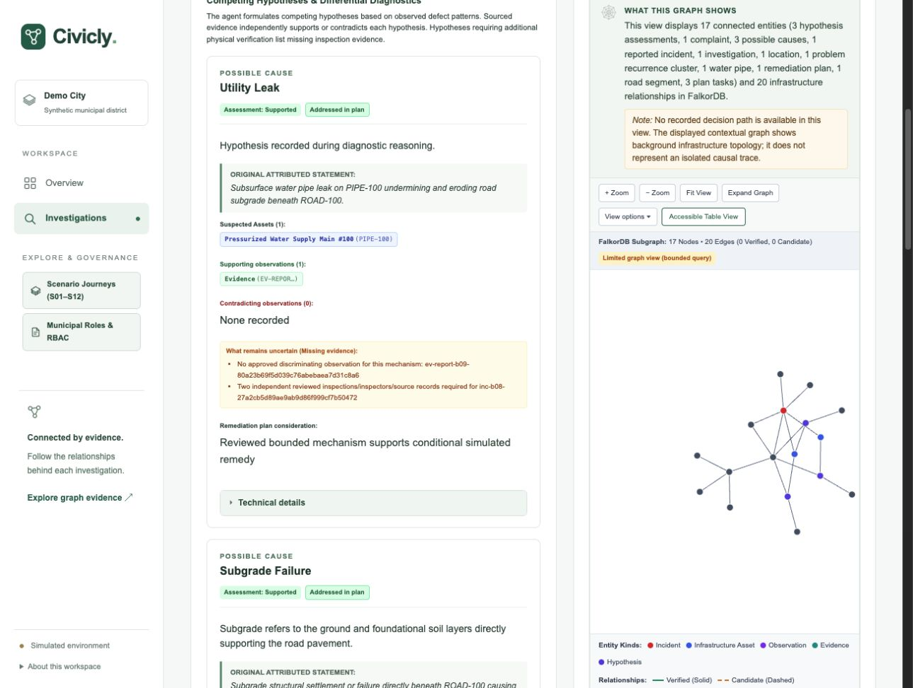
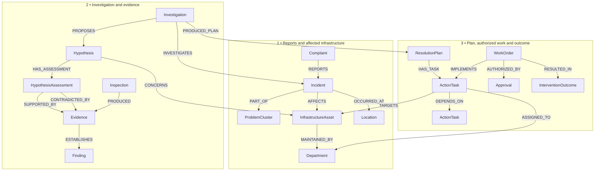
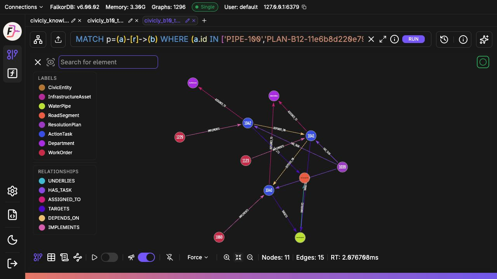
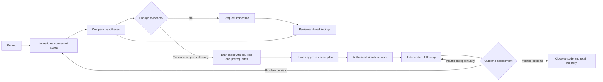
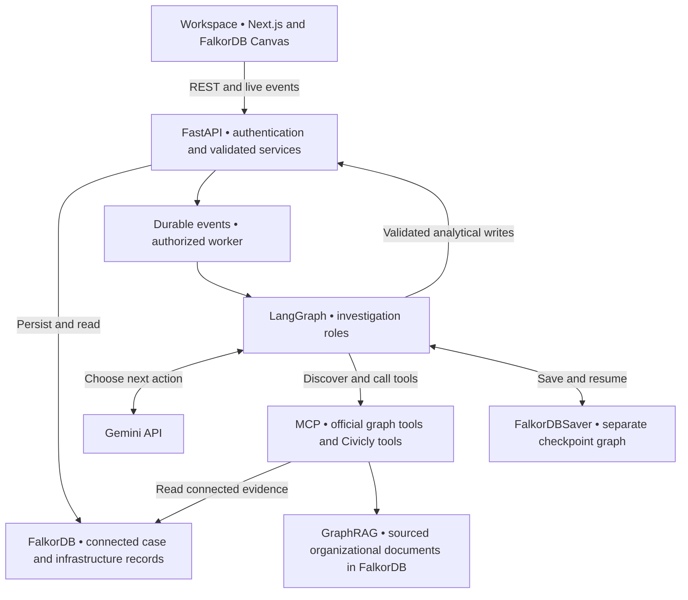
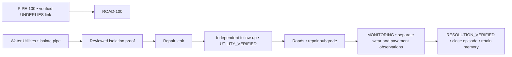

# Civicly

### Understand the cause. Coordinate the response. Verify the outcome.

**Civicly helps investigate recurring waterlogging, road damage and waste accumulation.** It connects complaints to the infrastructure, evidence and previous work behind them, then carries the investigation through a reviewed plan, human approval, simulated work and follow-up.

Consider a road that keeps developing potholes. Should the road be repaired again—or is a leaking pipe damaging the ground beneath it? Civicly helps an investigator follow the connections, compare explanations and see what evidence is needed before acting.

**FalkorDB is the connected record behind that process.** Gemini uses MCP tools to investigate it. People review evidence and approve work. The workspace shows how each decision relates to the reports, assets and findings that support it.

[**Live Demo**](https://civicly-13-55-205-208.sslip.io) · [**Follow the completed road case**](https://civicly-13-55-205-208.sslip.io/investigations?investigation=INV-B09-b9d4d66e130ed348c4f6a50e9d66a891) · [Run locally](#run-and-develop-locally) · [Technical docs](#technical-documentation)

> **About the demo:** municipal data, inspections and field work are synthetic. Gemini, MCP, FalkorDB, GraphRAG retrieval and saved workflow records use actual services. The hosted site lets you explore retained results; browsing does not start a paid agent run. Hosting uses a temporary hostname.



*The actual local workspace: reviewed utility-leak evidence alongside the bounded case graph. This capture shows contextual relationships, not a selected model decision path. Municipal observations are synthetic.*

## What can Civicly investigate?

| Problem | Questions the investigation can explore | Evidence that matters |
|---|---|---|
| **Waterlogging** | Is a drain blocked? Do several affected locations share a downstream restriction? Could capacity or a pump be involved? | Drainage connections, maintenance history, inspection findings and rainfall context |
| **Road damage** | Is the subgrade failing? Is a verified underlying utility connection relevant? Which department must act first? | Road and pipe relationships, structural observations, leak tests and repair history |
| **Waste accumulation** | Was collection missed? Was capacity insufficient? Was waste deposited after collection? | Collection routes, scheduled versus actual pickups and dated field observations |

These are competing explanations to investigate, not causes inferred automatically from a complaint. The [demo status](#what-is-demonstrated-today) below distinguishes the current results for each category.

## One investigation, six connected stages

**Report → Investigation → Evidence → Plan & approval → Work → Monitoring & memory**

This is also the frontend navigation. A judge can start with the reported problem, follow the agent's tool choices, inspect evidence, review the proposed response and see whether later observations justify closing the episode.

Three distinctions keep that story clear:

- **A report is not an incident:** several complaints may describe the same occurrence. Separate recurring occurrences can share a problem cluster.
- **A hypothesis is not a finding:** possible explanations are assessed against evidence, and previous assessments remain available.
- **Completed work is not verified resolution:** follow-up must establish what happened after the intervention.

## Graph data model

Think of the graph as a connected case file: **what was reported, what infrastructure is involved, what the evidence says, and what happened next.** Nodes represent those records; named relationships explain how they connect.

For example, `Complaint → REPORTS → Incident` means a complaint describes an occurrence. `WorkOrder → IMPLEMENTS → ActionTask` means an authorized order carries out a planned task. The diagram uses actual names from the [canonical schema](contracts/schema_registry.json).



### The most important connections

| Relationship | Read it as | Why it matters |
|---|---|---|
| `DRAINS_TO` | This drainage asset flows toward that asset | Follow connected drainage and find shared downstream locations |
| `UNDERLIES` | This pipe lies beneath that road | Investigate a possible utility contribution and validate repair dependencies |
| `COLLECTED_BY` | This waste point is served by that route | Connect accumulation reports to collection records |
| `MAINTAINED_BY` | This department is responsible for the asset | Resolve reviewed responsibility before planning work |
| `SUPPORTED_BY` / `CONTRADICTED_BY` | This evidence supports or challenges an assessment | Explain conclusions and retain conflicting findings |
| `DEPENDS_ON` | This task requires another task first | Prevent work from proceeding before its prerequisites |

Location and physical connection are different: **a pipe being nearby does not prove it lies beneath the road or caused the damage.** Relationships distinguish candidate and verified associations and carry source references and time bounds where available.

Beyond this overview, the model includes collection schedules and actual pickup records, rainfall events, procedures, tool executions and status events. Assessments are versioned; evidence retains its source, date and review status. See [the full graph model](docs/backend/02_graph.md) and [evidence rules](backend/EVIDENCE.md).

### The model in a running database



*An actual read-only query of the retained road case in FalkorDB Browser: **11 nodes and 15 relationships** connect the pipe and road (`UNDERLIES`), plan and tasks (`HAS_TASK`), task prerequisites (`DEPENDS_ON`), responsible departments (`ASSIGNED_TO`), target assets (`TARGETS`) and work orders (`IMPLEMENTS`). Browser node captions may show internal database IDs; Civicly keeps canonical IDs in technical details. These are persisted synthetic demo records, not a drawn mockup.*

[Read-only query and capture notes](docs/images/README.md) · [Reproduce the focused query](docs/images/road-task-graph.cypher)

## How FalkorDB helps at every stage



Each stage answers a practical question. The frontend uses readable labels and keeps canonical record IDs available in technical details:

| Stage | What the judge sees | How FalkorDB contributes |
|---|---|---|
| **Report** | What happened, where, and has it happened before? | Connects reports to occurrences, locations and persistent clusters |
| **Investigation** | What did the agent check, and why? | Retrieves actual infrastructure paths, maintenance history and related incidents |
| **Evidence** | Which explanation does the evidence support—and what is missing? | Links hypotheses to immutable assessment history and attributed evidence |
| **Plan & approval** | What should happen, in what order, and who approves it? | Resolves reviewed responsibility and validates task dependencies and their source references |
| **Work** | Who is assigned, what has happened, and what is blocked? | Connects approved tasks to authorized operations and durable status history |
| **Monitoring & memory** | Did the intervention help, and what should a later investigation remember? | Retains the episode's work/evidence/outcomes and retrieves historical context |

In the graph panel, judges can inspect entities and follow recorded decision paths alongside the case. The reasoning view connects **the question asked → returned graph evidence → recorded action**. It distinguishes a recorded decision path from a contextual read; visible adjacency alone does not prove the graph influenced a model decision.

Live updates use server-sent events (SSE) from persisted activity. They trigger a fresh read of the actual case, rather than animated or fabricated progress.

## Architecture



**Reading the diagram:** the workspace calls the backend; an explicitly authorized worker runs the investigation; Gemini chooses an action; MCP retrieves graph evidence; validated services record the resulting findings or plans. The UI then reads those persisted records.

| Component | Its job |
|---|---|
| **Gemini + LangGraph** | Select investigative actions and coordinate Supervisor, Investigator, RootCauseAnalyst, ResolutionPlanner and Coordinator roles |
| **Runtime MCP** | Discover available tools and execute validated reads through `tools/list` and `tools/call` |
| **FalkorDB domain graph** | Store infrastructure, incidents, evidence, assessments, plans, work and outcomes as connected records |
| **GraphRAG document memory** | Retrieve cited, versioned municipal guidance from a separate SDK-managed FalkorDB graph |
| **FalkorDBSaver** | Preserve the investigation thread so it can pause and resume |
| **FastAPI services and worker** | Enforce evidence rules, permissions, approval scope, task transitions and durable event handling |
| **Next.js + FalkorDB Canvas** | Present the six-stage case, inspectable graph, evidence and recorded decision paths |

These are modules in a backend application with a single worker, not a fleet of independently deployed agent services. Private authentication and spending ledgers use SQLite. The browser never receives database credentials or unrestricted query access.

Agent graph reads are bounded and read-only. Analytical changes pass through validated services; work requires authenticated roles and approval of the exact plan. [Detailed architecture](docs/backend/01_system.md).

## Follow one case: the road that kept failing

**The report:** recurring potholes and subsidence at a junction, alongside low-pressure complaints.

**The investigation:** Gemini reads road and utility history through MCP and compares two explanations: utility leakage and subgrade failure. Reviewed inspections provide evidence for both. Their assessments become **SUPPORTED**; this does not erase the remaining evidence gaps.

**The response:** coordinate utility work and road work so the road repair follows the required utility checks.

The graph contains a verified `PIPE-100 → UNDERLIES → ROAD-100` connection. The planning and execution services use it to enforce this order:



1. **Approve the precise response.** The human reviews the plan version, tasks, targets, departments and assignees. Its content hash binds approval to that scope.
2. **Isolate and repair the pipe.** Water Utilities must supply reviewed isolation proof before repair can proceed.
3. **Verify the utility result.** Separate follow-up checks support `UTILITY_VERIFIED`; this alone does not close the road case.
4. **Repair the road.** The Roads task can proceed after its utility prerequisite is satisfied.
5. **Observe before closing.** Completed work enters `MONITORING`. A separate synthetic wear and pavement follow-up supports `RESOLUTION_VERIFIED` and closes the episode.

This is where the graph becomes operational: the verified infrastructure connection and the task prerequisites determine **which work can proceed**, while evidence records explain **why**.

**Demonstration boundary:** the genuine Gemini run reached its retained token limit before drafting. The subsequent cited plan was analyst-assisted, explicitly approved by the human, and executed through authenticated simulated department workflows. This demonstrates the complete application lifecycle, not an autonomous end-to-end planning claim. All field work and observations are synthetic; verification follows the declared demo policy, not a claim of long-term municipal durability.

[Review the actual lifecycle evidence](docs/evidence/EXACT-ROAD-LIFECYCLE-RESULTS.md): three completed work orders, five outcome records, four recorded MCP decision paths and retained episode memory.

## Graph operations behind the investigation

| Function | What it answers | Interpretation |
|---|---|---|
| Directed drainage traversal | Which assets are connected upstream or downstream? | Returns bounded paths with provenance; connectivity alone is not obstruction proof |
| Shared bottleneck and impacted coverage | Do multiple incidents share a downstream asset? | Produces explainable coverage/count-based ranking, not hydraulic prediction |
| Typed infrastructure dependencies | Which reviewed utility connections matter to this road? | Uses explicit relationships; does not infer connections from distance |
| Temporal history and case retrieval | What happened here before, and what followed an intervention? | Retrieves dated context; similarity does not establish the present cause |
| Responsibility and procedure resolution | Who is accountable, and what guidance applies now? | Revalidates reviewed ownership and versioned source citations |
| Task dependency validation | Which prerequisite must be fulfilled before this work? | Checks cycles, scope and gates; deterministic ordering uses graph-fetched dependencies |
| Path explanation | Which returned nodes, edges and sources support a recorded step? | Exposes bounded, inspectable evidence paths and trace identity |
| Isolated graph ablation | What changes when a connection is removed? | Tested graph primitives change paths/rankings; the full genuine-agent ablation gate remains open |

Queries use parameterized, bounded templates and read-only execution for agent reads. Results disclose truncation and search limits; an empty result is not proof of global absence. [Implemented algorithms](backend/ALGORITHMS.md) · [Graph access controls](backend/GRAPH_ACCESS.md).

## How the agent remembers and uses knowledge

The investigation roles share a saved workflow. The model can choose to read, propose a hypothesis, assess evidence, request inspection, recommend a plan or pause. The host validates its structured output before executing an action. Limits on tools, iterations, tokens and spending make a pause an explicit outcome when the run cannot safely continue.

Memory serves different purposes:

- **Workflow continuity:** FalkorDBSaver checkpoints retain the investigation thread across pauses and resumes.
- **Episodic context:** graph retrieval exposes earlier incidents, repairs, outcomes and retained failed or uncertain attempts.
- **Organizational and procedural knowledge:** the FalkorDB GraphRAG SDK indexes versioned Markdown/PDF sources in an isolated document graph. Citations retain document/version, passage location, checksums and ownership; stale or revoked sources cannot silently authorize work.

Synthetic procedure assertions remain proposed guidance. Stored episode context is not automatically a generalized learned rule. [Runtime](backend/AGENTS_RUNTIME.md) · [Memory](backend/MEMORY.md) · [MCP](backend/CIVICLY_MCP.md).

## What is demonstrated today

Start with the [completed road case](https://civicly-13-55-205-208.sslip.io/investigations?investigation=INV-B09-b9d4d66e130ed348c4f6a50e9d66a891), move through all six tabs, and inspect the graph and supporting evidence at each step. The presenter-configured analyst session allows browsing without entering credentials; it does not grant approval authority.

| Category | Retained demonstration result |
|---|---|
| **Road damage** | Genuine Gemini/MCP investigation, reviewed findings, analyst-assisted plan, exact human approval, three completed simulated work orders, separate verification and episode memory |
| **Waterlogging** | Genuine MCP drainage investigation, reviewed findings and a sourced remedial draft awaiting approval |
| **Waste accumulation** | Inspection and service-history evidence retained; the live investigation stopped at its token budget before a completed reassessment or plan |

The scenario harness contains twelve scenarios with negative variants. A prepared scenario does not prove that an autonomous agent has solved it. Full live-provider, cross-category and comprehensive backend acceptance remain incomplete. Original failed attempts, uncertain operations and assessment history are retained.

[Requirements](docs/backend/00_requirements.md) · [Current task board](task_board.md) · [Known blockers](blockers.md) · [Road-case proof](docs/evidence/EXACT-ROAD-LIFECYCLE-RESULTS.md)

## Run and develop locally

Prerequisites: **Python 3.12, Node.js 22+, Docker and Docker Compose**. Backend and frontend dependencies have separate lockfiles.

```sh
git clone https://github.com/krvikash05/Civicly.git
cd Civicly
make setup
make up
make migrate
make health
make test-spec
```

These commands prepare the database foundation; they do **not** recreate the hosted private presenter snapshot or automatically run an agent. The public repository excludes credentials, runtime databases and saved private profiles.

For a fresh presenter setup, follow [the backend host runbook](backend/DEMO_HOST.md) and [API guide](backend/API.md); use a new isolated setup directory. Configure the frontend's ignored `frontend/.env.local` using [the connection guide](frontend/docs/API_CONNECTION.md), then:

```sh
cd frontend
npm ci
npm run dev
```

The usual local endpoints are frontend `127.0.0.1:3100`, API `127.0.0.1:8010` and developer FalkorDB Browser `127.0.0.1:3000`. Private profile provisioning and presenter authorization are required for genuine Gemini runs. Never put provider keys or presenter passwords in browser variables or Git. Browsing retained results does not call Gemini.

Focused development checks:

```sh
make test-spec
backend/.venv/bin/python -m pytest backend/tests/unit -q
npm --prefix frontend test
npm --prefix frontend run typecheck
```

These are commands to run, not a claim that this README change reran every suite. Real DB/MCP integration and lifecycle checks are documented in the evidence directory and may require isolated configured services. [Deployment and recovery](deploy/aws/README.md) describes the verified AWS-hosted demonstrator; it is not a one-command fresh deployment promise.

## Technical documentation

| Topic | Guide |
|---|---|
| Preserved original README and development context | [Development history](docs/DEVELOPMENT_HISTORY.md) |
| Architecture and full graph semantics | [System](docs/backend/01_system.md) · [Graph model](docs/backend/02_graph.md) |
| Runtime and source-grounded knowledge | [Agents](backend/AGENTS_RUNTIME.md) · [Memory](backend/MEMORY.md) · [Official MCP](backend/MCP.md) |
| Operations and independent outcomes | [Planning](backend/PLANNING.md) · [Approval](backend/OPERATIONS.md) · [Utility gates](backend/UTILITY.md) |
| API, events and frontend integration | [API](backend/API.md) · [Events](backend/EVENTS.md) · [Handoff](backend/FRONTEND_HANDOFF.md) |
| Reproducible demonstration and proof | [Judge walkthrough](backend/DEMO_WALKTHROUGH.md) · [Road lifecycle results](docs/evidence/EXACT-ROAD-LIFECYCLE-RESULTS.md) |
| Requirements and audit trail | [All eighteen requirements](docs/backend/00_requirements.md) · [Implementation status](implementation_status.md) · [Test log](test_log.md) |
| FalkorDB adoption and references | [Official-source implementation map](docs/backend/12_falkordb_sources.md) |

Built with **FalkorDB, FalkorDB GraphRAG SDK, FalkorDBSaver, runtime MCP, Gemini, LangGraph, FastAPI/Pydantic, Next.js/React/TypeScript and FalkorDB Canvas**.
