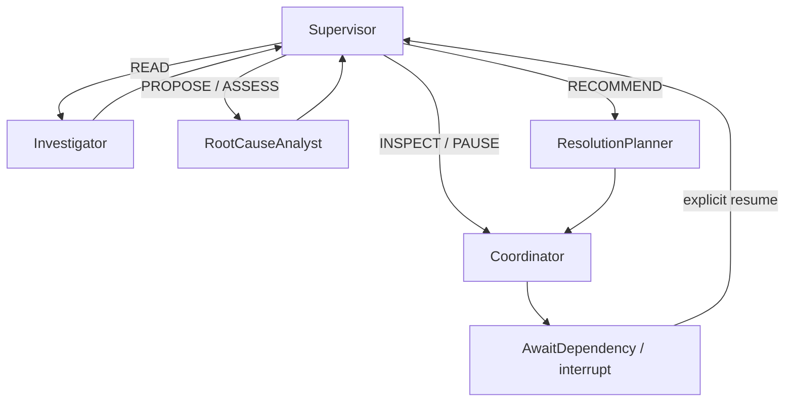

# B10 investigation runtime — B10-O-R2 controls, B10 live acceptance OPEN

> **Current B10-O-R2 contract:** See [provider/spending guide](PROVIDER_ACCOUNTING.md).
> New standard400000 /complex800000 cumulative tokens (maximum2000000), independent
> of1048576 input/65536 output capacity and default4096 output. Money8/.50/1.50 and
> other safeguards unchanged. Known nonbillable count requests settle zero with
> count/outcome/policy audit; unknown billing remains held. Saved60000-token
> checkpoints require explicit monotonic operator upgrade. R2 real-runtime and
> final results are in docs/evidence/B10OR2-RESULTS.md. B10 genuine live gates OPEN.
> The B10-O/B10-O-R sections below retain their historical implementation decisions;
> this current R2 contract supersedes their old token defaults/count-billing policy.

B10 only. `contracts/agent_runtime.json` defines the compatible runtime boundary. All 18 product objectives remain mandatory; this foundation does not complete GraphRAG, municipal operations, API or frontend. Final status and exact counts are in `docs/evidence/B10-RESULTS.md` and current tracking summaries.

## Actual file and control flow

`app.active` loads a private 0600 profile: exactly one B10 UUID source graph, a separate vendor checkpoint graph, and two distinct credentials. `active_scope` binds B08 ComplaintService and B09 EvidenceService through three narrow guard exceptions. Existing canonical/B08/B09 defaults remain intact. B03 repositories and B05 algorithms are reused. No city import or graph promotion occurs.

`app.agents.mcp.brokers` starts the pinned official Node MCP and actual Python `app.agents.server`, performs initialize/list through the existing validated B06/B07 brokers and supplies a combined safe catalog. The model sees names, actual descriptions and input schemas. `official::` exposes fixed bounded templates; `civicly::` exposes the existing 12 read domain tools. No arbitrary Cypher, graph selector, administration or operational write tool is exposed. The host supplies missing as_of from its case clock, rejects future selected cutoffs and reuses accepted B05 visibility rules to keep future raw official facts out of model context. Source accounts have only GRAPH.RO_QUERY on their exact source key. The checkpoint account has query/read access only to its separate checkpoint key. The B07 trace account remains separate.

B07 context syntax now accepts retained-city or validated B10 UUID references; that syntax is not authorization. Broker and production server require the exact configured source. Historical null rationale remains null; actual public model summaries can now be recorded on host trace observations. Envelope schema version 3 and original tools are retained; inventory hashes change to reflect the compatible output-context extension. No existing registry or migration is edited.

`models` defines strict state/selection/budgets. `provider.Gemini` submits the actual discovered catalog and current case/assessment context to configurable Gemini using responseJsonSchema. `prompts/B10-3.txt` (B10-1/B10-2 retained for earlier evidence) is versioned; later decisions record its SHA (early development decisions predate that metadata). Raw source text is untrusted. Only concise public model summaries are persisted; provider thought text is neither requested nor logged. Usage counts include thought tokens. Strict JSON has one repair attempt; HTTP errors are sanitized. Provider/model/timeout are configurable; only the Gemini adapter is implemented/live tested. No OpenAI adapter or live OpenAI claim.

`runtime.InvestigationAgent` builds one actual LangGraph:



Supervisor persists actual model selections as immutable AgentDecision records, with actual provider mode/usage/catalog hash/revision. Investigator calls the selected real broker and preserves evidence IDs, paths, reservations, truncated/negative results and limitations. RootCauseAnalyst calls existing typed B09 services; the model cannot grant VERIFIED. Coordinator can request an inspection, never perform field work or dispatch. Planner creates only a nonbinding, human-review recommendation; no Plan/WorkOrder/task/approval records are created.

`control` uses canonical AgentDecision, B10_OPERATION Evidence journals and Investigation.thread_id, through unchanged B03 parameterization, fences, integrity policies and CAS. It adds no ontology properties. Deterministic decision/execution/operation IDs are bound to thread/wake/step. Committed journal results replay without another tool/domain mutation. Native B09 receipts remain authoritative. A read prepared before a crash with no committed result is uncertain and must not be blindly reissued. Checkpoints retain validated observations and source references within the existing journal limit; credentials and provider thought text are excluded. B10-O removes the old lossy 18KB result slicing: oversized journals fail closed for explicit recovery.

## Persistence and recovery

`checkpoints.saver` uses the public `langchain_falkordb.checkpoint.FalkorDBSaver` constructor, separate graph/database, supported strict JsonPlusSerializer without pickle fallback, and LangGraph public invoke/state APIs. The SDK creates/manages its own Checkpoint/CheckpointBlob/CheckpointWrite labels and three thread indexes. No handwritten SDK schema or migration modifications.

The graph pauses with LangGraph `interrupt` only after controlled side effects have durable journals. The helper node has no side effects before interrupt replay. A fresh process recreates the graph/Saver and resumes the same thread with Command(resume=...). Each wake owns a 90-second exclusive Redis lease with 15-second heartbeat. A second owner is denied. State version, source/inventory, Investigation.thread_id, incident/cluster and hypothesis binding are revalidated. A changed graph revision/evidence hash forces a fresh MCP read before analytical actions. B09 continues its own source, temporal, episode and CAS checks.

Exceptions during an owned wake quarantine the thread instead of automatically resetting it. Stop the previous process first, inspect `graph.get_state_history(config)` using the public API and identify a complete, version-compatible last-good checkpoint. Reconcile PREPARED journals with existing B09 receipts and B07 execution IDs. A tool may have completed before its response/checkpoint was lost: retain the old execution and issue a new explicitly identified reconciliation read; never manufacture its missing result. Use the public `graph.update_state(last_good_config, validated_state, as_node=...)` to create a recovery checkpoint on the same investigation/thread, record the operator's recovery reason, and clear only that exact host quarantine key after the old process is stopped and reconciliation is complete. No volume deletion or checkpoint-graph DROP is a recovery strategy.

Limit: vendor Saver writes are multi-query, not atomic. It has no public socket-timeout constructor option. The orchestration has finite model/tool/iteration/token/wake deadlines and quarantines uncertain failures; an external operator must stop a process whose vendor I/O does not return before recovery. This is not a claim of distributed exactly-once execution, hard-kill resilience at every Saver subquery, or automatic corruption repair.

## Reproduction

From repository root, with Docker running and ignored local credentials configured:

```sh
UV_CACHE_DIR=/tmp/civicly-b10-uv-cache backend/.venv/bin/uv sync --project backend --frozen
PYTHONPATH=backend backend/.venv/bin/python -m app.mcp.civicly configure --output /tmp/civicly-mcp-preflight.json
backend/.venv/bin/python -m pytest backend/tests -v -s --run-persistence
make test-spec
PYTHONPATH=backend backend/.venv/bin/python -m app.mcp.civicly configure --output /tmp/civicly-mcp-configured.json
PYTHONPATH=backend backend/.venv/bin/python scripts/verify_b10.py --reprovision --output /tmp/civicly-b10-current.json
```

Container force-recreation retains graph/Browser data but clears dynamically configured ACL users. Run the explicit trusted MCP configure preflight before another suite; use verify_b10.py --reprovision to restore the retained B10 exact-key profile too. This changes authorization configuration, not municipal records, schemas or volumes. A failed post-recreation attempt in B10-O is preserved as B10O-auth-failed-tests.txt; no test was weakened.

B10 integration tests use freshly owned disposable graphs and delete only those test-owned keys. Their ScriptedModel/reactive fakes are explicitly labeled; real MCP and Saver calls are not mocked. Provider unit tests mock HTTP and do not count as live verification. Historical live-probe evidence remains intact. Paid legacy batch entry points are disabled; future per-investigation CLI requires explicit authorization.

The retained B10 `.runtime/b10-active.json` is deliberately ignored and private. The historical fixture drivers retain their source and evidence, but paid batch modes are disabled. Fixture creation remains nonbillable and refuses to overwrite an existing profile. The separately selected `tests/live/run_investigation.py` delegates to the genuine operator CLI. A key in .env does not authorize any request. **No live investigation was authorized or run during B10-O.** Future review must explicitly approve a particular case before invoking:

```sh
PYTHONPATH=backend backend/.venv/bin/python -m app.agents --profile .runtime/b10-active.json --investigation INV_ID --thread THREAD_ID --live --max-cost-usd .15
PYTHONPATH=backend backend/.venv/bin/python -m app.agents --profile .runtime/b10-active.json --investigation INV_ID --thread THREAD_ID --resume --live --max-cost-usd .15
```

These are future, billable commands, not reproduction commands for ordinary tests. An explicitly approved complex case can raise its cap; no model may grant that approval. CLI uses actual UTC clock, so retained synthetic future-clock fixtures must be checked for current temporal validity before any later live run.

## B10-O execution, context and spending contracts

`contracts/agent_optimization.json` extends the unchanged B10 runtime contract. `policy.Permit` binds live authorization to investigation/thread; MockTransport permits cannot access the network. `tests/conftest.py` installs an ordinary-test HTTPX/DNS interlock and propagates it to Python children, including explicitly configured MCP environments. The suite-wide audit counts requests blocked before network and separately labels intentional negative probes. Unexpected attempts fail the suite. This is defense in depth for the supported provider adapter, not a sandbox for malicious arbitrary Python or literal-IP networking. Normal tests never collect `tests/live/`.

`context.build` projects current state, all 16 actual discovered tool schemas, remaining budgets, latest B09 authoritative assessments, material prior classifications/negative evidence/episode exclusions/paths/temporal and provenance references. Full-content hashes intern repeated source records and schemas; different versions remain distinct. Full history remains in FalkorDB; no critical evidence is silently truncated to fit. Recent observations remain available, older validated results use source fact references. Targeted approved reads remain available without a hardcoded issue/tool map. Token overflow pauses rather than discarding contradictory information. B09 nested schemas are unchanged. Context byte and simulated cost measurements are in B10O-context-*.json; they are not actual tokenizer counts or billed savings. Native paid context caching is disabled pending verified support and measured benefit.

`mcp.Tools` memoizes validated discovery and caches at most 32 validated reads only under the exact graph revision, cutoff/as_of, arguments, permission/invocation scope, tool identity and inventory hash. Revision is checked before and after the read/hit. Every graph change invalidates, including host audit writes; this deliberately limits reuse during active agent writes. Hits preserve original execution references, evidence gaps, candidate/verified distinctions and bounded-negative flags, and never create fake ToolExecution records. A cache hit is never proof of absence.

`spending.Ledger` is auxiliary private SQLite accounting at `.runtime/ai-spend.sqlite3` (0600, WAL, synchronous FULL, atomic BEGIN IMMEDIATE). FalkorDB remains the municipal/evidence/memory/checkpoint store. Defaults: $6 managed project allocation, $.15 per investigation, one live investigation; per-request model/thread/investigation/milestone/pricing/usage metadata and warning thresholds 50/80/95/100 persist across processes and container recreation. Actual input/output/thinking/cached counts are reconciled in integer nanodollars. Missing/ambiguous usage retains the entire reservation. Each HTTP attempt/repair/retry has a separate conservative reservation. Duplicate decision IDs cannot be blindly rebilled. Unexpected actual cost above reservation records actual cost and holds subsequent calls for review. This manages new application usage, not historical/external API bills or Google hard caps.

Pricing is versioned in `agents/pricing/gemini-3.8-flash-standard-2026-10.json`; `CIVICLY_AI_PRICING_FILE` can select a verified operator schedule. The bundled Standard text schedule expires January 1, 2027 and rejects other models/tier/modality. Source: [Google pricing](https://ai.google.dev/gemini-api/docs/pricing). No native-cache spend occurred. `CIVICLY_AI_PROJECT_LIMIT_USD` initializes the ledger (default6); reopening with a conflicting explicit limit fails rather than resetting spend. Inspect with `PYTHONPATH=backend backend/.venv/bin/python -m app.agents.spending`. To change a persisted allocation, stop live sessions and use `Ledger.update_limits(reason=..., project_limit=..., default_case_limit=...)`; changes are audited. Existing case allocations and costs do not reset.

A live session spans the whole agent wake and heartbeats every15s; no stale-expiry takeover is allowed. After a process crash: stop the previous process, inspect `Ledger.summary()` and request rows, reconcile uncertain usage only from verified provider metadata, then explicitly `Ledger.release(exact_owner)` and resume the same graph thread. Never delete the ledger or release reservations to make a cap pass. Cap rejection happens before HTTP and follows the normal durable pause path. Over-reservation holds require operator accounting/pricing review; there is no automatic hold-clear command. Back up the SQLite database with its supported backup API, not by copying a live main file without its WAL.

Transient recovery distinguishes short-term429/503 from daily/project/unknown quota, auth/configuration, unavailable model, invalid JSON and network timeout. Only appropriate transient statuses retry within count and wait budgets; every attempt is reserved. Invalid schema gets at most one repair. Unknown quota and uncertain transport are not blindly retried. Sanitized failures and usage/model/prompt/pricing versions remain in durable checkpoints/decisions; provider raw bodies, keys and thought text are never logged. See [Google troubleshooting](https://ai.google.dev/gemini-api/docs/troubleshooting) and [rate limits](https://ai.google.dev/gemini-api/docs/rate-limits).

Exact B10-O commands, results, source inventory/patch and preserved B10 acceptance gaps: `docs/evidence/B10O-COMMANDS.md`, `B10O-RESULTS.md`, `B10O-FILES.md`. The B10 live three-issue, contradiction and topology gates remain OPEN and NOT RUN in B10-O. No B11 work.

Dependency/API sources: [FalkorDB LangGraph](https://docs.falkordb.com/genai-tools/langgraph), [vendor integration](https://pypi.org/project/langchain-falkordb/), [LangGraph persistence](https://docs.langchain.com/oss/python/langgraph/persistence), [interrupts](https://docs.langchain.com/oss/python/langgraph/interrupts), [Gemini structured outputs](https://ai.google.dev/gemini-api/docs/structured-output), [thinking levels](https://ai.google.dev/gemini-api/docs/generate-content/thinking).

B11 requires separate human authorization: isolated GraphRAG source graph, versioned documents/citations, prompt-injection/stale-document tests and episodic/semantic/procedural memory. No B11 work is included here.

## B10-O-R current accounting and recovery contract (supersedes B10-O defaults)

New ledgers allocate **$8 project / $.50 new investigation / one concurrent investigation**. A trusted invocation can explicitly allocate up to the persisted complex-case ceiling, initially **$1.50**, subject to remaining project/case funds. Approximately $4 of the user's stated credit remains outside this allocation. These are application safeguards, not a guaranteed Google billing cutoff. Existing ledgers keep their limits, case allocations, charges and unknown reservations. The upgrade below is a deliberate operator action; B10-O-R only exercised it on a private copy of the retained accounting witness.

`agents.tokens` loads a pinned Google Gemma3 SentencePiece vocabulary. It is **a proxy estimate for Gemini 3.8**, whose exact mapping is not published in the checked local-tokenizer implementation. It never labels a proxy count provider-confirmed. The complete serialized generation request includes prompt B10-3, current context, all16 tool schemas, controlled-action schemas, Selection response schema and generation settings. Its input allowance is ceil(proxy tokens×1.25)+256 framing/uncertainty margin, with4096 output tokens. This margin is a planning policy, not a mathematical upper bound for Gemini3.8. Bytes are recorded separately. Dollar reservations retain the earlier conservative byte/price fence; that financial heuristic is never used as a model-token count.

Authorized LIVE mode additionally requires an explicitly permitted and financially reserved `countTokens` RPC with `generateContentRequest`, including response constraints. Its verified input count+16 framing margin replaces the proxy input allowance; framing can differ from final generation usage. A count result is not a billing receipt: its dollar reservation remains held until separately verified accounting is available. No generation fallback bypasses unavailable/invalid counting. No provider counting or generation endpoint was contacted in B10-O-R. Mock counts, returned usage and charges in tests are explicitly simulated.

Each generation retry and structured-output repair reserves its own complete input/output allowance atomically with its dollar reservation. Actual validated `totalTokenCount` replaces that attempt's token allowance, while input/output/thinking/cached counts separately determine known cost. Unknown token use retains the full token allowance; unknown billing retains the dollar reservation. Durable `token_usage` and per-thread legacy floors prevent a stale checkpoint or process restart from resetting exposure. Checkpoint `tokens` now represents cumulative **accounted exposure** (known usage plus unknown held allowances); metadata separately records actual returned counts, bytes, estimates, provider counts and dollar exposure. If actual service usage exceeds the remaining plan, the host pauses and records it rather than hiding the overrun. Existing global max_tokens60000 was not raised. Checkpoint token-counter storage widens to2M only to retain an unexpectedly large receipt plus prior exposure; operational max_tokens remains bounded by150000. A1M-token simulated overrun plus100000 prior tokens checkpoints exactly1100000 and pauses, with no selected action.

Setup, ordinary development (public asset download only; no Gemini API):

```sh
UV_CACHE_DIR=/tmp/civicly-b10or-uv-cache backend/.venv/bin/uv sync --project backend --frozen
PYTHONPATH=backend backend/.venv/bin/python scripts/configure_tokenizer.py
```

The explicit setup command downloads the pinned4,689,074-byte vocabulary into ignored `.runtime/tokenizers/gemma3.model`, mode0600, SHA256 `1299c11d7cf632ef3b4e11937501358ada021bbdf7c47638d13c0ee982f2e79c`. Runtime never downloads it; missing/changed assets fail closed with setup guidance. `sentencepiece==0.2.1` is locked. Official local tokenizer smoke phrase “What is your name?” produces5 tokens. Sources: [Google token counting API](https://ai.google.dev/api/tokens), [Google local vocabulary mappings](https://github.com/googleapis/python-genai/blob/main/google/genai/_local_tokenizer_loader.py), [pinned vocabulary](https://raw.githubusercontent.com/google/gemma_pytorch/014acb7ac4563a5f77c76d7ff98f31b568c16508/tokenizer/gemma3_cleaned_262144_v2.spiece.model).

Stop all live processes/sessions, use SQLite backup API for a private consistent backup, inspect current accounting, then deliberately upgrade existing limits:

```sh
PYTHONPATH=backend backend/.venv/bin/python -m app.agents.spending
PYTHONPATH=backend backend/.venv/bin/python -m app.agents.spending configure --project-usd 8 --case-usd .50 --complex-usd 1.50 --max-concurrent 1 --operator OPERATOR_ID --reason 'Reviewed allocation increase; preserve all historical usage' --authorize
```

Do not run the second command merely to install this code. `config_changes` keeps previous/current caps and actor/reason; immutable update/delete triggers protect configuration and accounting audit rows. Existing case limits do not automatically rise. A later separately authorized invocation's `--max-cost-usd .50` or1.50 explicitly increases that case; it cannot reset usage. An explicit conflicting `CIVICLY_AI_PROJECT_LIMIT_USD` fails reopening instead of silently overwriting persisted caps. Remove stale explicit configuration or perform the approved upgrade first.

Exact settled-over-reservation recovery, after stopping the previous process and all sessions:

```sh
PYTHONPATH=backend backend/.venv/bin/python -m app.agents.spending hold EXACT_REQUEST_ID
PYTHONPATH=backend backend/.venv/bin/python -m app.agents.spending resolve-hold EXACT_REQUEST_ID --operator OPERATOR_ID --reason 'Verified receipt and tariff; available funds checked' --verified-pricing STORED_PRICING_VERSION --usage-sha256 SHA256_OF_EXACT_STORED_USAGE_TEXT --evidence-ref PRIVATE_ACCOUNTING_RECEIPT_REFERENCE --authorize
```

Inspection includes exact request, reservation, charged cost, usage, pricing, hold reason and current caps. Resolution requires stored usage hash, exact tariff version, reprice-equals-charge, known settled billing, explicit actor/reason/evidence, no active session, and project/case cap checks. The immutable audit retains the original request and verification binding; only that request hold becomes RESOLVED. Old charges/reservations and legacy hold history remain. Other open holds continue to block. Subsequent reservations recheck all caps. Custom pricing users may call `Ledger.resolve_hold(..., pricing=Pricing(verified_path))` with their retained exact tariff. Unknown billing cannot be cleared by this command; verified usage must first be reconciled for the exact request. Unattributable legacy holds remain blocked for manual accounting investigation. No reset/clear-all or automatic stale-session takeover exists.

Runtime budgets remain16 iterations/8tools/60000tokens/240seconds/5wakes, configurable within existing strict Budget bounds. At most32 Supervisor selections per wake fit recursion_limit150 (read/action cycles plus pause/resume helper nodes). Limits are cumulative except per-wake wall time. A genuine budget failure checkpoints a pause, never a causal conclusion. A trusted resumed CLI can pass an increased `--max-tokens`, `--max-iterations`, `--max-tools`, `--max-seconds` or `--max-wakes` and `--budget-reason`; explicit `--live` is still required. The complete new Budget must be monotonic and validated; counters, same thread, native action IDs and source-refresh requirements remain. Budget-input denials occur before ownership and do not quarantine a valid paused thread. A host-generated audit observation records prior/new budgets and reason. A model cannot invoke this recovery interface.

### Separate final-stage LIVE acceptance procedure — NOT AUTHORIZED / NOT RUN

1. Obtain explicit human approval for a selected three-category case suite and exact dollar allocations (default$.50, explicitly complex up to$1.50 each, cumulative project≤$8). Confirm remaining Google credit independently, current supported model/generation/counting API and unexpired pricing. Inspect ledger/session/holds; record a private consistent backup. Do not assume application accounting includes historical/external Google charges.
2. Verify scoped profile,16 MCP tools, current synthetic timestamps, source revision, checkpoint and evidence anchors. Use small authored WATERLOGGING conflicting-inspection, ROAD_DAMAGE verified/candidate/disconnected, and WASTE pickup-history cases. Do not expose hidden scenario answers. Enable no fallback provider.
3. Under that **separate approval only**, invoke `python -m app.agents` with the exact profile/investigation/thread, `--live`, and approved `--max-cost-usd`. Observe both countTokens and generateContent request reservations and genuine usage/cost. Verify at least one multi-step tool-selected investigation, actual tools/list/call, native hypothesis/assessment/inspection actions, source evidence and durable decision/rationale/trace/checkpoint IDs. Stop at cap/unknown billing rather than reset accounting.
4. Submit a contradictory reviewed inspection through B09, then explicitly resume the same approved thread. Compare genuine model-selected next action and preserved historical classifications; repeat the selected road topology variants and waste explanation test. Distinguish topology from causal evidence and retain candidate/negative limits. Exercise provider interruption recovery only where feasible without blind duplicate billing/actions.
5. Reopen checkpoints/ledger in a fresh process, inspect actual usage receipts and persisted outputs, compare retained data fingerprints, and publish sanitized proof. Mark a live gate green only for behavior directly observed. B10 live three-category/contradiction/topology/structured-output gates remain OPEN until this succeeds. B10-O-R mock HTTP cannot close them. B11 requires separate review/authorization.


## B11 compatible memory extension

See [memory guide](MEMORY.md) and contracts/organizational_memory.json. Existing organizational MCP read tools now return closed source/version/owner/hash/chunk citations under an explicit private exact-key capability; missing capability remains UNAVAILABLE. retrieve_case_memory projects actual corrected B09 assessment/Evidence chronology plus existing B05 case paths. Read-only SDK LocalRetrieval, no generated Cypher/write permission. Organizational reads bypass civic-only cache, enforce source revocation independently. Original B10 state/Saver/native journals/spending and16-tool catalog remain; new optional citation schema fields change inventory hash and require actual discovery. No historical trace rewritten. B10 genuine live acceptance remains OPEN/PARTIAL, explicitly deferred by human to final integration; B11 does not pass those gates. No B12+ implemented.

## B11-LIVE-SMOKE-R prompt and one-shot harness

Current provider prompt B11-1 is a versioned successor of B10-3; only stale memory
capability guidance changes. Organizational/case-memory READ requires actual
catalog discovery/authorization; source text remains untrusted, citations/version/
revocation/authority/uncertainty and all competing-hypothesis/approval safeguards
remain. Historical B10-3 bytes/hashes are preserved.

`scripts/b11_live_smoke.py` now targets a separate B11-LIVE-SMOKE-R profile/thread
and evidence prefix. Actual UTC clock is injected into fixture preparation, leaving
deterministic tests' default clock unchanged. Required investigation/incident/
cluster/assets and connecting relationships must be visible; binding monotonic,
source profile exact, no conflicting binding/checkpoint/quarantine/owner. Checks
repeat before execution ownership. Failed original case/markers/quarantine retained.
Existing ledger only, case cap0.15 including reservations, no project change;
provider retries0, two schema attempts maximum, count<=1 per generation. Static
LangGraph interrupts prevent analytical writes and stop after one READ. One
exclusive attempt marker, no resume/second wake. Sanitized nested errors retain
class/allowlisted codes only. Manual phases require explicit live authorization;
ordinary pytest interlock remains. Results do not establish full B10 acceptance.

## B12 compatible typed draft planning

Current B12-1 prompt permits RECOMMEND {plan_draft} matching the exact closed
controlled schema. Domain service validates all source/basis/DAG/owner/procedure
refs, persists DRAFT/PROPOSED only and returns immutable version/hash receipt.
Invalid input pauses PLAN_CLARIFICATION_REQUIRED. Legacy recommendation payload
and old checkpoint defaults remain. Plan ID/version/hash is validated on decode;
no approval/execution permission added. Apply0004/operator memory capability is
required; no model-driven migration/bootstrap. See backend/PLANNING.md and B12
review evidence. Prior B11-1/B10-3 prompts and genuine smoke evidence preserved;
no further live provider authorization is implied.

## B14-R validated recurrence refresh

Explicit owned resume of a reopened investigation may discover additional sourced
INVESTIGATES incident links. `recurrence.refresh` validates the B08 intake journal,
canonical hash/receipt, AFTER_RECORDED_END, original cluster/issue, prior dated end,
new active targets and actual independently reviewed report evidence. Existing
three-incident graph/state bound retained. It constructs a new closed validated
state with active incident/asset IDs and evidence hashes plus host-generated
RECURRENCE_SCOPE_REFRESH audit. Historical incident links, native plan/hypothesis
provenance and old public Saver checkpoint remain; no injection on decode, no
historical checkpoint editing. Old plan/hypotheses are recorded earlier-episode
context, never authority to assert cause/execute for new occurrence. Mandatory
fresh MCP READ follows revision/scope refresh before another analytical action.
Absent recurrence links leaves original resume behavior unchanged. Invalid refresh
fails closed via existing ownership/quarantine; no B15 delivery/automatic wake or
live calls. Actual test uses scripted READ new incident→READ new report→PAUSE with
real MCP/Saver, clearly separate from genuine Gemini acceptance (still OPEN/PARTIAL).
