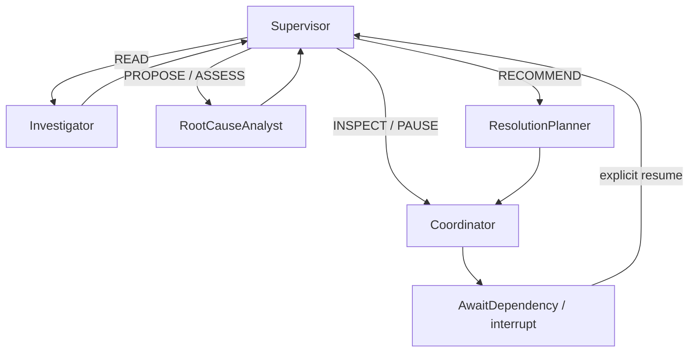

# B10 investigation runtime — B10-O controls, B10 live acceptance OPEN

B10 only. `contracts/agent_runtime.json` defines the compatible runtime boundary. All 18 product objectives remain mandatory; this foundation does not complete GraphRAG, municipal operations, API or frontend. Final status and exact counts are in `docs/evidence/B10-RESULTS.md` and current tracking summaries.

## Actual file and control flow

`app.active` loads a private 0600 profile: exactly one B10 UUID source graph, a separate vendor checkpoint graph, and two distinct credentials. `active_scope` binds B08 ComplaintService and B09 EvidenceService through three narrow guard exceptions. Existing canonical/B08/B09 defaults remain intact. B03 repositories and B05 algorithms are reused. No city import or graph promotion occurs.

`app.agents.mcp.brokers` starts the pinned official Node MCP and actual Python `app.agents.server`, performs initialize/list through the existing validated B06/B07 brokers and supplies a combined safe catalog. The model sees names, actual descriptions and input schemas. `official::` exposes fixed bounded templates; `civicly::` exposes the existing 12 read domain tools. No arbitrary Cypher, graph selector, administration or operational write tool is exposed. The host supplies missing as_of from its case clock, rejects future selected cutoffs and reuses accepted B05 visibility rules to keep future raw official facts out of model context. Source accounts have only GRAPH.RO_QUERY on their exact source key. The checkpoint account has query/read access only to its separate checkpoint key. The B07 trace account remains separate.

B07 context syntax now accepts retained-city or validated B10 UUID references; that syntax is not authorization. Broker and production server require the exact configured source. Historical null rationale remains null; actual public model summaries can now be recorded on host trace observations. Envelope schema version 3 and original tools are retained; inventory hashes change to reflect the compatible output-context extension. No existing registry or migration is edited.

`models` defines strict state/selection/budgets. `provider.Gemini` submits the actual discovered catalog and current case/assessment context to configurable Gemini using responseJsonSchema. `prompts/B10-3.txt` (B10-1/B10-2 retained for earlier evidence) is versioned; later decisions record its SHA (early development decisions predate that metadata). Raw source text is untrusted. Only concise public model summaries are persisted; provider thought text is neither requested nor logged. Usage counts include thought tokens. Strict JSON has one repair attempt; HTTP errors are sanitized. Provider/model/timeout are configurable; only the Gemini adapter is implemented/live tested. No OpenAI adapter or live OpenAI claim.

`runtime.InvestigationAgent` builds one actual LangGraph:



Supervisor persists actual model selections as immutable AgentDecision records, with actual provider mode/usage/catalog hash/revision. Investigator calls the selected real broker and preserves evidence IDs, paths, reservations, truncated/negative results and limitations. RootCauseAnalyst calls existing typed B09 services; the model cannot grant VERIFIED. Coordinator can request an inspection, never perform field work or dispatch. Planner creates only a nonbinding, human-review recommendation; no Plan/WorkOrder/task/approval records are created.

`control` uses canonical AgentDecision, B10_OPERATION Evidence journals and Investigation.thread_id, through unchanged B03 parameterization, fences, integrity policies and CAS. It adds no ontology properties. Deterministic decision/execution/operation IDs are bound to thread/wake/step. Committed journal results replay without another tool/domain mutation. Native B09 receipts remain authoritative. A read prepared before a crash with no committed result is uncertain and must not be blindly reissued. Checkpoints retain validated observations and source references within the existing journal limit; credentials and provider thought text are excluded. B10-O removes the old lossy 18KB result slicing: oversized journals fail closed for explicit recovery.

## Persistence and recovery

`checkpoints.saver` uses the public `langchain_falkordb.checkpoint.FalkorDBSaver` constructor, separate graph/database, supported strict JsonPlusSerializer without pickle fallback, and LangGraph public invoke/state APIs. The SDK creates/manages its own Checkpoint/CheckpointBlob/CheckpointWrite labels and three thread indexes. No handwritten SDK schema or migration modifications.

The graph pauses with LangGraph `interrupt` only after controlled side effects have durable journals. The helper node has no side effects before interrupt replay. A fresh process recreates the graph/Saver and resumes the same thread with Command(resume=...). Each wake owns a 90-second exclusive Redis lease with 15-second heartbeat. A second owner is denied. State version, source/inventory, Investigation.thread_id, incident/cluster and hypothesis binding are revalidated. A changed graph revision/evidence hash forces a fresh MCP read before analytical actions. B09 continues its own source, temporal, episode and CAS checks.

Exceptions during an owned wake quarantine the thread instead of automatically resetting it. Stop the previous process first, inspect `graph.get_state_history(config)` using the public API and identify a complete, version-compatible last-good checkpoint. Reconcile PREPARED journals with existing B09 receipts and B07 execution IDs. A tool may have completed before its response/checkpoint was lost: retain the old execution and issue a new explicitly identified reconciliation read; never manufacture its missing result. Use the public `graph.update_state(last_good_config, validated_state, as_node=...)` to create a recovery checkpoint on the same investigation/thread, record the operator's recovery reason, and clear only that exact host quarantine key after the old process is stopped and reconciliation is complete. No volume deletion or checkpoint-graph DROP is a recovery strategy.

Limit: vendor Saver writes are multi-query, not atomic. It has no public socket-timeout constructor option. The orchestration has finite model/tool/iteration/token/wake deadlines and quarantines uncertain failures; an external operator must stop a process whose vendor I/O does not return before recovery. This is not a claim of distributed exactly-once execution, hard-kill resilience at every Saver subquery, or automatic corruption repair.

## Reproduction

From repository root, with Docker running and ignored local credentials configured:

```sh
UV_CACHE_DIR=/tmp/civicly-b10-uv-cache backend/.venv/bin/uv sync --project backend --frozen
PYTHONPATH=backend backend/.venv/bin/python -m app.mcp.civicly configure --output /tmp/civicly-mcp-preflight.json
backend/.venv/bin/python -m pytest backend/tests -v -s --run-persistence
make test-spec
PYTHONPATH=backend backend/.venv/bin/python -m app.mcp.civicly configure --output /tmp/civicly-mcp-configured.json
PYTHONPATH=backend backend/.venv/bin/python scripts/verify_b10.py --reprovision --output /tmp/civicly-b10-current.json
```

Container force-recreation retains graph/Browser data but clears dynamically configured ACL users. Run the explicit trusted MCP configure preflight before another suite; use verify_b10.py --reprovision to restore the retained B10 exact-key profile too. This changes authorization configuration, not municipal records, schemas or volumes. A failed post-recreation attempt in B10-O is preserved as B10O-auth-failed-tests.txt; no test was weakened.

B10 integration tests use freshly owned disposable graphs and delete only those test-owned keys. Their ScriptedModel/reactive fakes are explicitly labeled; real MCP and Saver calls are not mocked. Provider unit tests mock HTTP and do not count as live verification. Historical live-probe evidence remains intact. Paid legacy batch entry points are disabled; future per-investigation CLI requires explicit authorization.

The retained B10 `.runtime/b10-active.json` is deliberately ignored and private. The historical fixture drivers retain their source and evidence, but paid batch modes are disabled. Fixture creation remains nonbillable and refuses to overwrite an existing profile. The separately selected `tests/live/run_investigation.py` delegates to the genuine operator CLI. A key in .env does not authorize any request. **No live investigation was authorized or run during B10-O.** Future review must explicitly approve a particular case before invoking:

```sh
PYTHONPATH=backend backend/.venv/bin/python -m app.agents --profile .runtime/b10-active.json --investigation INV_ID --thread THREAD_ID --live --max-cost-usd .15
PYTHONPATH=backend backend/.venv/bin/python -m app.agents --profile .runtime/b10-active.json --investigation INV_ID --thread THREAD_ID --resume --live --max-cost-usd .15
```

These are future, billable commands, not reproduction commands for ordinary tests. An explicitly approved complex case can raise its cap; no model may grant that approval. CLI uses actual UTC clock, so retained synthetic future-clock fixtures must be checked for current temporal validity before any later live run.

## B10-O execution, context and spending contracts

`contracts/agent_optimization.json` extends the unchanged B10 runtime contract. `policy.Permit` binds live authorization to investigation/thread; MockTransport permits cannot access the network. `tests/conftest.py` installs an ordinary-test HTTPX/DNS interlock and propagates it to Python children, including explicitly configured MCP environments. The suite-wide audit counts requests blocked before network and separately labels intentional negative probes. Unexpected attempts fail the suite. This is defense in depth for the supported provider adapter, not a sandbox for malicious arbitrary Python or literal-IP networking. Normal tests never collect `tests/live/`.

`context.build` projects current state, all 16 actual discovered tool schemas, remaining budgets, latest B09 authoritative assessments, material prior classifications/negative evidence/episode exclusions/paths/temporal and provenance references. Full-content hashes intern repeated source records and schemas; different versions remain distinct. Full history remains in FalkorDB; no critical evidence is silently truncated to fit. Recent observations remain available, older validated results use source fact references. Targeted approved reads remain available without a hardcoded issue/tool map. Token overflow pauses rather than discarding contradictory information. B09 nested schemas are unchanged. Context byte and simulated cost measurements are in B10O-context-*.json; they are not actual tokenizer counts or billed savings. Native paid context caching is disabled pending verified support and measured benefit.

`mcp.Tools` memoizes validated discovery and caches at most 32 validated reads only under the exact graph revision, cutoff/as_of, arguments, permission/invocation scope, tool identity and inventory hash. Revision is checked before and after the read/hit. Every graph change invalidates, including host audit writes; this deliberately limits reuse during active agent writes. Hits preserve original execution references, evidence gaps, candidate/verified distinctions and bounded-negative flags, and never create fake ToolExecution records. A cache hit is never proof of absence.

`spending.Ledger` is auxiliary private SQLite accounting at `.runtime/ai-spend.sqlite3` (0600, WAL, synchronous FULL, atomic BEGIN IMMEDIATE). FalkorDB remains the municipal/evidence/memory/checkpoint store. Defaults: $6 managed project allocation, $.15 per investigation, one live investigation; per-request model/thread/investigation/milestone/pricing/usage metadata and warning thresholds 50/80/95/100 persist across processes and container recreation. Actual input/output/thinking/cached counts are reconciled in integer nanodollars. Missing/ambiguous usage retains the entire reservation. Each HTTP attempt/repair/retry has a separate conservative reservation. Duplicate decision IDs cannot be blindly rebilled. Unexpected actual cost above reservation records actual cost and holds subsequent calls for review. This manages new application usage, not historical/external API bills or Google hard caps.

Pricing is versioned in `agents/pricing/gemini-3.8-flash-standard-2026-10.json`; `CIVICLY_AI_PRICING_FILE` can select a verified operator schedule. The bundled Standard text schedule expires January 1, 2027 and rejects other models/tier/modality. Source: [Google pricing](https://ai.google.dev/gemini-api/docs/pricing). No native-cache spend occurred. `CIVICLY_AI_PROJECT_LIMIT_USD` initializes the ledger (default6); reopening with a conflicting explicit limit fails rather than resetting spend. Inspect with `PYTHONPATH=backend backend/.venv/bin/python -m app.agents.spending`. To change a persisted allocation, stop live sessions and use `Ledger.update_limits(reason=..., project_limit=..., default_case_limit=...)`; changes are audited. Existing case allocations and costs do not reset.

A live session spans the whole agent wake and heartbeats every15s; no stale-expiry takeover is allowed. After a process crash: stop the previous process, inspect `Ledger.summary()` and request rows, reconcile uncertain usage only from verified provider metadata, then explicitly `Ledger.release(exact_owner)` and resume the same graph thread. Never delete the ledger or release reservations to make a cap pass. Cap rejection happens before HTTP and follows the normal durable pause path. Over-reservation holds require operator accounting/pricing review; there is no automatic hold-clear command. Back up the SQLite database with its supported backup API, not by copying a live main file without its WAL.

Transient recovery distinguishes short-term429/503 from daily/project/unknown quota, auth/configuration, unavailable model, invalid JSON and network timeout. Only appropriate transient statuses retry within count and wait budgets; every attempt is reserved. Invalid schema gets at most one repair. Unknown quota and uncertain transport are not blindly retried. Sanitized failures and usage/model/prompt/pricing versions remain in durable checkpoints/decisions; provider raw bodies, keys and thought text are never logged. See [Google troubleshooting](https://ai.google.dev/gemini-api/docs/troubleshooting) and [rate limits](https://ai.google.dev/gemini-api/docs/rate-limits).

Exact B10-O commands, results, source inventory/patch and preserved B10 acceptance gaps: `docs/evidence/B10O-COMMANDS.md`, `B10O-RESULTS.md`, `B10O-FILES.md`. The B10 live three-issue, contradiction and topology gates remain OPEN and NOT RUN in B10-O. No B11 work.

Dependency/API sources: [FalkorDB LangGraph](https://docs.falkordb.com/genai-tools/langgraph), [vendor integration](https://pypi.org/project/langchain-falkordb/), [LangGraph persistence](https://docs.langchain.com/oss/python/langgraph/persistence), [interrupts](https://docs.langchain.com/oss/python/langgraph/interrupts), [Gemini structured outputs](https://ai.google.dev/gemini-api/docs/structured-output), [thinking levels](https://ai.google.dev/gemini-api/docs/generate-content/thinking).

B11 requires separate human authorization: isolated GraphRAG source graph, versioned documents/citations, prompt-injection/stale-document tests and episodic/semantic/procedural memory. No B11 work is included here.
