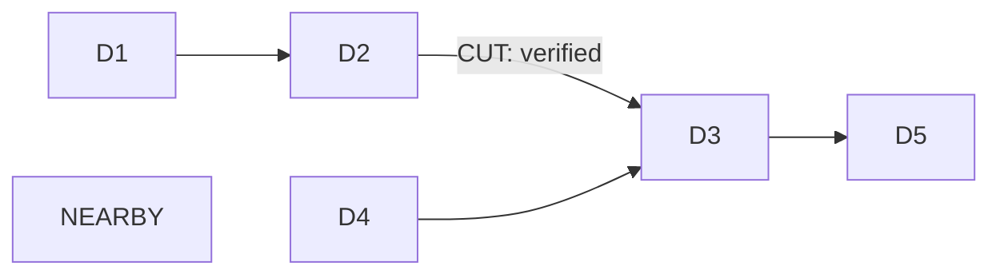

# B05 graph algorithms and case retrieval

B05 supplies typed graph primitives, not an agent, root-cause verdict, memory store,
MCP server, plan/approval workflow or frontend. All R01–R18 remain mandatory.
Registry v3, migration0001, existing graph-access policies and B04 source data are
unchanged. B04 accepted local baseline:8aaf17c; no remote push.

## Implemented entrypoints and responsibility

`GraphAnalysis(GraphRepository(client, graph), AnalysisLimits()).run(AnalysisRequest(...))`
and `.cases(CaseRequest(...))` accept typed values only. Fixed templates in reader.py
use official `GRAPH.RO_QUERY`; no executable caller Cypher or mutable scope input.
Source reads never acquire writer sessions, recover intents or change fences.

| Operation | Actual graph work | Meaning / ranking |
|---|---|---|
| reachability | Bounded directed DRAINS_TO upstream/downstream | Distinct reachable assets, actual paths; origin excluded |
| shared_downstream | Incident AFFECTS then0..h-1 DRAINS_TO | Distinct incidents per asset; coverage DESC, maximum total hops ASC, ID ASC |
| impacted_assets | Downstream DRAINS_TO from explicitly selected failure point | Possible directed exposure; not flood propagation or upstream backwater prediction |
| criticality | Downstream DRAINS_TO for selected assets | Distinct downstream infrastructure count DESC, stable ID ASC; no confidence score |
| dependencies | Directed DRAINS_TO / UNDERLIES / COLLECTED_BY | Explicit drainage, utility/road and waste/route dependencies |
| components | Bounded undirected paths over those dependency types | Weak components of induced export; membership ignores direction, physical-flow reasoning does not |
| task_dag | HAS_TASK and directed DEPENDS_ON | Kahn prerequisite-first order; external prerequisites/status gaps; not plan generation or execution readiness authorization |
| case retrieval | Real asset/dependency/zone/issue/cluster/history relationships | Lexicographic factors, temporal relevance, explicit missing proof/history |

Cypher traverses/filter paths in FalkorDB. Python groups distinct coverage, partitions
bounded component exports, applies Kahn ordering and ranks actual case candidates.
Native procedures are not assumed absent: real6.0.2 catalog lists BFS/PageRank/WCC
and others. A tested bounded native BFS call includes an expired link, so that
invocation does not satisfy Civicly time/proof semantics. B05 uses verified filtered
Cypher instead; no claim that every native procedure lacks filtering capabilities.

Primary references checked against the installed runtime:
[FalkorDB algorithms](https://docs.falkordb.com/algorithms/),
[procedure signatures](https://docs.falkordb.com/cypher/procedures),
[path/predicate functions](https://docs.falkordb.com/cypher/functions),
[GRAPH.RO_QUERY](https://docs.falkordb.com/commands/graph.ro-query).

## Budgets, temporal/proof rules and partial results

- Maximum6 total edges per returned path,100 paths,120 output nodes,200 output edges,
 20 caller roots,64 total read queries,10000 metered computation steps,1000ms per DB
  query and a5s cooperative analysis deadline. Limits can only be reduced. Both
  revision-retry attempts share query/step/deadline counters. Deadline checks occur
  before/after bounded I/O; an in-flight query/socket can finish after the deadline,
  then fails with ANALYSIS_BUDGET_EXCEEDED rather than a fake empty result.
- Shared AFFECTS consumes1 total hop; total1 permits directly shared affected assets.
  Case drainage context subtracts candidate AFFECTS1 and optional seed AFFECTS1.
  Each zone/cluster/history factor path is bounded separately; these are not
  concatenated into an invented connection. Zone needs2 hops; outcome history needs3.
  Omitted branches are reported. No implicit budget expansion.
- Scope fixed demo-city. UTC seconds/fractions use the accepted normalized comparison
  precision. Validity is half-open; unknown bounds stay open/unknown. Node creation,
  updates and actual event/evidence dates cannot exceed as_of. Future-updated records
  are excluded, not reconstructed as older versions. All path nodes/edges are strict
  registry-decoded with real endpoints, subtype labels and application IDs.
- Physical topology defaults VERIFIED and requires actual dated, attributed,
  non-AGENT verified Evidence. Exploratory mode explicitly includes CANDIDATE/REPORTED
  and labels that qualification. External evidence references also respect knowledge
  time. Evidence nodes retain source_kind/source_record_id/reliability/observed and
  recorded dates. Import receipts are never promoted to physical proof.
- No LOCATED_AT/coordinate proximity edge is used to establish physical connectivity.
  A co-located negative-control asset stays disconnected without an explicit allowed
  network relationship. Drainage criticality measures connectivity, not cause,
  hydraulic capacity, probability, severity or proven outcome.
- Pre/post READY revision/pending checks retry at most once. Pending writes refuse
  analysis; persistent revision instability refuses success. Raw privileged writes
  bypass general revision guarantees; this remains a documented local-demo boundary.
- `search_limited` always true for these bounded primitives. `truncated` separately
  marks row/path/node/edge cap omissions. Counts/ranks on partial exports are lower
  bounds; missing rows/paths are not global absence. Whole paths only, never dangling
  partial proof fragments. Query timeouts/database errors propagate as failures.

## Transparent case semantics

Explicit issue_type/zone/date filters are enforced. Seed-derived issue/zone are
ranking context, so actual cross-category connected cases can still be returned.
Historical cutoff is min(before,seed.started_at), excluding the seed and later events.
Ranking order is shared_asset_count, drainage_dependency_asset_count,
shared_cluster_count, same_zone, same_issue (all descending), started_at descending,
then stable ID. No weighted synthetic similarity/confidence score.

INSPECTS/PRODUCED and TARGETS<-IMPLEMENTS->RESULTED_IN return only actual historical
asset context. Asset sharing does not prove a work order resolved this incident;
resolution remains unknown without supported case evidence. Missing inspections,
work orders/outcomes, omitted branches and weak category-only similarity are explicit.
No full recurrence classifier, semantic memory, embeddings or GraphRAG implemented.

## Complexity

Traversal enumeration can be exponential in branching/hops; per-query timeout and
returned-row caps bound execution/output, not a guaranteed number of DB expansions.
Decoded exports are capped; coverage grouping O(P*h), weak components O(V+E), Kahn
O((V+E)log V) with stable heap ordering, case ranking O(C log C) plus bounded path
matching. P<=100, h<=6, V<=120, E<=200; query/step/deadline bounds additionally apply.
Case cap reached before all context means partial ranking, not the globally best case.

## Counterfactual methodology and ownership

`Counterfactual(source_repository)` creates a fresh B05 UUID graph; caller cannot
nominate/reuse a target. Complete source export is capped120nodes/200edges. Therefore
full B04 city cloning is deliberately refused; no truncation into a fake full clone.
Source snapshot is strict validated with references/policies; expired/future records
are copied intact so analysis filtering can be tested. Inspected drainage-cycle
exceptions require separate authority and are not silently replayed by this factory.

Migration0001 + ordinary repository creates copy stable IDs/properties. Clone audit
is new, not a forged copy of source mutation history. Every writer session checks a
factory-issued process-local capability and exact target. Only explicit verified
DRAINS_TO removal and candidate additions are exposed by the experiment API.
Removal uses expected digest, repository lease/fence/intent and atomic domain+
revision/audit commit. Source has no deletion/update/cleanup path in this module.
This internal capability is not DB RBAC or an enterprise security boundary.

Changes are recorded with exact edge/type/endpoints/properties/evidence and reason.
Compare verifies the clone matches its recorded changes; unrecorded edits/uncertain
interventions refuse success. Full source IDs/content/revision/audit/writer-state
hashes must stay identical before/after. Public fingerprints expose hashes, not
internal owner/epoch values. Actual before/after path IDs/ranking/coverage explain
what changed. This is hypothetical topology ablation, not physical simulation.

Lost mutation responses stop without retry. Named partial/uncertain clones remain
available; explicit repository proof-driven recovery inspects actual state. Cleanup
is explicit, owned-target-only and refuses a pending intent. Tests clean only their
new UUID scratch targets after proving retention/recovery; retained review graphs
and preexisting city/B01/canonical data are never reset. No volume deletion.

Controlled real fixture (SYNTHETIC, not city evidence):



Observed before/after CUT removal: D1 downstream3->1, D4 remains2; ranking
D1,D4->D4,D1. D2 impacted assets D3/D5->none. Shared SEED/DEPENDENT-CASE bottlenecks
D2,D3,D5->D2. Candidate replacement restores exploratory coverage only; verified-only
ranking stays D4,D1. Expired connection excluded; nearby asset has no physical path.
Source29nodes/28edges, revision/audit57 remain unchanged; clone advances57->58->59.

## Actual city readiness and deferred authoring

Actual retained city is858nodes/1246edges, revision/audit2104, unchanged exact B04
manifest. All42 drainage links CANDIDATE: verified-only drainage is empty within
filters. Exploratory D12->D18 is a real recorded claim, not established hydraulics.
Four broader asset-binding sets (S01/S02/S05/S07) are supported as investigative
candidate context; eight starting sets omit recorded affected assets and require
B19 source-author confirmation. Six cluster conflicts and three unspecified cluster
contexts remain. Budget-unproven extras are not labeled false global disconnection.

Every S01–S12 has some exploratory/network or historical context, but none has
verified causal scenario readiness. Some case searches truncate (notably S01/S05/S07);
S02 has no earlier case within its temporal cutoff. One real historical ROAD-R08
inspection can be retrieved in exploratory asset context; complete repair/decision/
outcome chains are absent. S07 cross-category topology,55 unlinked measurements,
schedule warnings, source-owner/version/PDF and runtime evaluator isolation remain
B08/B09/B11/B19 dependencies. No city dataset mutation or evidence promotion.
See B05-scenario-dependencies.json and B05-city-evaluation.json for exact real values.

## Frontend/MCP compatibility and reproduction

AnalysisResult contains graph/revision/as_of/scope, typed nodes/edges, stable ProofPath
IDs with ordered node/edge IDs and traversal-relative direction, evidence IDs,
explicit status/temporal attributes, rank factors, gaps, caps and measurements.
Coordinates are source properties only. CounterfactualResult keeps original/clone
names, change ledger, source hashes, timings and before/after subgraphs separate.
These serializable primitives can feed Canvas/timelines/explanations later; they do
not silently resolve DEC-004 MCP common-envelope/trace contracts or implement APIs.

```sh
backend/.venv/bin/python -m pytest backend/tests/unit/test_graph_algorithm_models.py -v
backend/.venv/bin/python -m pytest backend/tests/integration/test_graph_algorithms.py -v -s
PYTHONPATH=backend backend/.venv/bin/python -m app.graph.analysis controlled --retain --output docs/evidence/B05-controlled-results.json
PYTHONPATH=backend backend/.venv/bin/python -m app.graph.analysis city --output docs/evidence/B05-city-evaluation.json
PYTHONPATH=backend backend/.venv/bin/python -m tests.b05_benchmark
backend/.venv/bin/python -m pytest backend/tests -v -s --run-persistence
make test-spec
```

Run benchmark/evaluation before lifecycle tests, never during restart/recreation.
Controlled --retain keeps its newly created source/clone; report names identify them.
City evaluation requires accepted B04 bundle and retained graph. Missing services or
data fail; no mocked success fallback. Focused review ZIP manifest lists dependencies.
