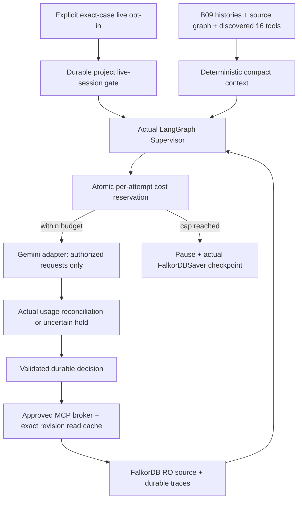

> **CURRENT B17 — TECHNICALLY PASS, HUMAN REVIEW PENDING.** B16/B16-R human accepted. All8 B17 routes exercised;52operations/49paths. Final focused45unit PASS +1real HTTP/FalkorDB/MCP/Saver/TCP-SSE PASS; both specification validators PASS; no live provider. Earlier failed attempts retained and corrected. All18requirements remain binding; B10 genuine acceptance OPEN/PARTIAL. No B18/B19/frontend/live authorization. Current entry supersedes historical status headings; see docs/evidence/B17-RESULTS.md.

# flow.md — Repository map and runtime data/control flow (update after every microtask)

> **CURRENT B14-R — TECHNICALLY PASS, HUMAN REVIEW PENDING.** Corrected waste B14-2 anchors24hours to latest actual pickup; B14-1 outcomes/implementation preserved. Recurrence includes original investigation/new incident sourced link and validated explicit same-thread active-episode refresh; old checkpoints retained, actual MCP/Saver reads exercised.14distinctPASS(11unit/3real),0unresolvedFAIL/0SKIP; both SPEC validatorsPASS once;5pytest/child guards0provider. B10 full genuine acceptance OPEN/PARTIAL. All18requirements binding; no B15/live/full-suite/lifecycle. This summary supersedes historical headers; docs/evidence/B14R-RESULTS.md.


> **CURRENT B14 — TECHNICALLY PASS, HUMAN REVIEW PENDING.** B13 accepted.41distinct focusedPASS(30unit/11real),0unresolvedFAIL/0SKIP; both final SPEC validatorsPASS. Authenticated simulated execution, actual B09 evidence/assessment history, independent3issue follow-up, failure/recurrence and existing memory verified.12pytest/child interlocks0external Gemini/countTokens; B10 full genuine acceptance OPEN/PARTIAL. Earlier data/migrations/history/quarantines preserved. No B15delivery/worker/API/frontend/live or full-backend completion. All18requirements binding. This current summary supersedes historical headers; docs/evidence/B14-RESULTS.md.


> **CURRENT B12 — PASS, HUMAN REVIEW PENDING.** Typed persistent DRAFT plans/PROPOSED tasks, verified responsibility + B11 citations, bounded DAG/version/hash/monitoring criteria and compatible planner/Saver path exercised.49distinct focused casesPASS(42unit/7real),0finalFAIL/0SKIP; both finalSPECvalidatorsPASS;0externalGemini/countTokens. Additive0004 tested isolated;0001–0003/retained city/checkpoints/evidence preserved. No approval/WorkOrder/monitoringexecution/API/frontend. B10 full live acceptance OPEN/PARTIAL. B13 not authorized; see docs/evidence/B12-RESULTS.md.


> **CURRENT B11-LIVE-SMOKE-R — PASS, HUMAN REVIEW PENDING.** Successor B11-1/actual-clock preflight corrected; genuine Gemini selected organizational READ,1count/1generation/1READ,5valid version1citations incl PDF. Fresh-process checkpoint/decision/server+broker traces/accounting PASS. Known$0.00571350/held$0 under existing$0.15casecap;16focused checksPASS(15unit/1real), both validatorsPASS once. Original failed case/quarantine/zero-call thread preserved. No further calls/B12. B10 full live acceptance remains OPEN/PARTIAL.


> **CURRENT B11-LIVE-SMOKE — BLOCKED before provider execution.** One attempted wake stopped on future-dated harness fixture/monotonic update precondition;0 count/0 generation calls,$0known/$0held, no checkpoint or model-selected trace.6 offline harness tests PASS; actual MCP/cited-memory preflight PASS, temporal preflight defect identified. Quarantine retained; no retry/resume/B12. B10 genuine acceptance remains OPEN/PARTIAL. See docs/evidence/B11-LIVE-SMOKE-RESULTS.md.


> **CURRENT B11-R STATUS — TECHNICALLY PASS, HUMAN REVIEW PENDING.** Three memory defects corrected;7 distinct real integration cases passing,0 final failures/0 skips; both SPEC validators PASS once, zero external Gemini/countTokens. Prior B11 evidence preserved. No full770/313 rerun or container lifecycle operation. B10 genuine Gemini acceptance remains OPEN/PARTIAL. No B12. This summary supersedes historical statuses; see docs/evidence/B11R-RESULTS.md.


## Intended architecture (NOT yet implemented)
Complaint/API/CLI -> validation/intake service -> FalkorDB graph and durable domain event -> worker -> LangGraph supervisor -> MCP client (`tools/list`, `tools/call`) -> [official read-only FalkorDB MCP | Civicly domain MCP] -> read graph / sourced data -> hypotheses -> plan -> approval -> work order -> simulated department event -> outcome evidence -> memory graph -> investigator resumes.

Organizational documents -> validated ingestion -> FalkorDB GraphRAG document graph (`civicly_docs`, isolated SDK-controlled schema) -> source-backed retrieval tool -> stable `Document`/`Evidence` references in canonical `civicly_knowledge`.

API -> versioned DTOs, sanitized graph subgraphs, trace and SSE -> FUTURE Next.js Investigation Studio / FalkorDB Canvas / map / plan DAG / approvals.

## File ownership and import rules (proposed)
- `backend/app/api/`: HTTP endpoints, auth dependency and SSE. Must not issue raw Cypher.
- `backend/app/domain/`: Pydantic models, state transitions and enums. No network calls.
- `backend/app/services/`: domain state-changing services, authorization, idempotency, event emission.
- `backend/app/graph/`: parameterized Cypher templates, migrations, read/write repository implementation.
- `backend/app/agents/`: LangGraph states/steps, decision policy, prompts, model adapters.
- `backend/app/mcp/`: MCP client broker, official server filters, custom MCP server and tools.
- `backend/app/knowledge/`: GraphRAG document store ingestion and cited retrieval.
- `backend/app/simulation/`: seeded world and causal test events, never imported into agent context.
- `backend/app/events/`: outbox, claim/ack/retry, SSE trace publication.
- `backend/cli/`: scripts that invoke same services as FastAPI, no separate business logic.
- `backend/tests/`: unit + real integration + behavioral scenario tests.

## Change template per task
### Bxx — Actual paths and call flow
- Files added/changed:
- Imports / outward dependencies:
- Input contract -> validation -> graph/API/tool state -> output:
- Persisted state / events / cache:
- Security boundary and failure behavior:
- Verified by test_log entries:

### B00 — Actual audit file/data/control graph | 2026-10-17
- Changed only six tracking files: decision.md, flow.md, implementation_status.md, test_log.md, blockers.md, task_board.md. No application paths created.
- Read chain: AGENTS/README/start prompt -> requirements/system/microtasks/vendor map -> current backend/contracts/frontend contract/demo docs -> tracking files. Generators inspected without execution.
- Actual flow: Python 3.12/jsonschema -> supplied validators -> registry/machines/MCP/API/events/seeds/scenario structure/document hashes -> stdout/exit status -> test_log. Additional inline JSON property audit -> confirmed seed defect -> decision/blocker records. Environment/version checks -> local capability baseline.
- No database writes, persistent events, MCP sessions or agent runs. Only selected environment-variable presence printed; no secret values. Hidden evaluator structures inspected only for development audit; future runtime exclusion still required.
- Debug from test_log reproductions -> blockers -> DEC-004 -> earliest affected microtask. Intended architecture above remains unimplemented.

### B01 — Implemented foundation file graph | 2026-10-17
- Root: .git/ (main, no commits/remotes), .gitignore, .python-version, .env.example, ignored generated .env, compose.yaml, Makefile, updated README.md.
- backend/pyproject.toml + uv.lock -> isolated backend/.venv -> editable `app` and `cli` packages + console `civicly`.
- backend/app/config.py: Settings (Pydantic settings, FALKORDB_* environment fields, optional explicit env file, masked password, finite timeouts).
- backend/app/graph/connection.py imports Settings + official FalkorDB + redis retry policy; context opens client -> yields -> finally closes client and disconnects pool. No domain repositories, migrations or labels introduced into canonical graph.
- backend/app/services/health.py imports configuration/connection, defines typed foundation result; backend/cli/main.py imports Settings/check_health. CLI parser -> Settings validation -> service -> client -> PING/MODULE LIST/GRAPH.LIST -> existing graph only: GRAPH.RO_QUERY with parameterized scalar RETURN and LIMIT 1 -> typed JSON and exit 0/1/2. API/MCP can reuse service later; neither exists yet.
- Health never creates graph: absent canonical graph returns `uninitialized`, graph_read=null and only server/module foundation health. It never implies full-system readiness. Redis errors map to redacted GRAPH_UNAVAILABLE; config errors map to CONFIG_INVALID.
- scripts/configure_local.py reads .env.example -> exclusive create of ignored .env with random Browser keys and mode 0600, preserving existing file. `make setup` -> Python 3.12 venv -> pinned uv -> frozen sync. `make up` -> configure -> Compose wait.
- Compose -> pinned official single container (database + developer Browser) -> localhost ports 6379 and 3000. Healthcheck verifies PING, GRAPH.RO_QUERY command registration and Browser HTTP. Named civicly_falkordb_data -> /var/lib/falkordb/data (AOF + snapshots); civicly_browser_data -> /var/lib/falkordb/browser/.data (actual API-token store). Runtime source/evaluator files are not mounted into container.
- Tests: backend/tests/conftest.py gates disruptive persistence; unit/test_foundation.py tests invalid config/redaction/framework compatibility. integration/conftest.py only allows local DB, creates random civicly_b01_test_* graphs and cleans only those graphs. test_graph_smoke.py exercises real parameterized writes/reads, RO denial/no mutation, healthy/missing graph behavior and subprocess CLI. test_browser.py verifies live HTTP. test_persistence.py creates graph node + synthetic Browser volume marker, restarts then force-recreates only civicly service, asserts same/different container IDs respectively, and fresh read/settings/HTTP/marker after each. Volumes never deleted.
- A separate civicly_b01_runtime graph retains synthetic B01-PERSISTENCE node for human review; no canonical seed imported. Real Browser login and read of that node verified after recreation; screenshot in docs/evidence/B01-browser.jpg. Actual suite and CLI outputs in B01-tests.txt/B01-runtime.txt.
- Durability boundary: graceful lifecycle persistence verified; event atomicity/outbox, crash recovery, checkpoints, memory/GraphRAG and evaluator process isolation remain future work, with DEC-004 findings open.

#### B01 exact created/modified paths
Created source/config/docs/evidence files:
```text
.gitignore
.python-version
.env.example
Makefile
compose.yaml
scripts/configure_local.py
backend/README.md
backend/pyproject.toml
backend/uv.lock
backend/app/__init__.py
backend/app/config.py
backend/app/graph/__init__.py
backend/app/graph/connection.py
backend/app/services/__init__.py
backend/app/services/health.py
backend/cli/__init__.py
backend/cli/__main__.py
backend/cli/main.py
backend/tests/conftest.py
backend/tests/unit/test_foundation.py
backend/tests/integration/conftest.py
backend/tests/integration/test_browser.py
backend/tests/integration/test_graph_smoke.py
backend/tests/integration/test_persistence.py
docs/evidence/B01-tests.txt
docs/evidence/B01-runtime.txt
docs/evidence/B01-browser.jpg
```
Modified supplied files: README.md, decision.md, flow.md, task_board.md, implementation_status.md, test_log.md, blockers.md.
Generated local-only state: .git/, ignored .env, backend/.venv/, .uv-cache/, temporary clean environment /private/tmp/civicly-b01-locked-env and earlier temporary Compose spike /private/tmp/civicly-compose-spike.yaml. Named Docker volumes persist outside Git. No commit or remote created.

### B02 — Actual schema architecture and data/control flow | 2026-10-17
- Baseline: accepted B01 local commit 426f6e1322dca9e83e470ee471b25b8df7f9e028; B02 edits remain reviewable/uncommitted; no remote push. Exact paths and diff in docs/evidence/B02-files.txt and B02-git-diff.txt.
- Registry v3 contracts/schema_registry.json -> app/graph/schema.py Registry: strict property shape, enums/bounds, UTC times, point adapter, scope constants, declared parent labels and directed endpoint types. Public ontology names/enums retained. Storage-only CivicEntity supplies global domain-node identity; metadata label does not enter domain reasoning.
- Registry -> frozen app/graph/migrations/0001.json (registry hash, explicit index/constraint plan). app/graph/migration.py imports Registry/utc_now + official Redis lease primitives; official FalkorDB connection passed from services/schema.py. No business repository/API/agent integration.
- CLI migrate/schema-status -> Settings -> services.schema.schema_operation -> connect -> MigrationRunner -> version/hash preflight -> exclusive renewed 60s lease -> bootstrap metadata index/constraints -> APPLYING -> additive missing index creation -> actual index OPERATIONAL polling -> constraint creation/readiness -> READY -> fresh full-catalog status. Errors persist FAILED + redacted code/audit; no destructive graph/data cleanup. Every rerun introspects live catalogs and verifies hashes.
- Dynamic data (IDs/maps/scope/timestamps/checksums) uses parameter arguments. Only registry/immutable-plan identifier tokens form DDL. GRAPH.CONSTRAINT uses separate Redis command arguments because installed client has no convenience helper. Catalog procedures have fixed explicit columns and bounded return count; no arbitrary query input.
- node_statement/edge_statement compile schema-validated one-entity writes with inherited labels and source/target typed MATCH. They are testable schema adapters, not operational repositories or authorized tools. Strict validation rejects unknown fields rather than filtering. geo_point map becomes parameterized native point; other complex property values rejected.
- Persistence: canonical graph now has only migration bookkeeping (zero CivicEntity domain nodes); constraints/indexes survive B01 restart+replacement-container regression on retained volume. B01 civicly_b01_runtime graph is intact. No fixture import, checkpoint/GraphRAG changes or new DB containers/volumes.
- Metadata: version1, registry3, checksums, current state, attempts, UTC times and append-only state_history JSON string. Lease is separate Redis key, scoped by graph name and released after migration; no workflow outbox claims.
- Legacy compatibility: validators explicitly check supplied v1/v2 fixture structure, skip only newly introduced required fields in legacy presence checks, flag the exact known 55 unknown fields, and reject new unknowns. Runtime canonical adapter accepts no implicit scope/version conversion. B04 must convert source/edge metadata and repair Observation fields; files unchanged.
- Scope flows identically through registry, state/MCP/API/event metadata and current architecture docs. Client cannot choose municipality. No current framework needs tenant_id; any future mapping is explicit at boundary.
- Tests: unit/test_schema.py covers strict types/unknowns/enums/scope/time and retained defects; integration/test_schema_migrations.py performs real DDL/constraints, subtype/point writes, failure/recovery/version/lease/drift tests and B01-probe protection. Existing B01 tests all retained. Synthetic examples in tests/schema_examples.py are isolated test records, not city seeding.
- Debug: make schema-status -> backend/SCHEMA.md recovery guide -> actual db.indexes/db.constraints -> test_log/blockers. Domain graph-wide cardinality/cycles/evidence existence, retrieval templates and typed repositories are B03, not implemented here.

### B03 — Actual repository/query file graph and control flow | 2026-10-17

```text
connection.connect(Settings) -> official FalkorDB client
  GraphRepository -> MigrationRunner.status (real catalog READY)
                  -> Registry v3 + contracts/graph_access.json
                  -> NodeRecord / EdgeRecord / digest
  GraphQueries -> QueryRequest + ReadLimits -> eight static templates
               -> GraphRepository read/validation -> GraphResult / PathRecord
  tests.graph_fixtures -> repositories -> disposable civicly_b03_test_UUID
  tests.b03_evidence -> real queries + EXPLAIN -> B03-runtime.json
```

- Actual added source: backend/app/graph/models.py, repository.py, queries.py;
  contract graph_access.json; test fixtures/unit/integration/evidence reporter;
  backend/GRAPH_ACCESS.md. Migration runner whitelist now admits B03 test graphs;
  immutable registry/migration0001 unchanged. Makefile adds test-repositories.
- Write flow: strict shape/identity/origin validation -> per-graph Redis lease ->
  metadata owner/epoch fence -> recover prior intent only if pre-state unchanged ->
  actual endpoints/scope/FKs/evidence -> bounded cardinality/cycle proof -> pending
  ID/hash journal -> one fenced graph statement updates domain record, audit,
  repo_revision and pending clear -> strict typed retrieval. Mutable updates need
  expected content hash. Failures preserve state/evidence and return explicit errors.
- Read flow: typed named request -> root type validation -> pre-read revision/no
  pending -> parameterized GRAPH.RO_QUERY (finite hop/result/time limits) -> validated
  driver nodes/edges mapped from internal IDs to public stable IDs -> original edge
  direction/path order/evidence metadata, node/edge caps -> post-read revision/no
  pending -> retry once on revision change -> serialized GraphResult. Disconnected
  metadata projection is avoided after its installed-runtime upstream-path failure.
- All eight query families and temporal checks are described in GRAPH_ACCESS.md;
  candidate source-evidence pointers are also filtered by as_of. Explicit edges
  connect waste, drainage and roads; matching coordinates alone adds no connection.
  Graph paths support investigation but do not declare causation or recurrence.
- Persisted state: existing graph AOF/volumes; internal migration record receives
  repo_owner/epoch/revision/pending/audit scalars only in graphs actually mutated by
  repositories. Canonical graph has zero domain data and no B03 repository mutations.
  Test graphs are deleted individually. B01 runtime graph/probe and both named
  volumes remain. Restart/recreation is real; durable domain events are still B15.
- Future MCP/API/domain services consume typed methods, never raw Cypher inputs;
  auth, approvals, status transitions and trace envelopes remain their own gates.
  No agent/MCP/GraphRAG/API/frontend/importer was implemented. Tests use purpose-built
  synthetic fixtures, not hidden ground truth or full-city ingestion.

### B03-R — Actual corrective file/import/control flow | 2026-10-17
- targets.py provides exact canonical / milestone02–25 UUIDv4 name validation;
  MigrationRunner and GraphRepository import the same guard before selecting any
  graph. No registry/migration0001 change; no B01/document/checkpoint target admitted.
- graph_access.json v2 adds IN_ZONE/PART_OF outgoing singleton policies and route/
  service schedule applicability. Existing locked relationship policy invokes
  _schedule_policies on HAS_SCHEDULE writes; schedule service/date node updates
  inspect incoming edges and revalidate the affected routes before fenced commit.
  Effective interval = edge interval intersect schedule-node interval. Different
  services/date windows remain valid; opaque recurring text proves no compatibility.
- QueryRequest(default total6) -> policy per-template/root minimum/maximum -> typed
  QueryBudget -> fixed connectors subtracted from native bounded DRAINS_TO grammar
  -> total-path filter + existing scope/time/evidence/revision checks -> GraphResult
  search_budget/search_limited + independent output truncated. Fixed branches are
  selected by exact lengths (maintenance1/2/2/3, ownership1/1/2/1). Invalid budget
  yields explicit error; empty bounded search never asserts global absence.
- Actual changed runtime modules: targets.py (new), migration.py/repository.py,
  models.py/queries.py; normative graph-access policy + graph/runbook docs. New
  unit/integration correction modules exercise real isolated graph writes/queries.
  Existing B01/B02/B03 tests/evidence and review ZIP are retained unchanged.
- backend/B04_BENCHMARK_PLAN.md documents the future pilot/full/repeat benchmark,
  O(E_k²) repeated scans and O(N²) audit serialization costs. It performs no import
  and supplies no bulk path; current writer fence/intent/audit/strict policy remains.

## B04 implemented conversion/import flow | 2026-10-17

- `scripts/generate_demo_seed.py` -> distinct `data/generated/source_city_v2.json`
  (revision2.1); originals under contracts are immutable. It imports the registry for
  required legacy shape, does not connect to DB or read evaluator truth.
- `backend/app/ingestion/__main__.py` imports conversion, audit, settings, connection,
  MigrationRunner and GraphRepository. `audit.py` is offline-only and reads source/
  manifest/scenario inventory; `conversion.py` imports Registry, digest and temporal
  interval helpers. No scenario oracle is imported by converter or importer.
- prepare: allowlisted source envelope -> explicit field rules/quarantine -> node
  reference order -> relationship/temporal/cardinality/DAG preflight -> final strict
  Registry validation -> deterministic NodeRecord/EdgeRecord manifest. Actual source
  pointers/hashes and field deltas remain outside runtime graph in conversion reports.
 18 hash-verified Markdown references become Document nodes; no PDF/measurement added.
- `importer.py` imports validated bundle, repository errors and graph target guard.
  B04-only UUID target -> operational0001 -> explicit pending-intent reconciliation ->
  dependency-ordered create/get nodes -> create/get relationships -> equality/hash
  no-op or explicit changed-source conflict -> complete count/hash/revision audit.
  All mutations pass existing lock/fence/intent/atomic commit and policy validation.
  Whole-file import is not atomic: completed prefixes persist and resume safely.
- `benchmark.py` invokes the same importer/repository on one pilot and three fresh
  full targets, twice repeats each unchanged source, records wall/latencies/scans/
  parameter bytes/audit/AOF/memory. Instrumentation adds overhead; no bulk path exists.
  Only its successful scratch graphs are deleted; final and failed graphs retained.
- `tests/ingestion_examples.py` supplies synthetic test shapes. Unit conversion tests
  exercise all42/47 types and original55 numbers; real integration tests cover every
  type, interruption, uncertain replies, concurrent imports, exact hashes and paths.
  Both SPEC scripts invoke `scripts/validate_dataset.py` in addition to frozen-source
  structure checks. Their outputs remain distinct from live DB proof.
- `data/ingestion/`: runtime city-v3 bundle; external input/conversion/generator delta
  manifests; offline source audit, scenario-readiness and release references;
  legacy-conversion/legacy-v1 preserve rejected originals. Reports must not be mounted
  as agent inputs. `contracts/dataset_ingestion.json` fixes this boundary.
- Persistence: existing Compose named volumes unchanged. B01 probe and canonical
  knowledge graph preserved; B04 city is retained in its isolated graph, not promoted
  to canonical. Restart/recreation regression rechecks volume retention. Actual graph
  names/counts/hashes are recorded in evidence, not assumed from source counts.
- Current product reach: data support for R01–R05/R09/R14/R15; no end-to-end requirement
  is completed by ingestion. MCP, agents, GraphRAG, operations, API and frontend remain
  later tasks. B05 is proposed only after human B04 review.

## B05 implemented file/control flow | 2026-10-17

```text
analysis.models -> existing graph GraphModel/NodeRecord/EdgeRecord/PathRecord
analysis.engine -> reader -> official Graph.ro_query + strict repository decoder
                -> cases (actual factor/history paths + lexicographic ranking)
analysis.counterfactual -> bounded complete Snapshot + ingestion.check_graph
                        -> migration0001 -> capability-owned CloneWriter
                        -> existing lock/fence/intent/commit/audit
                        -> GraphAnalysis before/after + source/change fingerprints
analysis.evaluation -> accepted B04 bundle/readiness (no oracle/reveal/catalog)
                    -> actual retained city read-only analysis + dependency report
analysis.__main__ -> controlled test-only source/evidence or actual city evaluation
 tests.b05_benchmark ->10 real read-only runs/workload + unchanged fingerprints
```

- Eight analysis modules provide strict request/result models, fixed bounded path
  queries, deterministic coverage/weak components/Kahn/case ranking, owned clone
  ablation and offline review CLI/evaluation. New contract graph_algorithms.json
  adds response/budget semantics; no existing stored schema or0001 change.
- Reader checks READY/pending/revision before/after, validates graph labels/fields/
  endpoint directions/evidence, applies UTC knowledge/half-open validity/status,
  caches evidence within each request, meters shared64-query/10000-step/5s deadline
  and existing6-hop/100-path/120-node/200-edge/1000ms caps. Proof IDs derive from ordered
  real application node/edge IDs; evidence/source properties and direction survive.
- Source write flow: NONE for algorithms/evaluation/benchmark. No recover_pending
  fence changes on source. Administrative B04 full-manifest verification is separate
  from bounded algorithm exports; it uses accepted <=5000-record source contract.
- Counterfactual factory mints only new B05 UUID target; validates/copies complete
  <=120node/200edge snapshot via normal repository. Every inherited writer session
  checks capability/target. DELETE only verified DRAINS_TO with CAS and existing
  intent+atomic revision/audit commit. Candidate additions use normal proof policies.
  Ledger/fingerprint checks reject unrecorded changes; unknown outcomes retain named
  clone and require explicit recovery/review. Only owned scratch cleanup; no source/
  B01/canonical/volume reset. Public fingerprints hash writer metadata.
- Real city data remains858nodes/1246edges and revision/audit2104.42 drainage claims
  stay CANDIDATE. B05 runtime output/evidence contains sanitized source facts, separate
  verified/exploratory results and B08/B09/B11/B19 data dependencies; no hidden truth,
  expected actions or delayed payload imports. Staged release remains B19.
- Frontend/MCP consumers can later map typed nodes/edges/ProofPath IDs, statuses,
  sources, dates, graph revision, gaps and measured budgets. No API/server/agent
  runtime integration is implemented here; DEC-004 envelopes/traces remain pending.

## B06 implemented runtime/control flow | 2026-10-17

```text
backend/mcp_runtime/package.json + package-lock.json -> npm ci -> official Node1.3.0
app.mcp.runtime -> trusted configure -> named read-only DB ACL + ignored0600 credentials
                -> empty temporary cwd + explicit child env + pinned Node entrypoint
app.mcp.broker.open_broker -> Python MCP2.3.0 Client/private stdio child
 -> initialize/protocol2025-11-25 -> tools/list -> exact7 names + schema hashes
 -> ReadBroker.tools() safe template request schemas / ReadBroker.call(dict)
 -> policy.Request strict/deny graph/tool/unknown fields -> serialized call budget
 -> internal fixed READY/revision/pending read via official tools/call
 -> four approved tools + fixed parameterized node/drainage query or capped schema
 -> GRAPH.RO_QUERY under graph-key ACL -> bounded text JSON -> typed models/registry
 -> post revision read unchanged -> ReadResult(raw facts, limits/candidate status)
 -> sanitized actual trace metadata -> operator proof JSON (not graph-backed traces yet)
context exit -> close SDK streams/stdin -> bounded child process-tree termination
```

New modules:runtime.py trusted setup/lifecycle config; policy.py strict request and
3 fixed Cypher templates (including internal revision); models.py result projections;
broker.py discovery/schema verification/authorization/traces/budgets/result validation;
__main__.py configure/proof CLI; __init__.py namespace. contract official_mcp.json pins
observed inventory, hashes, scope and limits. Makefile commands and backend/MCP.md
explain reproduction. No existing graph algorithm/repository/schema/migration edit.

Credential material flows only local0600 file -> explicit subprocess environment ->
authenticated graph-scoped DB account, never public call/result/trace. No TCP MCP
listener, resources/prompts/raw client interface for agent selection. Node initialization
needs INFO; GRAPH.QUERY/DELETE/LIST/admin and other graph keys denied by DB. Schema
storage labels stripped; canonical unknown fields rejected. No hidden evaluator files
read at runtime. Upstream arbitrary-query/delete tools remain discovered for operator
evidence but absent/rejected at broker. DB default developer account remains privileged.

ReadResult is a B06 official-fact result, not a replacement for18 B07 custom contracts,
B05 decision-grade algorithms or later frontend DTO. Node current state; edge half-open
validity/as_of with explicit raw candidate statuses. Actual revision read, never vendor
Graph version. Errors/timeouts invalidate session as documented; fresh owned context
reconnects, no automatic replay. Trace list/operator JSON is current evidence storage;
B07/B17 graph-backed envelope/persistence remains open. No agent rationale fabricated.
Existing graph/Browser volumes and original B01/B04/B05 evidence retained; ACL account
must be reprovisioned after DB recreation, generated local credential reused.

B06 temporal query compilation imports the accepted B03 GraphQueries._time_key;
all supplied/recorded UTC values compare at the same microsecond precision. Actual
boundary tests read retained edge dates without modifying them. Integration fault
injection corrupts an actual returned record only in the test process, validating
fail-closed unknown-property handling and subsequent fresh-session recovery.

Final B06 post-lifecycle proof executes configure -> actual MCP initialize/list/call
-> independent official Python read -> clean session shutdown. Separate administrative
read helper verifies all retained fingerprints and migration readiness. Source audit
compares86 original protected file hashes/direct pins, scans actual private values
without emitting them and checks child-process absence. Source diff excludes generated
evidence bodies (exact evidence paths inventoried separately); no B06 review ZIP.

## B07 implemented file/import/control flow | 2026-10-17

```text
scripts.rotate_b07_mcp -> admin ACL password replacement/CLIENT KILL
                       -> atomic private file -> old AUTH denial/new RO verification
mcp.civicly.contracts/models -> normative12 READ + shared context/envelope/trace schemas
mcp.civicly.runtime.configure -> admin0001 on separate new B07 trace graph
 -> storage.TraceMigration0002 -> OPERATIONAL additive indexes/constraints/own ledger
 -> dedicated trace graph+lock-key ACL/private config (source city credential unchanged)
mcp.civicly.server -> SDK2.3 lowlevel Server -> real stdio initialize/list/call
 -> strict wire args/_context -> service.CivicReadService -> ScopedClient/read-only city
 -> existing B05 GraphAnalysis reachability/cases + B03 GraphQueries maintenance
 -> fixed bounded registered pickup/road/direct-decision reads or explicit UNAVAILABLE
 -> shared validated result -> TraceStore atomic fenced ToolExecution+detail append
mcp.civicly.broker -> actual discovery/identity/input+output schema compatibility
 -> agent-safe civicly:: args -> server call -> strict result graph/proof validation
 -> persisted server output-hash verification -> separate parented BROKER observation
mcp.civicly.router -> civicly:: domain broker | official:: unchanged B06 read broker
 -> shared persisted trace metadata for both; vendor/domain result shapes distinct
```

Runtime/new files:contracts.py,models.py,storage.py,runtime.py,service.py,server.py,
broker.py,router.py,__main__.py,__init__.py. Additional storage migration0002 and shared
mcp_envelopes plus synchronized mcp_tools/API AgentTraceEvent schemas; no registryv3/
0001/source-dataset change. __main__ configure/proof is operator CLI only. New unit
and real integration tests cover strict boundaries/data gaps/trace/migration failures.

Source reads use rotated one-city readonly account; ScopedClient substitutes restricted
GRAPH.LIST with actual fixed READY lookup, never invented catalog success. Normal
repository catalog/registry checks still execute via RO_QUERY. Trace writer is separate
and cannot access city. Trace writes use existing session/fence/intent/CAS/audit and
atomic core/detail creation, with zero Redis automatic retries. Persisted data is
metadata/hashes/references, not raw arguments/output bodies. No cross-graph atomicity
claim; no source mutation. Server append precedes reply, broker append follows actual
validated receipt. Distinct execution IDs/parent preserve failed/corrupted observations.

Transport is private Python stdio; no model credentials/raw clients exposed by tool
schemas. Session budgets, serialization/timeout/restart behavior explicit. Model
rationale remains null. Procedure/memory/document/monitor capability gaps remain
UNAVAILABLE; external55 measurements have no legitimate location link. All42 drainage
links stay CANDIDATE. Shared node/edge/path IDs and evidence dates retain future API/UI
compatibility without implementing either. Trace records persist in existing DB volume,
separate trace graph referenced only by private configuration. No B08+ work.

Typed dependency mode is an optional read-RPC field, not a stored ontology change.
DRAINAGE(default) -> B05 directed reachability/BOTH bounded merge;
TYPED_DEPENDENCIES -> existing B05 forward dependencies (DRAINS_TO/UNDERLIES/COLLECTED_BY).
Unsupported reverse typed traversal is rejected by input schema. Legacy asset_ids
lists actual infrastructure assets only; full typed route/asset paths retain all IDs.
B07 proof includes actual waste→route and utility→road paths, candidate qualified.

Final verification flow:full426 tests -> actual DB restart/recreation -> trusted ACL
reprovision (same replacement credentials) -> read-only verify_b07 helper checks all
retained source hashes/B01/B05/canonical readiness and13 preexisting trace IDs -> fresh
actual custom initialize/tools-list/calls -> verified-vs-candidate and typed dependency
proof ->15 persisted server observations read back -> native0002 status93indexes/
186constraints total (2/4 additive) -> final source/secret/process audit. No source
mutation or B07 archive. Actual normalized SDK discovery included in operator proof.

## B07-R corrected history projection and query flow | 2026-10-17

- service.py imports the existing GraphQueries._time_key; schema.timestamp supplies
  normalized UTC parameters. history_query selects one of two fixed label/relation/date
  triples. RO_QUERY MATCH + optional typed Evidence -> visibility + requested date
  WHERE -> normalized chronological ORDER BY/time+eventID+edgeID -> LIMIT101 -> strict
  repository decode ->100 rows -> atomic record/Evidence export within existing caps.
- maintenance_history still calls B03 GraphQueries; maintenance_evidence intersects
  each event's path prefix with validated edges/Evidence, extending Inspection through
  PRODUCED only. Aggregate project evidence stays at envelope level.
- result() records operational field gaps before WorkOrder lookup. server.py appends
  absence/failure gaps without replacing capability gaps. Normal SDK/broker validation,
  durable SERVER observation, hash read-back and child BROKER observation unchanged.
- New tests/unit/test_civicly_mcp_history_projection.py exercises pure projection with structural
  fakes. integration/test_civicly_mcp_review.py creates canonical-validated disposable
  fixtures -> tests.b07r_server build() real SDK stdio -> unchanged DomainBroker +
  actual TraceStore. Source substitution is explicitly test-only; production CITY_GRAPH
  and readonly ACL unchanged. No dataset/policy/migration/algorithm edits.
- docs/evidence/B07R-* preserves before/after output/commands/patch; audit_b07r.py checks
  accepted working-tree hashes and actual private values without printing secrets.
  Full existing lifecycle/official/domain tests and fresh retained-source checks follow.

B07-R final verification flow:440-test full regression -> actual restart/recreation
(including B01/Browser volume) -> existing ACL reprovision -> production CITY_GRAPH
SDK initialize/list/all12 calls/15 trace readbacks -> verify_b07.py all retained
source/metadata fingerprints +13 earlier traces -> verify_b07r_traces.py actual log
ordering and fresh readback of15 final B07 +4 before +11 corrected observations ->
audit_b07r.py333 preserved old files, unchanged wire contracts, actual local-secret/
process checks -> B07-R-only inventory/patch. No source/volume reset or new migration.

## B08 actual file/import and data/control flow | 2026-10-17

```text
services.complaints.models -> strict Pydantic union/normalization/units/original/hash
services.complaints.reader -> existing GraphRepository.RO +B03 GraphQueries histories
                          -> B05 GraphAnalysis verified forward/upstream topology
services.complaints.service -> normalize +references +stable external ID
 -> repo.create_node(Evidence PREPARED journal) [separate fenced commit]
 -> repo._session -> actual bounded context +three validators +event/cluster plan
 -> complaints.writer -> exact registry +identity/endpoints/evidence/cardinality
 -> repo._commit -> one atomic approved domain batch +COMMITTED receipt +revision/audit
 -> strict actual relationship/evidence readback -> typed historical receipt
retry -> same journal hash -> PREPARED resumes current plan | COMMITTED verified replay
regroup -> trusted Review+CAS -> close old PART_OF/add replacement+review receipt atomically
preview -> bounded RO plan +preview flag/proposed IDs; no source write
```

New package has models.py,reader.py,writer.py,service.py,__init__.py; no broad scaffold.
New complaint_intake contract mirrors models/rules; no registry/0001/0002 changes.
No MCP module changes: actual fixture server tests.b08_server calls same SDK build()
with test-only source substitution; production scope/broker/TraceStore remain unchanged.
New b08_fixtures and tests exercise real DB failure/concurrency/typed history;
tests.b08_evidence creates retained synthetic graph and verifies exact fingerprint/
receipt replay after real container lifecycle. Source City/B01/B05/traces independently
verified. audit_b08.py checks all accepted files/pins/tests against baseline and
local-secret/process exclusions; exact source patch/file inventory under docs/evidence.
No domain-event worker/outbox, public API, agent, hypothesis lifecycle or frontend.

B08 final verification:507-test complete regression -> real restart/recreation +Browser
volume -> fresh retained B08 fingerprint against pre-retry owner/epoch anchor ->5
receipt replays no domain changes -> re-provision same MCP ACL credentials -> actual
production-city initialize/list/all12 reads/15 server trace readbacks -> verify_b08.py
all2104 city records/B01/B05/native schemas +43 accepted trace hashes -> preserve fresh
B07-R regression proof/restore accepted artifact -> audit_b08.py358 original files and
private-value/process check -> exact B08 source patch/file inventory. No later feature.

## B09 actual file/import and data/control flow | 2026-10-17

```text
services.evidence.models -> strict command union/Actor/Review/Report/Assessment/Receipt
services.evidence.policies -> versioned3-issue verification criteria/typed primary assets
services.evidence.reader -> GraphRepository.GRAPH.RO_QUERY +B03 microsecond time keys
                        -> B05 GraphAnalysis topology/historical cases (unchanged)
services.evidence.service -> typed command/role/target -> PREPARED Evidence journal
 -> repo._session fence/recovery -> current CAS +normative state transitions
 -> bounded actual references +report/original-command/finding provenance checks
 -> requested/prior/discovered evidence union -> as_of filter -> deterministic label
 -> evidence.writer -> registry/endpoints/B03 policies/global+batch IDs -> repo._commit
 -> one atomic nodes/edges/entity update +COMMITTED receipt +revision/audit/clear intent
 -> actual receipt/assessment/path readback -> typed historical acknowledgment
history -> validated proposal source -> append-only snapshots ordered time/revision/ID
inspection -> typed pending/unavailable/conducted/findings view +pre/post revision check
```

New package: __init__.py,models.py,policies.py,reader.py,writer.py,service.py.
New evidence_hypotheses contract mirrors runtime models/policies; EVIDENCE.md documents
limits, trust and active-graph gate. No schema/migration/dependency changes.
Tests.b09_fixtures creates actual B08 intake then explicitly copies stable records
into owned B09 graphs and verifies source hashes; no source guard bypass.
Tests.b09_server only substitutes disposable source in real SDK/broker/TraceStore,
production unchanged. b09_evidence retains a small source/working graph and immutable
verification→contradiction history for real restart/recreation read-only fingerprint
comparison. verify_b09.py checks city/B01/B05/native schemas plus accepted B07/B08
traces/intake; audit_b09.py protects accepted source/tests/data/pins and checks secrets.
No B10 agent/checkpoint, B11 GraphRAG, dispatch/monitor/worker/API/frontend.

B09 final verification flow:582 regression -> actual FalkorDB restart/recreation and
Browser volume/HTTP200 -> same-credential ACL provisioning -> fresh official MCP
5 reads/5 denials +independent equality; production domain list12/call12/15 readbacks
-> read-only retained B09/source exact fingerprints/history -> original B08 fingerprint
+five historical replays -> verify_b09.py with latest B08 owner/epoch anchor -> city/
B01/B05/native schemas +70 accepted trace observations -> restore accepted generated
B07R/B08 proof bytes/save fresh B09 copies -> frozen source/secret/process audit ->
file inventory/source patch and both SPEC validators. Canonical domain nodes remain0.
No B10 or later phase; full results and failures remain reviewable in docs/evidence.

## B09-R actual file and data flow | 2026-10-18

`EvidenceService.execute` still uses the same strict commands, actor authorization,
PREPARED journal, fenced session, revision/CAS and atomic writer/COMMITTED receipt.
`service.py` imports `classification.classify_evidence` and `policies.classify_reviewed`;
classification imports typed evidence uses and `relevance.attribute/independent`.
`relevance.py` follows INSPECTS -> immutable request journal -> Investigation ->
actual INVESTIGATES bindings + immutable open journal; never infers an occurrence
from the asset alone or reads a cluster's future mutable pattern to select identity.
Actual EXPLAINS/CONCERNS/AFFECTS must agree with the proposal and affected asset or
declared topology destination. Current incident visibility remains strict.

For each visible report observation: validate own provenance/inspection/finding hash,
asset subtype, request binding and per-incident interval; classify authority + meaning.
Optional version2 report attribution names earlier incidents and reviewed direct
evidence basis; earlier evidence references/hashes remain in the snapshot. Independent
corroboration requires disjoint source lineage per explained occurrence.
`Reader.topology` continues to use B05 verified-only bounded graph algorithms.
Only reviewed discriminating lists become SUPPORTED_BY/CONTRADICTED_BY; all other
uses remain explicit immutable assessment metadata. Hypothesis state and append-only
HAS_ASSESSMENT chain are written through unchanged writer.py. `models.py` reads v1
without emitting absent new fields and validates v2 category summaries/edge lists.

New tests: `unit/test_evidence_review_models.py`, `integration/test_evidence_review.py`,
`tests/b09r_fixtures.py` (explicit owned B08 source copies, actual intake, dated authored
repair/closure/recurrence). Existing B09/MCP/B05 tests are unchanged. No migrations,
new graph labels/relationships, dependency changes or runtime graph target changes.
Persistence remains B01 AOF retained volumes; no graph merge, volume removal or
historical assessment rewrite. See B09R-ACTIVE-GRAPH.md for the uncompleted shared
application graph gate before a live B10 investigator.


## B10 implemented runtime flow (partial acceptance; 2026-10-18)

```text
app.active [private profile, exact graph context, ACL provisioning]
  -> B08 ComplaintService -> B03 GraphRepository -> same B10 source graph
  -> B09 EvidenceService -> immutable hypothesis/assessment/inspection history
app.agents.__main__ / test drivers
  -> agents.mcp.brokers
       -> B06 official Node MCP initialize/list/call -> GRAPH.RO_QUERY exact source
       -> agents.server -> B07 CivicReadService -> B03/B05 same source
       -> B07 TraceStore -> existing separate B07 trace graph (0002)
  -> provider.Gemini + prompts/B10-1.txt -> strict models.Selection
  -> runtime.InvestigationAgent -> actual LangGraph StateGraph
       Supervisor -> Investigator -> Supervisor
       Supervisor -> RootCauseAnalyst -> existing B09 service -> Supervisor
       Supervisor -> ResolutionPlanner -> Coordinator -> AwaitDependency(interrupt)
       Supervisor -> Coordinator(request inspection/pause) -> AwaitDependency
       explicit resume -> source/reference/revision refresh -> Supervisor
  -> control.Control -> AgentDecision / B10_OPERATION Evidence / Investigation.thread_id
       B03 parameterization + CAS + fence + immutable decision + durable receipt journal
  -> checkpoints.saver -> public FalkorDBSaver -> separate SDK-owned checkpoint graph
  -> checkpoints.ownership -> host thread lock/heartbeat/quarantine
```

Imports: `active` reuses graph target validators and resolves the repository root locally; B08/B09 import only `is_shared_target`. B06 broker/policy use trusted graph injection. B07 Context/TraceRecord contracts permit compatible B10 source references and actual optional summaries. New agents models/provider/control/checkpoints/runtime compose existing B03/B05/B06/B07/B09 interfaces; no reverse dependency from graph algorithms into agents. The production domain server binds the profile exactly; credentials never enter model state/catalog/checkpoint/traces.

Startup: private profile -> schema readiness -> source/read ACL + separate SDK ACL -> two real MCP sessions and discovery/schema validation -> inventory hash -> strict typed state -> stable investigation/thread binding -> model selection -> policy and trusted-cutoff validation -> actual tool call -> inherited B05 returned-fact temporal validation or typed B09 action -> durable decision/journal/trace -> synchronous checkpoint -> interrupt. Actual provider summaries and execution IDs are preserved. Planning remains a nonbinding proposal; no operations.

Resume: recreate actual graph/Saver in a new process, take exclusive host lease, validate version/source/catalog/thread and graph relationship binding, resume helper with no prior side effects, compare source revision and evidence hashes, require fresh MCP read after change. Committed result journals replay; unknown PREPARED reads pause for reconciliation. Exceptions quarantine the exact thread. SDK internals remain vendor-owned; public checkpoint-history/update APIs are the recovery interface.

Actual persistence witnesses are B10-before-lifecycle.json and the final post-lifecycle comparison, separate from existing B01/B04/B05/B08/B09 retained checks. No old graph/volume deletion. Complete file inventory, commands, runtime proofs and limits are under docs/evidence/B10-* and backend/AGENTS_RUNTIME.md. Controlled shared-graph proof does not establish final canonical-city deployment, B11 memory or a completed product capability.


## B10 final verification record (2026-10-18)
- Full regression: **655 PASS / 0 FAIL / 0 SKIP**, 824.63s, including all accepted 617 cases, actual official/domain MCP and container restart/recreation.
- Final B10 source: **42 PASS / 0 FAIL / 0 SKIP**, 126.05s: 23 unit (including mocked HTTP/broker errors, not live) and 19 actual FalkorDB/MCP/Saver integration cases (18 explicitly deterministic fake-model cases; one direct shared-graph boundary probe). Four new cases added after the full suite collected; unique cases covered across both runs: 659, not one 659-test invocation.
- Both specification validators PASS; separate static evidence. Exact commands/raw logs in B10-COMMANDS.md and B10-regression-tests.txt/B10-final-runtime-tests.txt.
- B10 pre/post-recreation source fingerprint: revision103, 80 nodes/47 relationships, immutable content/audit and writer state exactly matched. Six public SDK checkpoint threads and 12 referenced actual executions retained; B07 storage remains separate. Browser HTTP/volume and B01 retained probe PASS.
- Accepted B01/B04/B05/B08/B09 source checks PASS; 101 earlier B07/B08/B09 trace observations verified. Original B09-R v1 node/journal hashes and exact two-version history preserved. Native receipt replay changed only writer lease metadata, explicitly distinguished from immutable content/audit. Four rolling proofs restored after their fresh output was saved under B10-regression-*.
- Registry3, 0001 and 0002 remain byte-identical; source/security audit and exact changed inventory/patch are in docs/evidence/B10-*. No ZIP or push.
- Live acceptance remains PARTIAL: actual provider 503/429, incomplete full three-issue competing-cause/contradiction/perturbation proof, B10-2 live correction unverified. Deterministic controls do not close those gates.
- Stop for review. Exact next task remains B10 acceptance/recovery; B11 cited GraphRAG/multi-layer memory is proposed only after separate approval.


## B10-O implemented flow (2026-10-18)

- `app/agents/__main__.py` parses per-investigation/thread `--live` and explicit cost cap; `policy.py` denies absent authorization and ordinary-test live attempts. `tests/live/` delegates only to this explicit CLI. Legacy paid batch drivers fail closed; prior evidence is retained.
- `runtime.py` loads unchanged actual B09 histories and exact discovered MCP catalog, then imports `context.build`. The projection interns repeated node/edge/path/report bodies by full-content hash and exact schemas into `facts`/`tool_schemas`. Latest authoritative assessments and all material historical classifications/contradictions/provenance/paths/limits remain. Current IDs, cutoff/revision, recent results and remaining budgets are explicit. Original histories and evidence remain in FalkorDB.
- `provider.py` imports `policy`, `spending.Ledger/Pricing`, strict `models.Selection` and prompt B10-3. A live session spans the whole LangGraph wake. Before each HTTP attempt it atomically reserves conservative integer cost in a shared private SQLite transaction, then reconciles actual input/output/thinking/cached token metadata or holds unknown billing. Configured limits, requests and warnings persist independently of database container recreation. SQLite contains accounting only, not municipal knowledge. No extra package dependency.
- `mcp.Tools` caches validated discovery; exact read-cache keys include source graph/revision, tool/inventory/schema, arguments, time cutoff and permission/invocation context. Hits return the original execution reference and bounded result, never manufacture traces. Revision change, including host audit writes, invalidates. All16 approved safe tools stay available and bounded GRAPH.RO_QUERY/exact-key ACL remain unchanged.
- `runtime` records sanitized provider failures/usage in durable checkpoint state; normal cap rejection selects PAUSE before HTTP, preserving evidence and Saver state. A resumed explicit higher case limit keeps prior spend. Uncertain process failures retain reservations/session ownership until operator reconciliation. No automatic takeover or cost reset.
- `backend/test_guards/sitecustomize.py` imports `civicly_no_live.install`; root pytest conftest installs HTTPX/DNS interception and inherits it into Python children, including real MCP servers. Suite-wide counters separately record intentional negative probes. Actual localhost DB/MCP/SDK calls continue; Gemini is blocked. Fake models and HTTP responses remain explicitly labeled. No live quality claim follows from these tests.



Preserved: `active.py`, checkpoints/public Saver APIs, all graph/repository/analysis/B09 source and migrations, three issue categories, candidate/verified separation and all18 objectives. New exact file inventory/source patch and measured byte/cost evidence are B10O-*; no B11 code or canonical dataset change.


## B10-O final observed verification — 2026-10-18

- Final **691 PASS/0 FAIL/0 SKIP**,951.17s:432 unit/259 actual integration. All659 previous unique cases retained (including accepted617 B01–B09-R),32 new cases. First full687 PASS,940.94s; overlapping runs are not added. Both specification validators PASS; uv lock --check --offline PASS,74 unchanged packages. Python3.12.1,SQLite3.43.1; no new external dependency.
- Entire ordinary-suite interlock:0 external Gemini requests,2 intentional HTTP parent/child probes blocked before network,0 ordinary unexpected attempts. Real model/live acceptance **NOT RUN** (not authorized). Mock provider errors and deterministic/reactive model routing are distinct from actual graph/MCP/Saver calls.
- Real actual-schema/context benchmark:8 persisted B09 assessment versions,4 source read observations and all16 discovered tools per issue.

| Issue | Before JSON bytes | After JSON bytes | Reduction |
|---|---:|---:|---:|
| WATERLOGGING | 62913 | 56921 | 9.52% |
| ROAD_DAMAGE | 63308 | 57121 | 9.77% |
| WASTE_ACCUMULATION | 63762 | 57512 | 9.80% |

Small actual two-assessment cases changed by+28/+10/-2 bytes; no universal reduction claim. Authored large duplicate-schema/source fixtures reduce74.8%, separately labeled and not treated as production savings. Simulated allocations use versioned pricing/context bytes only, not tokenizer/billed usage. Native paid caching remains disabled.

- Exact source/audit fingerprints, all6 retained B10 SDK threads/12 executions, original B01/B04/B05/B08/B09 sources and immutable B09R v1/v2 history preserved.101 prior trace observations verified (43+27+31). Registry3/migrations0001/0002 unchanged. Actual container restart/recreation and Browser persistence PASS. Simulated financial ledger matches exact before/after state, including unknown reservation; no reset or retained-volume deletion.
- Preserved genuine failed attempt: after first recreation dynamic shared MCP trace-writer ACL was unavailable.24 authentication failures/1 Browser pass, interrupted72.93s; unexecuted remainder is NOT RUN for that attempt. Existing trusted configure/exact-key provisioning restored authorization without changing domain records. All6 retained threads/source matched before lifecycle; final full691 run then passed. Runtime guide now states configure before pytest. Raw failure/counters retained in B10O-auth-failed-*; no test weakened or removed.
- Four rolling proofs saved as B10O-regression-* before exact pre-task copies were restored. Previous B10 evidence remains byte-identical. B10O-FILES.md/source-audit.json and incremental B10O-changes.patch identify exact changes against frozen B10O-baseline.json, not a misleading HEAD-only diff.
- **STOP for human review.** B10-O verified; B10 remains PARTIAL pending separately authorized genuine three-issue/contradiction/topology/B10-3 acceptance. B11 cited GraphRAG/memory is proposed only after the B10 gate and explicit authorization, not implemented. All18 objectives remain binding.

## B10-O-R actual token, accounting and recovery flow

B10-O-R only, after accepted baseline c16346a; registry/migrations, source graph,
B03/B05/B09 policies, B10-3 prompt, all16 MCP tools and context projection unchanged.

- `agents.provider` imports `tokens.plan/total_usage`, `policy.Permit`, `spending.Ledger/Pricing` and strict `models.Selection`. `tokens` verifies the ignored offline Gemma3 asset SHA and uses locked SentencePiece0.2.1. Only `scripts/configure_tokenizer.py` downloads the pinned public asset; runtime does not fetch anything.
- Complete generation body → serialized UTF8 byte measurement (separate financial estimate) + local proxy count → explicit uncertainty margin/input+4096 output plan. LIVE additionally goes through exact-case authorization → reserved countTokens RPC → verified input count plus framing allowance. Counting is not a generation usage receipt and its financial reservation remains held. Ordinary tests intercept all external Gemini calls and use explicit MockTransport.
- `Ledger.reserve` atomically checks exact session/case/project/hold limits and durable per-thread cumulative token exposure, inserts separate dollar request and token reservation, and appends immutable accounting audit. No byte/token arithmetic remains in token guards. Retry and repair each get an independent allowance; repair includes changed instructions/schema.
- Provider usage → independently validated token total and integer-priced input/output/thought/cache usage → reconcile known fields, retain unknown reservations. Host state `tokens` records cumulative accounted exposure; request metadata separately records actual returned usage and simulated/proxy/verified origin. Reopening the ledger cannot erase exposure; legacy checkpoint consumption is a durable floor.
- `runtime.run` validates operator budget input before acquiring ownership (bad input does not quarantine). A paused same-thread resume accepts only explicitly authorized monotonic Budget changes, records previous/current/reason, retains counters and native journal identities, then revalidates graph/evidence and requires fresh MCP reads on source changes. Recursion150 accommodates bounded32-selection wakes; default limits unchanged.
- `spending_cli` supports summary, explicit audited configure, exact hold inspection and bound single-request reconciliation. Settled-over-reservation recovery reprices stored usage under the exact tariff, binds usage hash/evidence/operator/reason, checks available caps and immutable audit, and resolves only that hold. Unknown billing/unattributed legacy holds cannot be cleared. Original request/charge/legacy hold records remain.
- SQLite config adds compatible complex_cap; accounting_events/request_holds/legacy_hold_links/token_usage/token_floors are auxiliary private accounting, not graph schema. Original retained B10-O probe is inspected read-only; configuration migration is demonstrated on a private SQLite backup. New accounting witness includes one unknown token/$ reservation and one resolved settled overage for process/container lifecycle comparison. FalkorDB remains the source, evidence, MCP trace and checkpoint store.

New test helpers `tests.b10or_http`, `b10or_worker`, `b10or_context` feed explicitly
simulated graph-reactive HTTP selections into the actual Gemini adapter and
MCP/B09/StateGraph/Saver path. Two fresh Python processes reopen the same ledger
and checkpoint. Three real complex contexts preserve eight assessment versions,
two competing hypotheses, all16 schemas, source/provenance/negative/temporal
material, pickup history and road topology/episode identities. Simulated counts
are never presented as genuine Gemini usage. No B11 or live acceptance closure.


## B10-O-R final observed verification | 2026-10-18

- Local reviewed baseline c16346a; no push. Final **740 PASS/0 FAIL/0 SKIP** in1249.98s:466 unit/274 actual FalkorDB/MCP integration; all691 original cases unchanged plus34 unit/15 integration. Actual Gemini outputs/counts/costs **NOT RUN**; HTTP responses and returned usage are simulated. Both specification validators PASS; frozen offline lock75 packages, only SentencePiece0.2.1 added.
- Whole-suite external-request interlock:0 Gemini requests,2 intentional parent/child probes blocked,0 ordinary unexpected attempts. All new tests and original real official/domain MCP, B09 authority/episode rules, LangGraph/Saver and actual Docker restart/recreation/Browser checks passed. Targeted overlapping batches58/76/10/29 passed; do not sum overlapping totals. Initial unit1-failure and authored integration-fixture failures are preserved in B10OR-COMMANDS.md/raw logs.
- Bytes/token minimal reproduction: old byte+output guard127331 vs corrected proxy allowance30394 tokens under60000. Three real complex contexts preserve8 assessment versions/4 observations/2 alternatives/all16 schemas: complete request bytes66234/73621/81990; proxy input+output allowances37476/41089/46721. Exact/-1/+1 cases reject/pass/pass. These estimates and mock130-token receipts are not genuine Gemini usage or billed savings. Model mapping/framing uncertainty is explicit; LIVE requires separately authorized/accounted counting.
- New-ledger8/.50/concurrency1/explicit complex ceiling1.50; existing6/.15 history and reservations unchanged. Explicit audited upgrade demonstrated on a private SQLite backup, not the original. Exact-request hold recovery binds known usage/tariff/hash/evidence/operator/reason and caps, retains immutable audit, and cannot clear unknown billing. Reopen/fresh-process/lifecycle witness retains5120 token exposure. Same-thread authorized Budget increases preserve counters/source refresh; operational defaults unchanged. Only checkpoint counter storage widens to2M to retain an unexpected1100000-token simulated overrun exactly and pause.
- Retained B10 source revision103/80nodes/47edges/content/audit/writer state and all6 public SDK threads/12 executions match accepted evidence. B01 probe, B04 city858/1246 revision2104, B05/B08/B09 sources and B09R original v1/v2 history preserved;101 accepted trace observations checked43+27+31. Registryv3/0001/0002 and all prior evidence unchanged. Four fresh rolling proofs saved as B10OR-regression-* before restoring accepted bytes. No graph/volume deletion to pass tests.
- Supplemental legacy verifier rejected only pytest's ',2 warnings' summary formatting after real data assertions. New B10OR evidence adapter validates the untouched raw740-pass log, lifecycle markers and successful guard, then runs every unchanged original B09 graph/history assertion. PASS; no old tests or logs normalized. This genuine compatibility adjustment/failure is recorded in B10OR-retention-parser-compatibility.json.
- Current source inventory, actual patch, dependency/retention/financial/zero-request proofs and commands live under docs/evidence/B10OR-*. Final source/security audit checks exact accepted files, actual private values without printing them, secret patterns and leaked MCP children. Human review required; no ZIP or later milestone.

Final verification flow: preflight exact-key ACL restore → full pytest740 with inherited Gemini interception and real Docker lifecycle → restore dynamic ACL only → read-only retained source/checkpoint/trace/history and private accounting comparison → save fresh rolling proofs/restore accepted bytes → warning-aware raw-log adapter reuses original B09 assertions → exact source/secret/process audit and review patch. Application source stayed fixed throughout final regression; only documentation/evidence compatibility tooling finalized afterward.

Final B10-O-R scope/security audit PASS:61 prior test files unchanged, all prior evidence byte-identical, actual private credential values/patterns absent, no leaked MCP children. No push or ZIP. Exact source inventory/patch is against c16346a; subsequent human review and separately authorized B10 live acceptance remain required.


## B10-O-R2 implemented control and accounting flow | 2026-10-18

Scope is provider accounting/budget correction only; all graph/MCP/B09/Saver data and policies retained. Application changes are limited to agents. `limits.py` supplies published request capacities, finite cumulative profiles and the exact versioned nonbilling policy; imported by `provider.py`, `tokens.py`, `models.py`, and CLI `__main__.py`. No dependency, graph schema or migration change.

Actual file/import flow: CLI profile/custom allowance → existing `Budget` validation → `InvestigationAgent` ownership + saved-state decode → `Gemini.choose` → unchanged live permit + SQLite session/caps → full B10-3 prompt/Selection steering → `tokens.plan` pinned proxy → atomic count dollar reservation → authorized count endpoint (MockTransport in R2) → immutable `Ledger.reconcile_count` event (known-policy zero / unknown-policy held) → separate input-capacity check → atomic generation dollar and cumulative-token reservation → response parsing + strict Selection → receipt reconciliation → real broker/discovered16 tools → B09 controlled mutations/evidence → LangGraph FalkorDBSaver → next decision. Count metadata does not enter generation token usage. Byte metadata remains only a conservative financial fence, never token admission.

Per-request input1048576/output65536, configured output4096; cumulative new standard400000/complex800000/max2000000; counter storage4000000 supports retaining an overrun. Published input check excludes the16-token cumulative framing margin. Explicit profile changes do not grant dollars. Existing saved60000 remains60000. CLI `--budget-profile` and `--max-tokens` are mutually exclusive; resume requires the existing explicit reason, monotonic increase and live opt-in. Existing SQLite8/.50/explicit1.50 defaults do not replace persisted caps; no historical ledger row is released automatically.

Durable recovery: before next model/tool admission, host synchronizes exact generation receipts + conservative unknown allowances from per-thread ledger floors. Token/money admission failure persists an explicit pause and same Saver thread; separately authorized operator increase preserves counters/native journal. Fresh-process tests mutate source while paused, require MCP refresh and resume the same checkpoint without duplicate native writes. Count timeout completion remains unknown but zero billed under the verified nonbillable contract; unknown/expired endpoint policy and unknown generation remain held. No live requests in this task.

New tests: unit `test_agent_count_billing.py` checks zero settlement, policy/failure/restart and independent capacities. `tests/b10or2_fixtures.py` constructs actual B09 histories/conflicting reports/eight assessment versions, actual MCP contexts including pipe/drain/older incident/pickups, then feeds graph-reactive **simulated** Gemini responses with realistic usage. `test_agent_multistep_budget.py` uses actual count/generation adapter, broker, B09, LangGraph and Saver; `b10or2_worker.py` proves two-process recovery. This test selector is not production routing or genuine model acceptance. Evidence and exact commands: docs/evidence/B10OR2-*. Final full regression includes original lifecycle checks; retained graph/checkpoint/history and ledger witnesses are verified independently afterward.


## B10-O-R2 final corrective verification | 2026-10-18

- **CURRENT B10-O-R2 STATUS — PASS, HUMAN REVIEW PENDING.** Final **770 PASS /0 FAIL /0 SKIP** in1206.63s (488 unit/282 real integration), both specification validators PASS;740 baseline cases retained plus30 new. Zero external Gemini,2 intentional blocked probes,0 unexpected attempts. Real MCP/B09/LangGraph/Saver, fresh-process token/dollar resume and retained-volume lifecycle PASS. Endpoint-specific count settlement zero; standard400000/complex800000 tokens with independent dollars and saved-setting preservation. B10 genuine live gates remain OPEN/PARTIAL; no B11, push or ZIP. Review: docs/evidence/B10OR2-RESULTS.md. This current summary supersedes historical headings.
- Root causes: count requests were left uncertain despite verified endpoint nonbilling;60000 cumulative tokens admitted only one or two realistic decisions. New endpoint-specific count audit/zero reconciliation, independent capacity/cumulative controls and safe explicit pause reasons; no historical ledger rewrite. Existing60000 checkpoints and money caps require explicit authorized upgrade; profiles do not grant money.
- Six-decision actual B09/MCP/Saver simulations cover allthree categories, competing hypotheses/dated contradiction, pipe+drain and candidate/verified topology, older incidents, pickup/schedule history, source revisions,503 and output repair. Plausible prompt counts/output/thinking receipts are simulations, not billed Gemini usage. Token and dollar limits each pause then resume the same checkpoint in two real processes, retaining counters/native writes.
- Compatible old-test changes limited to two unit files: new finite maximum bounds and known count billing zero. No previous test removed; all other tests and all prior evidence unchanged. New22 unit/8 integration cases. Focused/targeted overlapping batches and one sandbox setup error are documented without inflating totals. One completed final run after interrupted timeout-metadata correction, with --durations=25/--run-persistence; application/test code fixed throughout.
- Retention: original city858/1246 revision2104/all42 drain links CANDIDATE, B01 probe, B08/B09 source/history,101 accepted trace observations, B09R v1/v2 audit, B10 revision103/80nodes/47edges and all6 SDK threads/12 executions match; private ledger witnesses remain row-identical with5120 accounted tokens. Registryv3/migrations0001/0002 and dependency lock unchanged. Fresh rolling proofs retained separately before restoring accepted bytes.
- Exact source inventory/patch, raw tests, slowest25 durations, zero-provider interlock, simulated request/ledger histories and commands: docs/evidence/B10OR2-*. Remaining: genuine Gemini three-category/contradiction/topology/B10-3 gates, proxy/expiry/historical billing limits, existing SDK recovery/canonical activation and future DEC-004 findings. No product capability is declared complete. STOP for review, no B11.

## B11 actual organizational memory flow | 2026-10-18

Human sequencing exception: B10 genuine Gemini gates deferred to final integration,
OPEN/PARTIAL; B11 explicitly authorized, B12+ not started. Local audited B10-O-R2
baseline9f7ec1d preserves af42149; no remote push.

Files/import graph:
- `app.memory.models`: strict source/citation contracts, exact five-owner mapping,
  manifest whitelist, UTC/version/authority/checksum/path/symlink/instruction checks.
- `app.memory.sdk`: official SDK GraphRAG/connection/store/loader/chunker/extractor/
  LocalRetrieval; two fixed fulltext DDL translations for6.0.2; offline lexical
  embedding and proposed SourceStatement extraction, no external provider.
- `app.memory.storage`: new compatible0003 plan, readiness/checksum and canonical
  companion/source registration/revocation audit via existing fenced repository.
- `app.memory.service`: SDK→canonical reconciliation, exact chunk/vector/metadata
  binding, effective-version/source selection, bounded cited RO retrieval.
- `app.memory.runtime`: optional private exact-key read credential and trusted source
  capability; `__main__` trusted local setup, no MCP/model administration.
- Existing `CivicReadService` consumes optional memory profile for two organizational
  tools and B09/B05 histories for case memory. Both actual server entrypoints wire
  optional trusted config. `app.agents.mcp` forwards host-only profile path and skips
  civic-only cache for organizational reads. Selection/checkpoints/spending unchanged.
- `data/documents/b11/manifest.json` plus synthetic D001 PDF derivative; original18MD
  manifest/source bytes unchanged. `contracts/organizational_memory.json` and optional
  citation output extensions in existing MCP schema; both spec validators now also
  execute static `scripts/validate_memory.py` (not runtime evidence).

Ingestion: exact authorized source/hash → STAGED journal → actual SDK Markdown/PDF
parse → fixed800-character chunks → proposed statement/lexical graph/embeddings and
indexes in civicly_docs(+SDK ontology graph) → verify indexed chunk IDs/text hashes →
INDEXED journal → one existing fenced canonical Document+READY companion commit →
READY journal. Version IDs ORG:<ID>:<version>, stable URI/hash/content_ref. No join or
transaction across graphs assumed. Complete SDK/canonical boundary interruptions
recover by verification/replay; incomplete SDK internal stages quarantine. Additive
0003 verifies OPERATIONAL indexes/constraints and original0001 checksum. Revocation
appends attributed prior metadata in same canonical transaction; never deletes old
versions/records. Version/owner/trust/effective metadata in companion, not silently
added to immutable public registry. No SDK label/index enters canonical graph.

Read/control flow: actual MCP initialize/list/call → existing validated broker/schema/
identity → read-only domain handler → exact private memory capability → canonical
READY source/version/review/effective/URI/hash + actual SDK LocalRetrieval.RO_QUERY →
match retrieved chunk IDs to exact verified source chunks → <=5 citations×800chars,
PROPOSED assertions and synthetic review labels → canonical memory revision recheck
→ common MCP result/trace persisted → B10 bounded context projection → Saver. Old
civic-source-only cache is bypassed for document reads; no stale revocation reuse.
Case memory projects existing corrected B09 assessment/evidence history and B05
qualified semantic graph paths, never invented resolution or operational facts.

Actual setup registers19 organizational versions/five sourced department references
in civicly_knowledge and isolated civicly_docs; city858/1246/42candidate links stay
separate. Runtime memory reader sees only exact canonical/docs keys with RO_QUERY;
official source, checkpoint and trace credentials remain separate. Dynamic ACLs
need exact-key reprovision after recreation; AOF retains graphs/indexes/versions/
checkpoints. New genuine integration proofs use isolated retained B11 targets and
public Saver reads/fresh interpreters. Original B01–B10 source/history/trace/checkpoint/
accounting witnesses are checked before and after lifecycle; no volume reset.


## B11 final implementation and verification | 2026-10-18

- **CURRENT B11 STATUS — PASS, HUMAN REVIEW PENDING.** Organizational memory and actual SDK1.4.0 MD/PDF ingestion/cited retrieval implemented; canonical19versions/SDK19chunks, repeat19/19,0003READY. Final targeted308PASS (226unit/82real), final B11-only40PASS (25unit/15real), strengthened three-graph MCP1PASS, lifecycle1PASS;313distinct cases total,0finalFAIL/0SKIP. Both SPEC validators/retained-data/accounting checksPASS; zero external Gemini/countTokens. No full770rerun, justified DEC-047. B10 genuine live gates remain OPEN/PARTIAL under explicit human sequencing deferral. No B12+, frontend, push or ZIP. Exact results/inventory/patch: docs/evidence/B11-RESULTS.md. This current summary supersedes historical headings.
- Sources: frozen18MD originals/manifest retained; canonical owner mapping and synthetic PDF derivative in data/documents/b11. Strict source/version/effective/review/authority/citation contract; unknown fields/scope/paths/hash/symlinks/evaluator instructions denied. No synthetic/LLM statement promoted to verified civic policy or cause.
- Actual SDK GraphRAG ingestion and LocalRetrieval; two fixed6.0.2 fulltext DDL adaptations, SDK document/ontology graphs isolated. Offline lexical hash64/proposed extraction is not genuine model-quality proof. Lock121packages/all75prior versions unchanged,100installed; frozen compatibilityPASS. New compatible0003companion storage,0001/0002/registry unchanged.
- STAGED/INDEXED/atomic canonicalREADY registration, source/chunk/vector verification, idempotency/version supersession/revocation with prior metadata audit. Tested two cross-graph failure boundaries, missing/invalid/unreviewed/disputed/tampered sources, single-writer lease/pre-write bounds. Internal SDK partial writes fail closed for explicit repair, no automatic success.
- Actual MCP organizational reads and8version B09 case memory, validated Evidence context, B05 semantic history projection. Scripted model context/real LangGraph/Saver pause/resume and fresh interpreter retrieval; separate civic/reference/SDK graph revocation proof with unchanged civic revision. Exact-key independent memory RO credential, original official/source/checkpoint/trace permissions preserved. No new autonomous write tool.
- Targeted regression308PASS305.13s; final B11-only40PASS56.82s; strengthened MCP1PASS14.96s; persistence1PASS15.22s. Overlapping unique313cases227unit/86integration; no full770required, no old test modified/removed. Slowest25 and both validators recorded. Failed SDK/API/fixture/schema-transition/evidence-context attempts retained with exact corrections; vendor deprecation warnings not hidden.
- Original B01probe/B04city858/1246rev2104/all42candidate drains/B05/B08/B09 sources/101accepted trace observations/B09R v1→v2/B10source103/80/47/all6threads12executions and ledger5120accounted tokens preserved after restart+recreation. New SDK/canonical19sources/19chunks/PROPOSED statuses/indices persisted; canonical0SDKchunks. Repeat setup19/19replayed. No volume reset or historical witness rewrite.
- Remaining: human review; B10 genuine Gemini gates explicitly deferred OPEN/PARTIAL; offline learned-semantic quality, SDK-internal partial repair, synthetic/history gaps and future DEC-004 approval/event/API/evaluation findings. All18 requirements binding, no backend/product-complete claim. Proposed next B12typed plan/DAG/owner/procedure/monitoring draft only after explicit approval. STOP.

Final source-admission/excerpt refinement: version>1 requires explicit supersession of latest registered version;26source unit+1real version testPASS4.40s. Exact-ID excerpts use verified indexed SDK source chunks, avoiding semantic top-k starvation; affected real MD/PDF/version/MCP cases retested. No old test/source behavior weakened. Distinct final cases312(227unit/85real), overlapping batches not summed. Earlier lifecycle anchor preserved separately.

Canonical procedure identity: existing KnowledgeProcedure nodes use ORGPROC:<document_id>:<version>, exact document_ref to the versioned Document, normative string version and status PROPOSED. MCP procedure_id references that actual node and integer response version comes from validated source metadata. Source review never automatically verifies a procedure. New ingestion creates Doc+procedure+companion atomically; trusted replay additively backfills missing proposed procedures after source/chunk verification. No B12 planning/resolver/approval permission. See DEC-048 and final procedure tests.

Final procedure-state persistence verified: repeat only B01 lifecycle1PASS15.25s after DEC-048, earlier proof preserved under B11-earlier-*; fresh interpreter read exact final19PROPOSED procedure/document bindings, source/version/chunk hashes and same checkpoint thread. All original B01–B10/101traces/ledger witnesses rechecked unchanged. No additional full regression.

Final UTC boundary verification: supersession compares canonical parsed instants, including optional fractional seconds, rather than string order. Exact real test rejects whole-second rollback from .1Z and accepts .2Z, retaining original and new procedure/document versions.1PASS, no earlier test or data changed. Final distinct coverage313(227unit/86integration), all final casesPASS; earlier overlapping batch counts remain historical.


## B11-R corrective verification | 2026-10-18

Authorized requirements R09/R13/R14 plus R07/R15; all18 preserved. DEC-049 records choices/alternatives.
- Real original-code reproduction: source crowding omitted eligible coordination source D018 and global INSPECTION top12 excluded both Water Utilities chunks. Deployed original-versus-corrected RO comparison confirms0→D005/D017 citations. Missing embeddings replayed successfully; limit1 returned oldest assessment. All three corrected and exercised on real code.
- Actual SDK global search retained; bounded fallback reads/verifies eligible SDK chunks (20sources×128chunks,5citations×800characters). Explicit ELIGIBLE_SOURCE_FALLBACK, never metadata-only evidence or learned relevance claim. Real19-source corpus covers10department/action pairs, including Water INSPECTION.
- Shared vector/index validator before replay/new registration/retrieval: actual OPERATIONAL Chunk embedding VECTOR64/cosine plus text FULLTEXT, exact IDs/count, finite64vectors matching offline embedding within float32 tolerance. Healthy replayPASS; missing embeddings/wrong64vector/missingvectorindex each explicitly SDK_PARTIAL_REQUIRES_REPAIR. No automatic repair/reset or ANN internal-membership guarantee.
- Latest visible assessment revisions selected DESC time/id before requested budget+1 (<=101), selected output ASC time/id. Truncation/OMITTED_PREDECESSOR gaps preserve omitted IDs as history references, not returned evidence.8revision limit1 and104revision limit100/latest1/historical-cutoff casesPASS; existing schema/envelope unchanged. No B09 guard weakened.
- Exact tests/logs: B11R-COMMANDS.md, B11R-RESULTS.md, B11R-test-summary.json. Initial3failed reproduction; corrected batch4PASS/1fixtureFAIL28.07s; isolated history rerun1PASS16.68s; existing version/revocation plus extended actual MCP/Saver/fresh-process2PASS16.36s.7 final distinct real integration cases,0 unresolvedFAIL/0SKIP. Overlapping reproduction not summed. No separate unit run; actual graph scenarios cover new validation logic. Both validatorsPASS once after final source/contract changes.
- Ordinary pytest interlock inherited by Python MCP children:0 external Gemini/countTokens,0 unexpected attempts; offline embedder/NoLLM and scripted agent are not genuine live model proof. New proof only B11R prefix; old B11/B00–B10 evidence unchanged. No dependency/migration/city/checkpoint/accounting changes; corruption only owned isolated graphs, deployed comparison read-only.
- Minimum selection suffices: all source applicability pairs; healthy and three damaged indexing states; small/overcap/temporal history; directly affected version/revocation and one actual broker/schema/trace/Saver/resume test. No full770/313 suite or lifecycle operation because no cross-cutting/persistence change.
- Remaining: human B11 acceptance, B10 genuine acceptance OPEN/PARTIAL, offline semantic quality, bounded citations/source/version caps, SDK manual partial repair and ANN internals not proved; historical mutable-node visibility still applies. B12+ approvals/events/API/frontend remain outside scope. STOP after B11-R.

B11-R actual file/data flow:
`CivicReadService → Memory.retrieve → Store.all/Source.active → SDK LocalRetrieval (top12) → SDK.chunks + validate_indexing → eligible bounded chunk fallback → Citation → existing MCP schema/trace → agent/Saver`.
`Memory._ingest replay → SDK.chunks equality → SDK.validate_indexing → ensure_procedure → READY receipt`; new ingest/complete SDK retry uses the same validator before registration. Fixed RO queries inspect index metadata and bounded chunk vectors; no repair/write capability added to retrieval.
`retrieve_case_memory → temporally visible Investigation/hypothesis/assessment/relationships → ORDER DESC assessed_at,id + limit budget+1 → select budget → chronological ASC output → actual Evidence projection + omitted-history gap`. Immutable source graph and native Saver data/control flow unchanged.


## B11-LIVE-SMOKE — BLOCKED | 2026-10-18

DEC-050 records original authorized single-wake fences; R06/R07/R09/R13/R14/R15 and all18 preserved. One attempted run for INV-B09-d8b67c785a6aa6bdcf800dbefe0a4f2f/thread ae94b094ee9f4ad599f88789df4d959e, private profile .runtime/b11-live-smoke-agent.json. Actual provider attempts0count/0generate, known$0/held$0, no model version/selection/usage/checkpoint/live trace. No Gemini compatibility success claimed.

Actual official/domain discovery16tools, exactROpermissions and cited Drainage source preflight PASS;6offline static interrupt casesPASS1.28s,0fail/skip/providercalls. A real host ExceptionGroup occurred before thread binding/provider scope. Read-only diagnosis establishes fixture created12:00UTC vs wall06:25UTC; Control.bind would violate monotonic updated_at. Preflight incorrectly omitted temporal visibility. Original inner exception was not captured, precise temporal precondition documented without inventing captured stack. First diagnostic separately failed on relative profile paths; absolute-path discoveryPASS/sameinventory. No accepted source policy weakened.

Limits: case0.15USD incl holds; zero transient retries, at most2 schema generations/count<=1 each;2048output; one provider decision/one wake; static interrupts block analytical writes and stop after READ. Default live ledger absent and initialized once via existing implementation unchanged8USDproject defaults/newcase0.15, no historical probes altered, no counters/holds/caps reset or raised. Exclusive attempt marker/quarantine remain, no second live attempt. Existing B10-3 prompt still excludes memory despite B11 runtime; preserved and disclosed.

Evidence prefix B11-LIVE-SMOKE; exactcommands/IDs/results/limits in RESULTS.md. Fresh-process source/Saver/ledger/catalog reads confirm no checkpoint, no thread binding,0requests, quarantine. No full770/313/7case rerun/container restart; narrow harness tests only. B11/B11-R technical evidence preserved, all old source/data/checkpoints/dependencies/migrations unchanged. Next: human review, separately authorize valid fixture and exact recovery path before further live smoke. No B12. B10 three-category/contradiction/topology/end-to-end acceptance OPEN/PARTIAL.

Actual smoke harness file flow: scripts/b11_live_smoke.py prepare → existing fixture/domain services + ActiveProfile/exact ACL → actual brokers discovery/read citations → original Gemini/Pricing/Ledger readiness → private initial state/public authorization. Execute → exclusive start marker → original InvestigationAgent with supported StateGraph static interrupts → ownership → Control.bind monotonic timestamp rejection → quarantine. Provider execution_scope/reserve/count/generate never reached. Read-only diagnostic → original source timestamp/Saver.get_tuple + SQLite RO + fresh MCP catalog; no retry. backend/tests/unit/test_live_smoke_harness.py proves6static branches with InMemorySaver, clearly offline.


## B11-LIVE-SMOKE-R — PASS, human review pending | 2026-10-18

Requirements R06/R07/R09/R13/R14/R15; all18 preserved. DEC-051 records alternatives/bounds and scoped ID reuse. Actual UTC optional clock injection corrects smoke preparation while retaining deterministic fixture defaults. Required investigation/incident/cluster/assets/connecting-edge visibility, monotonic binding, exactsource/profile/no checkpoint/binding conflict/owner/quarantine checked before READY and immediately before runtime ownership. Original failed case/profile/timestamps/zero-call thread/quarantine remain unchanged.

Versioned B11-1 changes only B10-3 stale capability sentence; original B10-3 bytes/hash preserved. Provider selects successor version, runtime/optimization contracts synchronized. Discovered/authorized organizational+case-memory READ permitted with explicit gaps, untrusted source/citation/version/revocation/authority/uncertainty and prior hypothesis/approval safeguards. Existing structured Selection/provider/MCP/Saver retained, no new framework/function calling. Sanitized nested exceptions expose class/allowlisted category/code only, no raw error strings or bodies.

Minimal offline16PASS0fail0skip7.15s=15unit+1realFalkorDB temporal/bind. Old6static interruption branches, successor safety/parity and nested error redaction,6direct provider request/repair/failure/budget tests plus one timeout-version compatibility check. Future clock rejected without ownership/quarantine/provider side effects; actualUTCbind/recheckPASS. Only existing timeout assertion adapted from literal B10-3 to currentPROMPT_VERSION; old behavior checks retained. Both specvalidatorsPASS once after final source/contract edits. No770/313/7case/lifecycle rerun.

One real authorized retry on .runtime/b11-live-smoke-r-agent.json/source e924ed0c58b94d14a278202f0bb1ab15, local investigation INV-B09-d8b67c785a6aa6bdcf800dbefe0a4f2f/thread57185be0ce624da5a8b69472c16f811a; original threadae94b094ee9f4ad599f88789df4d959e retained0requests. Existing ledger shares conservative0.15casecap for same local investigation ID, no reset/replacement ledger/project increase. Actual prompt B11-1 hash40316606a6d7189e273e14b7dbaaee7e016031a0ee73b3ca5cbb18e7a978a105; modelgemini-3.8-flash reported same version.

Genuine Gemini selected civicly::get_organizational_procedures {department_id:DEPT-DRAIN,action_type:INSPECTION}, concise rationale persisted.1count+1generation,0repair/0transientretry/1selection/1READ; no errors. Actual MCP discovery16tools and validated citations D001-PDF,D001,D002,D003,D012 version1(PROPOSED source-derived guidance, not verified causes) reached committed journal+workflow state. Static interrupt stopped after Investigator; no resume/second wake/analytical write. Fresh process verified native checkpoint1f1cabd8-07d6-60da-8002-032cf251731c, decisionDEC-B10-6db86522180a134fd3c9766e2a00e1e8, executionMCP-B10-6db86522180a134fd3c9766e2a00e1e8 and brokertraceaa34fccdf8eb4210b473a5e74f1e50a0. Exact output/trace digest matches, original source citations retained.

Provider usage prompt7123/candidates99/total7222; thinking not separately returned, prompt+candidates sumtotal; existing default0 absent thoughts documented. Count settled0 under verified nonbillable policy. Generation known5713500nanodollars=$0.00571350, held0, activeSessions0/openHolds0. Prior project8USD/case0.15 unchanged; reservations guarded before HTTP. Application cap not guaranteed Google cutoff/balance; no claim actual invoice. No fallback/model switch/other paid calls.

Exactsourceinventory/diff/commands/runtime/proofs under docs/evidence/B11-LIVE-SMOKE-R-*. Current status closes this small compatibility smoke only, not B10 three-category/contradiction/topology/end-to-end gates (OPEN/PARTIAL). SDKofflinelexicalquality/manualrepair/bounded-source/synthetic/history and future DEC-004 gates remain. STOP for human review before B12 or any further live call.

B11-LIVE-SMOKE-R actual flow: optional create(clock=capturedActualUTC) → domain intake/open → temporal_preflight(Reader node+edge visibility, monotonic bind, no old checkpoint/quarantine/owner) → actual MCP read/citation preflight → private profiles/state/publicauthorization. Execute rechecks hash/inventory/time/ledger → exclusive marker → existing ownership+Control.bind → Provider execution_scope/reserve → actual countTokens→zero reconciliation → actual generateContent→Selection+usage settlement → AgentDecision → actual MCP server/broker schema validation+ToolExecution → committed B10_OPERATION result → Saver sync checkpoint → public static interrupt. Fresh process reads Saver, decision/journal, server+broker traces/digests, citations and SQLiteRO accounting. No second Supervisor/model call or resume. Original failed profile/quarantine/source graph remains separate.


## B12 typed draft planning — PASS, human review pending | 2026-10-18

R10 advanced; R09/R11/R14/R15/R17 supporting, all18 mandatory, no full capability-complete claim. Closed PlanDraft/tasks/basis/monitoring/receipt models; version-bound cited procedures, immutable latest assessments, evidence/target/investigation references, reasons/alternatives/outcomes/risks/uncertainty, SIMULATED + deterministic normalizedSHA. Tasks admit sourced INSPECTION drafts currently; no invented cost/duration/confidence or repair authority. No approval or execution.

Bounded12task DAG rejects duplicates/unknown/self/cyclic dependencies and foreign basis refs. Actual verified/datelyattributed MAINTAINED_BY ownership resolves accountable department; B03 evidence/date rules reused. Unknown/candidate/conflicting/mismatched ownership blocks; document author separate (coordination source can guide actual Drainage owner). Actual B11 SDK source/version/hash/chunk/ref comparison and action applicability, future-citation/superseded/revoked rejection; PROPOSED remainsPROPOSED. Monitoring requires comparable rainfall/waterlogging, pavement+wear, or scheduled/actual pickups+reaccumulation window; absent opportunityUNRESOLVED, completionneverresolution.

Additive0004 companion, checked checksum/index/constraint readiness in isolated graphs. Registryv3/0001–0003 unchanged. One existing fenced/audited parameterized graph mutation creates native ResolutionPlanDRAFT/ActionTaskPROPOSED and PRODUCED_PLAN/HAS_TASK/DEPENDS_ON/ASSIGNED_TO/TARGETS plus fullcompanion/provenance/hash; external B11 graph IDs are pointers, no fake crossgraph edges. Request-safe acknowledgment, injectedpostcommitresponse-loss/retry, next-headversion/CAS and preservedpriorversionPASS. No WorkOrdercreated (existing fixturehistory remains), no B15platform scaffold. Accepted graphs not automatically migrated/seeded.

B12-1 successor prompt/currentruntimecontracts enable RECOMMEND{plan_draft}; originalSelection wire schema/framework unchanged. Narrow service called by ResolutionPlanner; invaliddraft→PLAN_CLARIFICATION_REQUIRED pause. CurrentplanID/version/hash receipt persisted and decode-bound; legacyRECOMMEND/Nonecheckpointdefaults retained. Actual scripted READ→modeldraft→domainvalidation→Saverpause, freshPython read sameplan/hash and resumedthread withoutduplicatePASS; cyclicinvaliddraft creates0plans. No genuine model-planning claim.

Focused final49distinctPASS/0unresolvedFAIL/0SKIP:42unit/7real; new15unit/6real + selected27unit/1legacyreal. Initialcollection error(newmodulebasename collision) and foundation18PASS/1promptloaderFAIL28.11s retained; corrected runtime/affected31PASS29.80s, legacy1PASS7.75s; finalB12references6PASS50.94s overlaps. No inflated batch sums. Both validatorsfinalPASS, preliminaryPASS retained before necessary stale domain-write/not-claimed contract text correction. Ordinary inherited providerguard all5batches0external/0unexpected; no livecalls.

No full770/313/accepted7/smoke rerun. Selection covers boundedDAG/hash/monitoring, allthreeissues/crossdept, source/owner/ref denials, version/replay/ackloss, actualMCP/Saver/freshprocess/resume/invaliddraft, legacyrecommend and changedstate/context/provider. No containerlifecycle: existingdurability protocol unchanged; additivegraphschema/singlemutation and freshprocess verified. Allpriorevidence/frozenfixtures/migrations/dependencies preserved; previousliveledgerhistory notreset/altered.

Review docs/evidence/B12-RESULTS.md/B12-COMMANDS.md/B12-FILES.md/B12-changes.patch and backend/PLANNING.md. Humanverify road planDRAFT/version/hash, Road→Waterdependency, ownerEvidence and PROPOSEDcitations, monitoring; inspect freshprocesscheckpoint. Remaining B10 genuine fullacceptance OPEN/PARTIAL; draft-only INSPECTIONscope/source action applicability and synthetic/manualSDKrepair/boundedhistory/DEC-004futuregates. ExactnextB13 approvals/auth/planbinding/idempotentWorkOrder only after newauthorization. STOP afterB12.

B12 file/control graph: agents.provider → prompts/B12-1 + existingSelection; agents.runtime.action_schemas → services.planning.models → contracts/resolution_planning.json. ResolutionPlanner → PlanningService (trusted analyst) → B09Reader latestassessment/temporalbinding + B03ownership/evidencechecks → B11Memory.retrieve actualSDK/citation/KnowledgeProcedure/currentversion checks → planning.Store under sourcelease → compiledregistrytypednodes/edges + CivicPlanDraft companion via repo._commit → readbackreceipt ID/version/hash → workflowstate → originalCoordinator/AwaitDependency/Saver. Invalid→explicitclarificationpause; legacyrecommend→oldnonbindingpath. PlanMigration0004 creates only additivecompanionindices/constraints/ledger, requires0001checksum and OPERATIONALreadiness; neverautomigratedfrommodel. tests.b12_worker reads originalnativeSaver then validatedStore/hash in freshprocess; resumehasnoextraPlan. External sourcegraph pointers carry provenance insteadofcrossgraphGOV_BY. No calls into approval/WorkOrder/execution/event/API/frontend modules.


## B12-R implemented file and control flow
`planning/models.py` imports strict B09 types and B11 Citation; adds Remediation/Prerequisite while old normalization omits absent additions. `planning/policy.py` imports normative B09 cause rules; service imports it only for remedial tasks. `service.create` -> existing fenced session -> latest assessment/source membership/version -> policy: target/cause/support/current report+finding hashes/typed gate codes and dependency -> existing resolve: dated verified owner + fresh B11 source/version/action -> existing Store.commit one parameterized audited draft mutation. Store/migrations are unchanged. Source/finding snapshots, typed gates and policy proof remain in companion JSON bound by payload and plan hashes.

Separate three-source `data/documents/b12r/manifest.json` -> existing Source.checked_path SHA/authority -> actual GraphRAG SDK ingest/vector/fulltext -> canonical proposed KnowledgeProcedure -> reviewed-only retrieve -> version/chunk citations. `memory/__main__.py` accepts explicit --manifest for trusted operator use; default B11 source setup is preserved. No retained canonical ingestion is automatic.

`planning/feedback.py` imports closed Model, static classifications and known exception types. Agents.models references Feedback with None old-state default. Runtime ResolutionPlanner -> domain create -> valid receipt/ID/version/hash -> human review OR safe feedback state+observation -> explicit pause -> existing Coordinator/Saver. Unsafe ownership/unknown-write/checkpoint exceptions -> sanitized recovery/quarantine, no forged rejected/committed acknowledgment. Supervisor context contains issue-specific action policy/guards and persisted feedback. Later authorized bounded resume sees feedback; no auto rewrite/replan. Actual scripted MCP READ, remedial service write, native Saver checkpoint and fresh-process worker all exercise this flow.

Persistence protocol and migration0004 remain unchanged; source additions use existing SDK and canonical companion journals. Focused repeated ingest/retrieve and fresh-process Saver/source proof cover the new path; no lifecycle operation or database reset is needed or authorized.


## B12-R corrective review gate | 2026-10-18

Final runtime evidence:3category source/ownership/gate/provenance native draft records; actual scripted MCP/Saver remedial fresh-process/resume; bounded invalid-DAG and pre-write dependency feedback in state/observations. Unknown failures propagate to existing quarantine with no fabricated feedback persistence.61distinct focusedPASS, both SPEC validatorsPASS,0provider. File graph above and B12R-FILES.md identify actual changed sources. No retained canonical import or lifecycle.

Review docs/evidence/B12R-RESULTS.md, B12R-COMMANDS.md, B12R-FILES.md and B12R-changes.patch. Human: inspect3category gates/citations, actual native receipt/hash/checkpoint, safe invalid/recovery feedback and zero operational deltas. STOP for review; exact next task B13 only after explicit authorization.


## B12-R2 corrective review gate | 2026-10-18

Imports: planning.service adds existing graph.repository.OutcomeUnknown subtype PlanRecoveryRequired. Proven pre-write validation remains outside commit boundary. commit attempt -> ACK-only readback -> verified receipt OR sanitized recovery exception with exact original IDs. Existing persisted-request replay -> Store.get/receipt validation -> valid existing receipt OR same recovery type. feedback treats that subtype and legacy PLAN_READBACK as UNKNOWN. Runtime copies only typed reconciliation metadata to existing RecoveryRequired -> unchanged ownership exception path sets quarantine; no rejected/accepted acknowledgment output. Existing native companion/decision and last durable Saver checkpoint remain operator evidence. No new recovery store/checkpoint field or background worker. Actual fault proof shows retained original plan/hash and quarantine; no retry/deletion/clearance.

Review docs/evidence/B12R2-RESULTS.md, B12R2-COMMANDS.md, B12R2-postcommit-recovery.json, B12R2-FILES.md and B12R2-changes.patch. Human verification: inspect exact identities,1plan/version1, UNKNOWN/recovery diagnostic, last durable checkpoint with no false acknowledgment and retained quarantine. Reproduce only the isolated mismatch test; no reset/retry of stored fault wake. STOP for review; B13 requires explicit authorization.


## B13 review gate | 2026-10-18

File/control graph: operations/auth.py private SQLite signed sessions -> server Actor; models.py closed command/full assignment binding -> Operations.service requires permission and graph active scope -> existing repository._session fence -> Storage operation replay hash OR current planning Store.get/head/native projections -> B09Reader latest assessments/report+finding hashes -> PlanningService.resolve B11cite/current ownership + remedial policy -> submit/decision/order/update normative guards -> operations/storage.py fixed registry compiler -> one repository._commit creates/updates native plan/task/approval/order/status/domain event plus CivicOperationState lifecycle/request/approval/order proof. operations/migration.py +0005checksummed indexes/constraints READY/OPERATIONAL. plan Store.get imports verify_plan_lifecycle only when state differs fromDRAFT or attestation exists; immutable B12 JSON/receipt unchanged. Agent decode/currentplanhash unchanged and actual Saver checkpoint valid under ownership. Commit/readback -> OpsRecovery(OutcomeUnknown) bounded IDs/UNKNOWN, explicit original-request reconciliation; no false rejection/auto retry. Native DomainEvent payload_ref -> immutable operation envelope/actor/proof; PENDINGdelivery no worker. Auth material absent graph/events. __main__ bootstrap private auth, b13_worker actual fresh-process auth and graph read. No API/agent approval tool or field execution.

Review backend/OPERATIONS.md, docs/evidence/B13-RESULTS.md/B13-COMMANDS.md/B13-FILES.md/B13-changes.patch. Human inspect B13-flow.json exact binding+audit/order, denials/conditional/checkpoint proof, run only isolated flowtest for reproduction. STOP for human review; exact next B14 simulated execution and independent outcome verification only after explicit authorization.

## B14 implemented file/data/control flow

```
backend/app/services/operations/
  service.py -> dispatch Progress/Inspect/Evaluate/Recur -> execution.py
  execution_models.py -> strict B09 command union + B14 work/window commands
  execution.py -> existing auth.py / PlanningService / Storage
               -> EvidenceService.authorize/plan (actual B09 models/Receipt/Journal)
               -> Reader.evidence/history (actual report/finding/source proof)
               -> verification.py (B14-1 explicit synthetic condition policy)
               -> ComplaintService.plan(normalize, optional strictly bound journal)
  storage.py -> registry / unchanged B03 relationship checks + planned journal check
             -> one existing fenced repository _commit
             -> native entities/edges +0005 operation/lifecycle/proof + PENDING event
contracts/operations.json -> execution schemas, units/policies/lifecycle
contracts/state_machines.json -> unchanged transition enums, explicit cross-entity guards
backend/tests/b14_fixtures.py -> authored observations/controlled clock/real services
backend/tests/{unit/test_execution_policy,integration/test_execution_runtime}.py
scripts/validate_operations.py -> B13+B14 schema/permission/policy parity in both validators
```

Token resolves current server-owned actor; exact work binding/CAS, current approval,
plan head/task projection and owner/procedure guards precede dispatch. START/neworder
also validates current causal assessment/gates/dependencies. Native progress changes
attested plan state; immutable B12 payload/receipt/checkpoint refs stay unchanged.
Current same-meaning assessment may advance without freezing graph revision; changed
meaning requires explicit next PlanDraft version, submit and new approval. Reports
and terminal outcomes record actual started work even after contradiction, without
authorizing more work. Separate analyst token supplies independent report review.
B09 planner returns native report/findings/updated inspection/assessment; B14 compiles
it with COMMITTED B09 journal, audit/event and0005 request receipt in same fence.
B03 unchanged; compiler validates planned unverified operation journal before source
checks on remaining properties, and checks within-batch cardinality. B08 optional
planned journal is exact original/canonical/hash/source/time bound for atomic recurrence.

COMPLETE→ACTION_COMPLETED; all tasks→MONITORING. Evaluate validates post-completion
window/report provenance/units/all targets, applies explicit rain/wear/pickup policy;
missing→MONITORING, contradictory→INCONCLUSIVE, adverse→PROBLEM_PERSISTS. Each task
needs verified follow-up; no open task/gate/dependency or current addressed causal
contradiction at closure. Verified→MITIGATION_VERIFIED/RESOLUTION_VERIFIED, native
plan/investigation COMPLETED, incidents ENDED/time, cluster CONTROLLED. Recur reuses
B08 AFTER_RECORDED_END, creates new incident linked original cluster, retains old
plan/outcome/approval/evidence and REOPENED investigation/cluster. Existing B05 case
paths retrieve old orders/outcomes; no new memory implementation.

All values parameterized; read paths through existing GRAPH.RO_QUERY. Controlled
clock only, no hidden scenario reader or provider. Native event payload_ref points
immutable operation envelope; delivery PENDING until B15. Storage/recovery protocol
unchanged: post-commit uncertainty→OpsRecovery UNKNOWN identities, no auto retry,
redraft/delete/reset/quarantine clearance. Focused ACK-loss exact replay retains one
outcome/completion; no lifecycle operation justified. Real B12 checkpoint read under
lease preserved. Existing city,0001–0005, sources/evidence/ledger remain untouched.

## B14 review gate — 2026-10-18

Implemented B14 file/control/data graph above exercised. Exact native lifecycle and0005 attestations retain B12 payload/checkpoint hashes; new report/result/monitor operations reuse B09/B08 planners and existing fence. Final41distinct cases total(30unit/11real), both validatorsPASS; no new persistence/worker machinery. See B14-RESULTS/B14-FILES/B14-changes.patch.

Review backend/OPERATIONS.md and docs/evidence/B14-RESULTS.md, B14-COMMANDS.md, B14-FILES.md, B14-changes.patch. Human inspect retained3issue outcomes, contradiction/failure/recurrence-memory and ACK-loss proof; optional single isolated water test. STOP after B14 for review.

## B14-R implemented control/data flow

```
operations/verification.py B14-2
  -> ACTUAL_PICKUPS latest observed_at per target -> elapsed window -> outcome
operations/verification_v1.py (exact original B14-1 bytes, historical reference only)
operations/execution.py Recur
  -> existing B08 plan/journal -> new incident + old cluster
  -> sourced temporal INVESTIGATES(new incident), old links retained
  -> same fenced0005 operation/outcome/event + REOPENED original investigation
agents/runtime.py explicit owned AwaitDependency resume
  -> agents/recurrence.py refresh
  -> B09 temporal Reader + B08 normalize/load/receipt + reviewed report proof
  -> validated active incident/assets/source hashes + host scope audit
  -> fresh MCP READ barrier -> actual read new incident/report -> new Saver checkpoint
```

No old checkpoint rewritten; public SDK ID-specific read proves original persisted
checkpoint unchanged. Native recurrence receipt/event exposes investigation and link
IDs. Latest equal aggregate pickup observations are not summed; latest timestamp
conservatively anchors every supplied window. Conflicting totals INCONCLUSIVE;
insufficient elapsed MONITORING. Historical B14-1 outcomes/exact replay untouched.
No new schema/migration/infrastructure/dependency/automatic wake. Existing graph and
closed state max3incidents retained, invalid/missing-active historical reopen fails
closed using existing ownership/quarantine. Old plan/hypothesis refs remain explicit
earlier-episode context. Actual14focused checks; commands/evidence under B14R.

## B14-R corrective review — 2026-10-18

File/control flow above exercised with real B09/B08/FalkorDB/MCP/LangGraph/Saver. Original checkpoint remains immutable; refreshed state and two actual new-episode/report reads persisted only after explicit owned resume. No automatic event delivery or new storage schema.

Review docs/evidence/B14R-RESULTS.md, B14R-COMMANDS.md, B14R-FILES.md, B14R-changes.patch and B14R-audit.json. Human inspect waste timestamps/versions and sourced new investigation link/checkpoint refresh; optional two-case isolated reproduction. STOP for human review before B15.

## B14-R2 — 2026-10-18 | human review pending

Actual flow: AwaitDependency detects source revision change → recurrence.refresh revalidates persisted RECURRENCE_SCOPE_REFRESH against current INVESTIGATES/source journal/B08 receipt → validated historical set excluded from additions → existing strict validator handles only genuinely new episodes. Repeat refresh returns existing active state; caller retains mandatory MCP READ. Same thread creates new checkpoint; original and first-adoption checkpoints remain unchanged. Files: agents/recurrence.py + two existing test files; no new subsystem.

Review docs/evidence/B14R2-RESULTS.md, B14R2-COMMANDS.md, B14R2-FILES.md and B14R2-changes.patch. STOP for review.

## B15 actual file and data/control flow — 2026-10-18

app.events.__main__ imports active profile/Settings/connect/GraphRepository → Delivery(service.py) → Store(store.py), Sources(sources.py), Event/routing/public(models.py) → Worker(worker.py) → Runtime(runtime.py) → existing brokers/InvestigationAgent/ownership/FalkorDBSaver. Reuses Operations.Storage and immutable0005. Full paths/commands/handler matrix/recovery in backend/EVENTS.md.

B08/B09 committed journals+B12 verified draft or B13/B14 native operation event → strict envelope and native identity/readback → explicit active-profile revision cutover/selected historical IDs → companion+optional native event+stable public cursor in one fenced source write → owner/token/expiry/attempt+case claim → RUNNING → release writer fence → actual MCP+same-thread LangGraph/Saver → host STARTED/CONSUMED exact batch marker at safe paused checkpoint → consumer receipt+DONE/source status mirror under short fence. Every transition adds hashed B15_DELIVERY_AUDIT evidence as repository intent subject. No cross-graph ACID claim. Heartbeats/finite budgets preserve source writer availability; source revision updates retain fresh-read barrier.

Claimed-before-dispatch death: lease expiry reclaims original event (attempt2). Running-after-checkpoint death: replacement validates saved batch marker under original ownership, acknowledges without redispatch (wakes unchanged1). Missing/corrupt/quarantined proof: recovery-required, no plan/order duplication or reset. Later explicit source update+two compatible requests: one second wake, active recurring incident correct, old ENDED link and both old checkpoints intact. Monitor intent at controlled due time→FOLLOWUP_REQUESTED/missing-opportunity receipt, no synthetic observation. Public committed registration cursor persists across fresh process, bounded allowlist/redaction; no HTTP/SSE.26distinctPASS, final2SPECvalidatorsPASS,0provider. STOP before B16.

## B16 actual files, imports and request/control flow — 2026-10-18

app.api.__main__: explicit host-only private profiles/auth/clock → lifespan existingconnect/Auth/PlanningService/Operations/Delivery/Memory → app.api.application.create_app. Dependencies supply server principal/services; coverage.py is44-operation table; models.py holds closed transport/DTO/envelope models. API layer emits no Cypher. app.services.http.service adapts accepted commands; reads.py performs only fixed bounded repository projections and scope filtering. No new dependency/migration/storage engine, no domain/runtimes/MCP source edits.

HTTP → server request correlation → real B13session/RBAC → strict JSON+Idempotency-Key+optional independently authenticated reviewer header → source-bound hashed api_request companion under B15fence/audit → accepted domain service/requestidentity → typed projected saved acknowledgment → envelope. Unknown post-dispatch or no durable response remains409RECOVERY_REQUIRED/UNKNOWN, no automatic redispatch. GET revalidates scope/current audited lifecycle; authorize before count/cursor, never raw journal/exception/graph/profile/credentials. Work projection orders actual recorded outcomes by parsed evaluated_at+ID; completed vs verified/recurrence remains distinct.

B09case creation→persistB15intent→HTTP returns before any model → separate deterministic B15worker→actual official/domain MCP discovery/call→LangGraph/Saver paused checkpoint→durable acknowledgment. Explicit HTTPresume→same durable case/thread→new checkpoint, original unchanged. Actual TCP Uvicorn uses same private config, public health/readiness andOpenAPI/docs + authenticated me exercised; readiness probes graph/MCP/Saver/delivery/auth/memory, not model. Secure startup/stop and43originalroute reconciliation now44core+11deferred in backend/API.md/B16-COVERAGE.md. No HTTP SSE/API backgroundworker. STOP before B17.

## B16-R actual corrective flow — 2026-10-18

CURRENT B16-R technicallyPASS/reviewpending. Only backend/app/services/http/service.py source changed: Services.command creates request-local Boundary; dispatch performs accepted pure validation → Boundary.invoke snapshots existing source audit/pending state → DISPATCHED → original B08/B09/B12/B13/B14/B15service → RETURNED → projection → final typed response and persistedDONE. API routes/models/business services unchanged. Generic ValueError/Pydantic across DISPATCHED/RETURNED cannot writeREJECTED; known no-write rejection requires explicit phase/evidence. Existing journal defeats inference from unchanged revision. Existing body validation/role gates/staleCAS/identityconflict stay actionable.

Fault→best-effort validated B09COMMITTED receipt lookup→retain original sourceboundHTTPrequest, journal hint, inspection and investigation/plan IDs→existing sanitized409RECOVERY_REQUIRED/UNKNOWN→existingDISPATCHING intent with bounded recovery metadata if available. Pending source/failedmetadatawrite preserves lastdurablestate, no feedback guarantee. Exact replay checks intent and returns recovery without service invocation; invalidDONE read also fails safe. Real twofaultloop retains1inspection/COMMITTEDjournal perrequest,2total; readbackphaseDISPATCHED and postserviceprojectionphaseRETURNED, bothreplays0calls/0duplicates. No worker/wake/quarantine/migration/repair. See B16R-real-proof.json and B16R-RESULTS.md; STOP before B17.

## B17 actual file/query/event flow — DEC-062, 2026-10-18

B16/R accepted. app.api.coverage retains44B16 routes and adds8B17GETs; app.api.models imports closed view_models.py, preserving planned DTO names/required fields. application.py authenticates existing Auth principal, validates finite ReadFilters and rejects irrelevant/repeated parameters → services.http.views.Views. No API Cypher. Existing POST dispatch/Boundary, durable source-bound intent and B16-R recovery behavior unchanged.

views.py → GraphRepository._read (GRAPH.RO_QUERY, fixed allowlisted families with parameterized IDs/filter values) → registry decoding and B05 temporal/provenance proof reader → strict public projection. Per-request Snapshot/adjacency batches replace incident/ownership N+1 reads; no persistent cache.500family/5000adjacency/100per-root relationship bounds fail closed. Check repository revision/pending before/after each projection; unstable response refused, later pages explicitly current rather than snapshot. Graph breadth first depth<=5,120nodes/200edges, verify evidence/date/authority, authorize both endpoints/provenance, never proximity. Map uses actual canonical Location points only; absent geometry explicit. reads.py retains accepted detail/lifecycle and now exposes validated observation meanings/source/review; inspection candidates constrained to actual case assets.

services.activity.py → exact native INV.thread_id + canonical AgentDecision Selection/metadata → configured existing TraceStore validated BROKER and optional parent SERVER → source/investigation/thread binding → public decision/tool fields and execution mode. Read-only official Saver tuple supplies actual checkpoint phase/pause/error/revision/quarantine; never a wake or clearance. selected_paths reads actual COMMITTED B10 journal, validates selected-input digest and path identity against persisted trace, ordered endpoints and actual edge/evidence proof; only in-view paths highlighted. UTC-Z trace cursor + stable eventID avoids URL plus-sign decoding and timestamp-format ambiguity.

Separately operated events.Sources.scan → bounded actual source decisions/traces, shared scan/trace connection and configured Delivery clock cutoff → exact persisted fact adapter → existing B15 INFO register/fence/cutover/monotonic public cursor. Canonical migrations0001–0005/source data/checkpoints unchanged. Activity writes only existing delivery/native notification metadata, never invents prior actions or acknowledges a consumer. Existing native/journal/draft source adapters remain.

HTTP stream → services.http.stream.Stream validates existing activation/cursor/contiguous history/session/investigation scope before headers → StreamingResponse → bounded .25second readonly polling of Delivery.public → closed event validation and per-emission scope/auth → normative event-name mapping → durable SSEid. Unauthorized/nonmatching rows advance only cursor-control frames, no hidden data. No event discovery, delivery ack, lease, queue, agent or checkpoint write in stream. Auth expiry/revocation emits sanitized transport error and stops; cancellation stops generator.30second reconnect/refetch,50row batch; heartbeats comments only. Typed data preserves B15 fields plus planned event_id/timestamp aliases. Raw journals, argument/provider bodies/private reasoning/credentials remain internal.

Actual shared real HTTP/FalkorDB/MCP/Saver journey + TCP Uvicorn SSE evidence under B17-*. State distinctions: native current lifecycle vs immutable draft receipt vs actual approval vs completed work vs independently verified outcome; checkpoint phase can be older and requires fresh read. All18requirements preserved, B10 full genuine acceptance OPEN/PARTIAL. STOP after B17; B18/frontend/live unauthorized.

### B17 final verification supersedes pending notes above
Both specification validators PASS in the single final make test-spec invocation. Final focused45unit+1real PASS,0unresolvedFAIL/0SKIP; repeated runs count as one distinct integration case. Delivery evidence separates source_graph from the public graph projection; failed-log session text sanitized without value disclosure. Final preservation/private-value/accounting audit and narrow patch recorded under B17-*. B16/R recovery paths unchanged; B10 genuine gate OPEN/PARTIAL. STOP for human B17review; exact proposed next B18 CLI, not authorized now.

## B17-R actual query-control flow — 2026-10-18
app.api.view_models.QueryRules retains integer/boolean/date-window validators → ReadFilters remains internal service superset; explicit VIEW_QUERY_FIELDS selects closed ResourceQuery/DashboardQuery/MapQuery/HypothesesQuery/TraceQuery/GraphQuery/AssetQuery. application.endpoint assigns that selected model to the FastAPI query annotation → OpenAPI exposes exactly its fields → unknown/irrelevant/repeated422 before Views → validated subset converted to original ReadFilters defaults → unchanged Views run/filter/pagination/graph/SSE paths. No service/storage/worker/auth/migration/recovery edits. Domain data and oldcheckpoint/quarantine unchanged.

Hypotheses onlystatus/limit/cursor; dashboard onlyissue/status/department/date; trace inclusive actualeventtimestamps and pagination; resource/map filters and graph bounds preserved. scripts/validate_api checks actualOpenAPI querykeys=model_fields=contractquery_parameters and query_schema_id. B17Rexporter writesnewOpenAPI/querycoverage, never B17proofs. Existing realjourney extended with date-repro422/dashboard rejection/supportedmetricchanges/hypstatus andtracewindow, writesonlyB17R-journey whenexplicitprefixset; alloldassertions andrealTCPstreamretained.59unit+1realPASS, bothSPECvalidatorsPASS. STOPforB17-Rreview.

## B18 actual operator command/file flow — 2026-10-18
cli.main → legacy.main(originalbyte-identicalhealth/migrate/schema-status) or closedoperatorparser → cli.private boundedJSON/private0600files/session exactsource/authstore → existing app.api.__main__.configured_app lifespan → exactconfiguredAuth/Planning/Operations/Delivery/Memory → httpx ASGITransport(in-process, no serverUI) → existingtypedAPI/RBAC/Services/ROprojections anddomainwriters. Source-bound HTTPrequest/CAS/idempotency/B16-RRecovery unchanged; independentreviewerreadfromprivatefileheader. No credentials/token values inargv/output/logs; sourceuntrustedtext neverinstructions. Commandtable↔contracts/operator_cli.json/staticvalidate_cli.py↔acceptedAPIrouteinventory.

Graph explain: authorizedB17GraphSubgraphDTO → services.operator.explain → fixedB03GraphQueries(hypothesis_evidence,max4/limit40) → samerevision/authorizedendpoint-edge-evidencefilter → qualifiedanalysisPaths withprovenance/reservations, not modelselectedclaims. Existingstructuredfindings/citations/draftapprovalworkoutcomedistinctions retained.

Advance: authADMIN/ANALYST+explicitkey → existingcli_advancecompanion/fencedintent → separateDelivery.discover OR max4Worker.once(discoverFalse) → actualbrokers/officialFalkorDBSaver+existingReadPause → validatedDONEbatchsummary → samekeyhistoricalreceipt; uncertainintent/status→RecoveryoriginalrequestID, neverredispatch/clearance. Reset: authADMIN+key/destinationhash→existingcli_resetintent→exclusivenewprivateSTARTEDmanifest/newprofile→freshkeycheck→existing0001/0004/0005/newrepositoryfixedcanonical4node2edgewrites→exacthashreadback→newread/SaverACL+memorysourcecapability/freshactivation→privateDONE+companionreceipt. Samekeychangedpathconflict; partial→UNKNOWN andmanualinspection; nooldtargetdelete/repair/reseed. Requiredactivation/auditmetadata additional tofixturecounts. TestcommandcallsboundedactualServices.health(True), neverarbitraryshell/suite/lifecycle/provider.

ActualsharedCLIprocessjourney71invocations: newlyopenedcase→offlineworkeractualMCP/Saver→hypotheses/assessment/citations→typedstandaloneinspection(unreviewed)→sourcedplan/exactapproval/authorizedorder→independentreviewedcompletion/followup→verifiedoutcome→graphpath/trace/source→realcommittedreadbackfault/UNKNOWN/replayblocked→2deterministicfreshresets/conflicts. DomainjournalCOMMITTED/1inspectioneffectretained,1workorder; existingquarantine untouched.71unit+1realPASS, bothSPECvalidatorsPASS; all18binding/B10genuineOPEN. See backend/OPERATOR_CLI.md+B18evidence; STOPforreview.

## B19 actual file/control/data flow — 2026-10-18
cli.main.ACTIONS.demo → actual typed FastAPI3routes → Services.command existing api_request rootintent/Boundary → services.demo.Demo. GETcatalog uses safe inventory and graphcompanion publicstate, not evaluator catalog. Reset validates runtime-v1 host definitions → existingcli.reset freshprivategeneratedprofile/0001+0004+0005/exactACL/memorysource/cutover → bounded validatedB04subset/newexplicit contextsurveys → ComplaintService.intake/replay → EvidenceService.open → existingDelivery companion publiccaseIDs/stage; privateworld.json holds only variant/sourcebinding. Publicreceipt carries generatedgraph/profile-reference/logicalIDs/baseline semantic hash, never secrets or futurepacket.

Advance ADMIN + actualAuthfield/reviewer → prewrite expectedstage/case/inspection/hash/department/timechecks → existing graphfence release reservation DISPATCHING → host-only packet load → B09ReportInspection + authenticatedReview + occurrence binding → actualCOMMITTEDreport/readback → publicstage merge underexistingfence → rootDONEreceipt. Partialcrosscategory remainsbaseline untilallcasereports. Exactreplay historical; unknownroot/reservation blocks redispatch. Authenticated journal actor recorded in request-localBoundary so existing recovery can identify field-report receipt despite ADMIN transportactor. Failed checkpoint/receipt persistence neverguarantees feedback; preserve last durableintent andsafe IDs. Noauto retry/delete/quarantineclearance. Laterstages reuseOperations.validate+approvedbinding/verifiedorder/independentoutcome, percase receipts globalonlywhenallcasesready, noauto approvals/work/outcomes.

agents.isolation auditguard wraps InvestigationAgent.run/brokers/domainMCPserver; Pythonreads world/evaluator/playbook/evidence/privateworld denied, controlleroutsidecontext allowed. NotOSsandbox; agent hasno file/shelltool. ActualMCP readonlynamespace/limits unchanged. Realrepresentative CLIqueue→boundedofflineReadPauseWorker→actualofficial/domainMCP/Saver→authorizedrelease→readableevidence/APIgraph/trace/citations→explicitlaterdiscovery, priorcheckpoint hashesretained. SDKdocument sources unchanged. Sourcecodegraph/imports in B19-FILES/patch; nofrontend/providers/B20.

## CURRENT B19 final normative/retention verification — 2026-10-18
Thisappend supersedes prior B19subtotals withoutremovingaudithistory. Final147distinctPASS=121unit/26real,0unresolvedFAIL/0SKIP; finalwholefocused B19selection26PASS226.85s, contract/guard/CLIunits118PASS1.32s plus3acceptedrecoveryunitsPASS0.23s. BothfinalSPECvalidatorsPASS;10pytestchild+2specguardproofs0external/0unexpected. Fourhistoricalpytestfailedattempts retained: S04missingroadasset, probeexecutionIDreuse, probe missingevidence_type, and actualcross-sourcebaselineINV/tracecollision. Newlygeneratedcase requests nowuseexisting source/actor-boundrequest_identity; logicalasset/reportidentityandbaselinehash stable, actualINV/thread/tracesdisjoint. FailedB19wake/quarantine remainsintact, no retry/repair/clearance.

PreservedrequirednormativeDemoDTOfields; explicitseed19/confirmtrue and expected_current_stage, additiveprivateprofile/case/readiness only. Release event_id nowactualdurableB15PENDINGinspectionevent derivedfromCOMMITTEDB09journal; registrationnotdelivery. OriginalSeedReportactualcanonicalcounts/seed_fingerprint, ScenarioDTO.stage andPagecursor/count retained. ExistingOperationsvalidation forlaterstages unchanged. Test-onlypytest-autocleanup lossofoldtemporaryprofiles caughtbyread-onlyaudit; finalall24variantprofilesretainedunderprivate.runtime/b19-review, previousgraphsneverremoved. Actualsetup2.6940–4.5487s/release0.0809–0.1995s; authoredqualitativeworld vsrealDB/API/CLI/MCP/Saver/SDK/eventI/Oexplicit.

S03pressurecontextneedsseparateutilityinspection; historicalwork/recurrence/currentcandidateownership andunsupportedutility/capacity/routeredesign/dumpingactiongaps remain B20–B23matrixitems, no fullscenario/AI/backend-completeclaim. B19RESULTS/READINESS/COMMANDS/FILES/patch/WALKTHROUGH/hiddenproof/audit arecurrentreviewevidence. AllR01–R18binding, B10genuineOPEN/PARTIAL. STOPafterB19review; nextproposedB20S01–S06behaviorandprecisecapabilitycorrections requiresseparateauthorization, nofrontend/live.

### B19 final UNKNOWN replay identity check — current superseding total
Final148distinctPASS122unit/26real,0unresolvedFAIL/0SKIP. One new unit verifies committed reconciliation.entity_id precedes route label on UNKNOWN replay;3acceptedBoundaryunits overlapPASS0.35s. Strengthenedreal reportfault/replayPASS25.17s with original/replayrequest/report/investigationIDs identical, COMMITTEDjournal/oneeffect andDISPATCHINGreservation retained. Firstattempt1setupERROR4.40s sockettimeoutbeforefaultpath; read-onlycontainerhealthy/CLIhealthok, freshfixture-onlyretry, nooldrequestredispatch/lifecycle/quarantineclearance. Fourpriorfailedassertionattempts+onesetupERROR recorded. BothfinalSPECvalidatorsPASS afterlast executablechange;13pytestchild+3specguards0external/0unexpected. Prior147subtotal superseded. B19RESULTS/COMMANDS/FILES/patch/audit current; retainedfailedwake/all18requirements/B10genuineOPEN unchanged. STOPB19review; B20/frontend/liveunauthorized.


## B20 implemented evaluation file/control flow — 2026-10-18
New files only: tests/b20_fixtures.py reuses accepted Settings/connect, B19 host fixture setup, active profile migrations/provision, private Auth and existing GraphRAG Memory; no prior teardown/evidence writes reused. Private .runtime/b20-review retains all fresh sources/profiles. tests/integration/test_scenario_behavior.py imports B19 fresh/client_run/headers/inspection helpers and new PolicyModel; test_scenario_behavior.py unit tests import existing strict evidence/plan models and classify_reviewed. Production imports/logic remain unchanged.

Actual flow: authorized host B19 reset → B08 real intake + B09 investigation → real brokers initialize/tools/list → issue-only scripted READ/PROPOSE/ASSESS/PAUSE → existing MCP validation/RO_QUERY/trace + EvidenceService journals/immutable assessments + LangGraph decisions/FalkorDBSaver checkpoint → host authenticated inspection lifecycle + B19 staged reviewed release → explicit same-thread resume → source revision requires fresh MCP read → reassessment/new checkpoint. Old checkpoint is read by its exact ID and compared, never rewritten. S01 independent clear survey and S03 separately targeted utility survey each add a second explicit resume with preserved history/checkpoint. No automatic worker or recovery retry.

Boundary flow: current actual assessments + sourced citation → strict PlanDraft/PlanningService → missing evidence, invalid DAG, causal/safety or candidate ownership rejection with zero scenario plans/work. Separate new authored B12-R verified-owner control → real SDK cited PROPOSED procedure → stale same-length quote rejected → valid sourced drainage policy/typed MET guards → one persisted DRAFT → exact idempotent replay. Existing storage/recovery infrastructure unchanged. HTTP read projections demonstrate graph/hypothesis/trace story at explicit synthetic cutoff; public B20 proofs carry safe IDs/source evidence, not private profiles or secrets. docs/evidence/B20-audit-script.py reads retained city/B01probe/B12R2+B19 quarantines/accounting and hashes previous files. No old graph/volume/checkpoint deletion. B20 remains PARTIAL/BLOCKED per capability matrix; noB21/live/frontend.


### B20 final retention evidence — 2026-10-18
Read-only auditPASS: all1534pre-B20 public files retained,1085earlier evidence files byte-identical,116accepted test files unchanged, allsix tracker histories append-only. Production logic/contracts/migrations/data unchanged; original city858nodes/1246relationships/fullcontenthash and42CANDIDATE drainage links intact, B01probe and original B12R2singleplan/quarantine + B19quarantines retained. Historical2paidrequests unchanged with no active sessions/holds. Finalpublicartifact/patchprivate-value scanPASS;9guardreports0external/0unexpected. Actual FalkorDBmodule60002(6.0.2); installed falkordb1.8.0,mcp2.3.0,langgraph1.2.16,langchain-falkordb0.2.0,fastapi0.143.3,pydantic2.14.1; no dependency changes. Exact inventory/patch use pre-B20 snapshot, excluding earlier accepted uncommitted Git work. No old failed graph repaired. B20acceptance remainsPARTIAL/BLOCKED; STOPforreview.


## F00 frontend file/data flow — 2026-10-18
frontend/AGENTS.md + README.md → frontend/docs/tasks.md and docs/integration.md → isolated frontend task sequence. Current contracts/{api_endpoints,api_models,event_delivery,event_types}.json → frontend/scripts/check_contracts.py (read-only JSON/schema identity checks + SHA256) → compare frontend/contracts.baseline.json → PASS or explicit drift failure. Only --record writes the frontend baseline. frontend/scripts/test_contracts.py → disposable temporary contract copies → unchanged/drift/duplicate/missing-schema checks. No HTTP/DB/MCP/worker/provider call in frontend tooling. Planned later browser→frontend proxy→existing authenticated REST/SSE→backend services; no browser DB credentials or graph writes.


## B20-R-OWNERSHIP file/import and control flow — 2026-10-18
New services/responsibility/models.py imports accepted strict Model/ID/Hash/Time and canonical timestamp; service.py imports existing Auth, Evidence Reader, Operations Storage/Migration/OpsRecovery and repository types. Existing API models/coverage expose three typed routes; HTTP dispatch imports shared Responsibility, prepares typed/auth/CAS inputs before Boundary.invoke and uses existing source-bound intent/recovery. CLI fixed responsibility submit/review/get mappings invoke that same API. contracts/responsibility.json plus generated API/CLI and graph/planning contracts match source; static validate_responsibility joins both validators. No new MCP tool or migration.

Lead authenticated assertion → source/record/version identity+canonical hash → immutable UNVERIFIED/REPORTED Evidence + hashed0005 state/operation + durable native GRAPH_EVIDENCE_CHANGED in one parameterized fenced batch. Independent analyst CAS review → revalidate source hash/actor department/assets/times → reject any VERIFIED overlap → immutable VERIFIED synthetic inventory review Evidence + sourced MAINTAINED_BY + state/audit/event atomically. Storage/compiler only accepts narrowly validated staged review source for this relationship. Candidate/source/submission records untouched; safe DTO separately labels source status and temporal applicability. B15 native adapter discovers actual operation-backed event; no automatic case/worker execution.

Planning.resolve requires one currently visible verified assignment and independently sourced procedure/causal/safety prerequisites; new proof includes ownership source/edge hashes. Operations.validate compares original draft owner binding before approval/new work; expired assignment+new same-department edge fails without rewriting plan. Reads.ownership_departments/Views resolve single current verified source, retain candidate-only read context and reject conflicts. Existing rootHTTPintent persists DISPATCHING before dispatch; committed readback/projection faults → OpsRecovery→existing409UNKNOWNoriginalIDs; exact replay returns recovery without dispatch. GET verifies source/status, never reconciles or clears quarantine.

New focused unit/integration tests reuse retained B19/B20/B12-R helpers. Actual fresh candidate→review→supported sourced drainage plan/approval→temporal successor→denied work, independent evidence/safety,3CLIchildren, actual MCP/Saver/scriptedchoices, original checkpoints and source hashes retained. Injected postcommit fault is real database persistence plus test-only readback fault, no mocked success. B20R-OWNERSHIP evidence/audit/patch preserve all earlier artifacts. Full B20 remainsPARTIAL/BLOCKED; noB21/frontend/live.


### B20-R-OWNERSHIP final preservation/security evidence
Read-only auditPASS:1581pre-task public files retained,1129earlier evidence files byte-identical,119accepted test files unchanged; allsix tracker histories append-only. Original migrations0001–0005/schema registry/city/scenario/evaluator data/dependency files unchanged. B04fullcityhash/858nodes/1246edges/42candidate drainage links, B01probe, B12R2singleplan/quarantine and B19quarantines retained; original candidate/source/submission and draft/receipt/checkpoint hashes intact. Historical2paidrequests exactly unchanged;14guards0external/0unexpected; public-artifact/patchprivate-value scanPASS. ActualFalkorDB6.0.2/Redis8.10.2 and pinnedpackageversions recorded in audit; no dependency changes.

Two audit utility bookkeeping stops retained separately (missing authorized CLI path in allowlist, then concurrentnewfrontend additions). Corrected the task allowlist/exclusion; no application/evidence/data repair. Seven concurrentfrontend files were not created/edited/executed by this task, preserved and excluded from ownership patch/inventory; hashes recorded separately. No frontend work performed here. Final task101distinctPASS100unit/1real,0unresolvedFAIL/0SKIP; full B20PARTIAL/BLOCKED, B10genuineOPEN/PARTIAL. STOPforhumanreview; proposed next B20-R-UTILITY only after separateauthorization, noB21/live/frontend.


## CURRENT B20-R-UTILITY — technically passing; human review pending (2026-10-18)
B20-R-OWNERSHIP is human accepted. Implemented only closed synthetic UTILITY_ISOLATION/UTILITY_LEAK_REPAIR with typed future ISOLATION_PROOF/UTILITY_VERIFICATION dependencies over existing B12–B14 services. Reviewed pipe causal+safety evidence, current independently acquired verified ownership, current D022 PROPOSED procedure, exact approval and assigned operator remain mandatory. Existing B05 verified-only bounded traversal scopes road dependency; no B09 allowlist weakening. Immutable approved prerequisites are fulfilled from persisted attributable independently reviewed completion/follow-up proof, not task/DAG status.

Actual real S04 primary: ownership→sourced approved WATER isolation→reviewed isolation proof→WATER repair→independent UTILITY_VERIFIED→separately sourced/qualified ROAD repair completed. Three completed work orders; plan MONITORING, incident not ENDED, case_closed=false. Utility component outcome never substitutes for road pavement/wear verification. Negative normal-pressure S04 contradicts leak and refuses utility work,0plans/0orders. Additional safety/road surveys are explicit new synthetic observations; original B19 claims/candidate/source bytes retained. D022 author/self-review and PROPOSED authority honest; no physical engineering standard asserted.

Actual committed utility follow-up report plus injected readback ValueError returns409RECOVERY_REQUIRED/UNKNOWN; original request/work/plan/correlation IDs retained, one durable report, exact replay no redispatch, transport intentDISPATCHING. No retry/delete/new version/replacement key/rollback/quarantine clearance. Operator must inspect original domain operation/journal/evidence and obtain supported reconciliation review; safe status reads do not clear intent.

Final75distinctPASS=38newutility+35directcompatibilityunits+2realS04cases;0unresolvedFAIL/0SKIP/0setupERROR. Both specification validatorsPASS once after final source edits. Historical13failedtestexecutions retained:10unit frozen-model fixture errors,3primary failures (B09 read-family restriction twice, then unsupported ProofPath field); corrected without graph repair. Final real primaryPASS27.37s, initial negativePASS retained; passing journey rerun only for final changed completion boundary/road proof, no broad/lifecycle/live tests. Explicit synthetic commands, real DB/GraphRAG SDK/HTTP/CLI; no fake or autonomous model claimed. MCP/Saver unchanged/not rerun. Provider interlocks and children0external/0unexpected; historical paid accounting retained.

Evidence: docs/evidence/B20R-UTILITY-RESULTS.md, COMMANDS.md, FILES.md, changes.patch, primary-proof.json, negative-proof.json, audit.json and WALKTHROUGH.md; operator design backend/UTILITY.md. Old migrations/schema/source/city/earlier evidence/quarantines preserved. BLOCK-B20-02 technically addressed pending this review; BLOCK-B20-03..05 remainOPEN. Full B20PARTIAL/BLOCKED and B10genuineOPEN/PARTIAL. No B21/frontend/other corrective phase/live authorization. STOPforhumanreview; exact next task is review B20-R-UTILITY and separately authorize one remaining B20 correction.

### B20-R-UTILITY actual file/control graph
planning/models.py imports existing strict Model/Citation; adds two action literals and two prerequisite kinds without new default hash fields. planning/policy.py→planning/utility.py validates exact predecessor/action/target and uses evidence.Reader.topology→B05 GraphAnalysis→parameterized bounded GRAPH.RO_QUERY; unverified/truncated paths never supply dependency scope. PlanningService.resolve remains the authority for current reviewed ownership and retrieved procedure. New D022 manifest→existing memory.sources/Memory.ingest→SDK documents+canonical KnowledgeProcedurePROPOSED→Citation in immutable plan.

operations/service.py order/update and operations/execution.py START call operations/utility.fulfilled→existing Storage/verified_order + Reader.evidence/B09 journal/native finding validation. Isolation COMPLETE checks utility.isolation_proof before fenced batch. Repair FOLLOWUP accepts only closed utility codes; utility.evaluate validates post-completion window/targets and records component outcome through existing native event/operation/verification state. Road gating re-reads completion/verification reports and hashes; original approved task conditions remain UNMET bytes. Existing operations/execution.py final-case gate treats isolation as unresolved unless corresponding repair has independent component verification; legacy road pavement policy remains unchanged. Existing HTTP/CLI delegate unchanged service paths, dispatch intents and sanitized UNKNOWN recovery. No changes to agent/MCP/Saver/worker/data/migrations. New tests/unit/test_utility_intervention.py uses explicit fake readers only; integration/test_utility_intervention_runtime.py reuses b20_fixtures and B19 fresh/release helpers plus real SDK/API/CLI, deterministic authored inspections and actual committed readback-fault injection.


### B20-R-UTILITY final read-only retention/security evidence
AuditPASS: all1642pre-task public files retained;1176earlier evidence files byte-identical;121accepted test files unchanged; allsix tracker histories append-only. Migrations0001–0005/schema registry/city/scenarios/dependencies unchanged. Original B04fullcityhash/858nodes/1246edges/42candidate drainage links and B01probe retained;12previous B20scenario checkpoints, B12R2singleplan/quarantine, B19quarantines, accepted OWNERSHIP sources/checkpoints and UNKNOWN intent retained. Utility graph retains3COMPLETEDorders, MONITORINGplan, UTILITY_VERIFIEDcomponent with case_closedfalse, one actual COMMITTEDreport and original UNKNOWNtransportintent. Historical2paidrequests unchanged/no active sessions or holds;11provider reports0external/0unexpected; publicartifact/patchprivate-value scanPASS. ActualFalkorDB6.0.2/Redis8.10.2, existing pinnedpackages recorded in audit; no dependency changes. FullB20PARTIAL/BLOCKED; STOPforhumanreview.


## CURRENT B20-R-UTILITY-R — technically passing; human review pending (2026-10-18)
Only the road/utility binding correction is implemented. AllR01–R18 remain binding; directly protects R04/R05/R09/R10/R11/R17/R18. planning/utility.py now rejects more than one utility-repair task linked through existing bounded verified-only UNDERLIES topology to any road-task target, with stable sanitized UTILITY_MULTIPLE_REPAIR_PREDECESSORS. With exactly one linked task, UTILITY_VERIFICATION and depends_on must identify that exact task, and all road targets must be covered. No linked repair preserves existing independently qualified road behavior. Duplicate references/unsupported shapes remain rejected. No prerequisite schema expansion, default/hash/migration/storage/approval/recovery change.

Existing Operations.validate reuses this same remediation policy with current Reader/B05 topology before new order/assignment/START authority. Fresh topology cannot select one of several predecessors. Multiple relevant tasks are unsupported under the single-predecessor contract; do not omit repairs or treat approval as a workaround. Historical draft/receipt/approval bytes untouched; no graph repair/retry/quarantine clearance.

Focused final53distinctPASS=52utilityunits(38accepted+14new)+1realS04PRIMARY;0unresolvedFAIL/0SKIP. Actual schema-valid two-distinct-pipe draft with sourced verified UNDERLIES→same road rejected by real planning/API before0plans/0draftcompanions/0workorders. Existing actual isolation→reviewedproof→repair→independentUTILITY_VERIFIED→justifiedroadcompletion and committed-readbackUNKNOWN/no-redispatch assertions retained/passed. Utility remains component-only; planMONITORING/caseopen. No unchangedNEGATIVE or35earliercompatibilityunits/broad/lifecycle/live rerun. No model solver/MCP/Saver changes or claim. Both final specification validatorsPASS;0externalGemini/countTokens in ordinarypytest/children. Review reproduction retained3FAIL/7PASS/41deselected before fix; one realfixtureFAIL missing mandatoryupdated_at retained/corrected in new fixture, failed graph not repaired; finalrealPASS29.47s.

Allsix histories appended. New evidence docs/evidence/B20R-UTILITY-R-RESULTS.md, COMMANDS.md, FILES.md, changes.patch, primary-proof.json, review-repro.txt and retention.json; single-predecessor limit documented backend/UTILITY.md and contracts/resolution_planning.json. Earlier utility evidence/tests/assertions/data/accounting/quarantines preserved. FullB20 remainsPARTIAL/BLOCKED for remaining capacity/route/dumping/chronology corrections; B10genuineOPEN/PARTIAL. STOPforhumanreview; exact nexttask is reviewB20-R-UTILITY-R, then separately authorize further work. NoB21/frontend/otherB20/live authorization.

### B20-R-UTILITY-R actual file/control flow
PlanningService.create→planning/policy.validate_remediation→planning/utility.validate_dependencies→underlies→Reader.topology→bounded verified-only B05 GraphAnalysis/GRAPH.RO_QUERY. Collect linked UTILITY_LEAK_REPAIR tasks across every road target; count>1 rejects before draft commit. Count1 requires exact condition+depends_on identity, then existing all-target/scope checks. Operations.validate reaches the same policy from original immutable draft before new authority, using a fresh Reader. Existing completion/verification/recovery code is unchanged. Focused test adds explicit synthetic second-pipe survey/node/VERIFIED UNDERLIES in a fresh isolated PRIMARY graph; schema-valid ambiguous draft fails real API with no plan/order; valid original scope then runs all accepted assertions. No historical graph/checkpoint rewrite or general multi-predecessor system.


### B20-R-UTILITY-R final retention evidence
Read-only auditPASS: 1685pre-task public files retained;1212earlier evidence files byte-identical;121other accepted test files unchanged, only two authorized utility test extensions. Six histories append-only. Original migrations/schema/city858nodes1246edges42candidate drains, B01probe,12B20checkpoints, B12R2/B19quarantines, accepted ownership/utility records and UNKNOWNintents retained. Historical2paidrequests/no active sessions or holds unchanged. 7interlock reports0external/0unexpected; publicartifact/patchsecret scanPASS. ActualFalkorDB6.0.2/Redis8.10.2; no dependency changes. Final53distinctPASS52unit/1real,0unresolvedFAIL/0SKIP. STOPforreview; fullB20PARTIAL/BLOCKED/B10genuineOPEN/PARTIAL.


## F01 — frontend routes and interaction flow (2026-10-18)
frontend/app/layout.tsx → components/shell.tsx + app/globals.css; Overview app/page.tsx → issue links → /investigations?issue=canonical_issue. Investigation route → components/investigation-workspace.tsx → local issue/stage state → descriptions and reserved graph-evidence panel. Selected section does not change backend state. Expandable graph explanation describes question→returned evidence→recorded decision; no graph paths drawn. components/unavailable.tsx displays explicit data absence. components/icons.tsx contains SVG interface icons, no evidence graph. No backend request/tool/database dependency. frontend own package/lock/config → next build → localhost3100 preview, sampled desktop/mobile browser QA → saved screenshots/results in frontend/docs/evidence. Preview stopped after checks; backend processes unaffected. Six root logs append only.


## CURRENT B20-R-SERVICE-EVIDENCE — technically passing; human review pending (2026-10-18)
Ownership and utility/dependency correction are human accepted. Implemented only dated S05/S06 controller evidence: canonical PickupExecution/PICKUP_FOR, specific synthetic service-log due/actual/checked/recorded times, attributed reviewed source and actual route/point references; separate lifecycle-valid field/deposit report. Candidate recurring schedules/routes/owners and original runtime-v1 definitions remain unchanged. UNKNOWN service creates no execution; explicit MISSED has no actual_at. No quantities invented. No capacity/route/dumping intervention, plan, approval or resolution manufactured.

Controller-only writes reuse existing0005 fenced Storage, hashed provenance/receipt, durable native event and source-bound HTTP recovery; no generic ledger/endpoint/migration/role/dependency. Rule3 is scoped by hashed demo/current S05/S06 investigation binding for new missed-pickup/dumping assessments. It validates source/target/route/report/journal/native hashes and strict pickup-before-deposit timing, not labels, codes, record counts or equal dates. Generic rule2 semantics and old rule1/2 assessment bytes retained; rule2 is not service chronology. B14-2 monitoring unchanged. Validated source DTO adds optional service_record to existing evidence API/CLI; actual MCP pickup history retains PARTIAL/gaps and current provenance checks. Runtime/agent reads cannot access the new controller packet.

Final43distinctPASS=37newfocusedunits+2directAPI/CLI-schema compatibilityunits+4realS05/S06PRIMARY/NEGATIVE.0unresolvedFAIL/0SKIP. Final focused39PASS3.62s; shared four-realPASS99.74s; only affected uncertain S06NEGATIVE recheckedPASS26.76s after removing unnecessary duplicate-source probe from uncertain path. Both finalSPECvalidatorsPASS once. Historical9failedtestexecutions retained:1unit expectation about parse-only body vs bound state,4real exact version2 coupling,4real incorrect SUCCESS-only assumption for actual PARTIAL history. Failed graphs never repaired. Explicit authored synthetic facts, actual FalkorDB/SDK/HTTP ASGI/CLI/runtime MCP; no model solver or live provider.

S05PRIMARY actual MISSED→qualified MISSED_PICKUP SUPPORTED; capacity observation remains separate SUPPORTED, no capacity intervention. S05NEGATIVE UNKNOWN/no execution→INCONCLUSIVE. S06PRIMARY actual pickup11:59Z→separate deposit12:00Z→ILLEGAL_DUMPING SUPPORTED/MISSED_PICKUP CONTRADICTED. S06NEGATIVE completion only→dumpingINCONCLUSIVE. No independently VERIFIED root cause or resolution asserted. Actual service-commit+injected readback ValueError returns409RECOVERY_REQUIRED/UNKNOWN; one execution/source retained, exact original HTTP replay no redispatch, intent/demo reservation remainDISPATCHING. No retry/replacementkey/delete/rollback/clearance; original IDs and committed report/source/event support human reconciliation only.

Evidence/guidance: backend/SERVICE_EVIDENCE.md; docs/evidence/B20R-SERVICE-EVIDENCE-RESULTS.md/COMMANDS.md/FILES.md/changes.patch/WALKTHROUGH.md and fourdated proofs/retention.json. Allsix logs append-only; earlier artifacts/data/approvals/accounting/quarantines retained; ordinarypytest/children0externalGemini/countTokens. BLOCK-B20-05 technically addressed pending human review, fullB20PARTIAL/BLOCKED for capacity/route/dumping interventions; B10genuineOPEN/PARTIAL. NoB21/frontend/live authorization. Exactnext: human reviewB20-R-SERVICE-EVIDENCE, then separately authorize further work. STOP.

### B20-R-SERVICE-EVIDENCE implemented file/control graph
Existing API/CLI→Services.command source-bound intent→Demo.prepare_advance validates ADMIN+fieldDEPT-SAN+distinctANALYST and actual IN_PROGRESS inspection→Demo.advance reserves release, EvidenceService.execute commits reviewed B09 report→demo/service_history.release reads host-only service-evidence-v1.json→services/service_evidence.ServiceRecord→ServiceEvidence.record uses existing Storage(0005) to atomically create source/optionalPickupExecution/PICKUP_FOR/nativeevent/hashedreceipt→ServiceEvidence.readback validates actual journal/report/source/native/route/target hashes→existing B19 report event registration and stage update. Failure after any mutation→existing sanitized HTTP UNKNOWN; no redispatch. Service native event remains durably discoverable even if stage/ack fails.

EvidenceService.evaluate→classify_evidence uses hashed demo scope to select rule3 for S05/S06 service causes→service_evidence.validate/qualify→current typed source, original B09 inspection/journal, canonical PickupExecution/PICKUP_FOR and hashed audit. Source stays contextual citation; report codes gain qualified causal meaning only with actual scoped result/chronology. Other assessments remain rule2; old snapshots untouched. Existing runtime MCP history fixed RO template filters/sorts/looks ahead, then validates new service provenance. Existing Reads evidence projection validates and supplies optional closed ServiceRecord; matching department scope follows original report/inspection. Agent file guard already blocks entire data/scenarios, including new packet. No worker/model/operational intervention added. New unit tests label fake scopes explicitly; four fresh real tests use actual B19/FalkorDB/GraphRAG SDK/HTTP ASGI/CLI/MCP, authored observations and one deliberate postcommit fault.


### B20-R-SERVICE-EVIDENCE final compatibility verification
CURRENT final45distinctPASS=39newunit+2directcompatibilityunit+4real,0unresolvedFAIL/0SKIP. Two final unit cases ensure optionalservice_record is omitted when absent, preserving legacy EvidenceDTO/DONE replay response shape; populated sources unchanged from actual runtime proof. Focused final41PASS; actual duration in focused-final.txt. Both finalSPEC validatorsPASS after finalsource edit. Earlier43-case summary is superseded by this45-case total, not additional runtime journeys. Duplicate generated static-check blocks removed and JSON formatting minimized; no behavior/schema-name change. No real journeys repeated for documentation/legacy-null serialization-only edits. All earlier evidence preserved; fullB20/B10 genuine gates remain open.


## F02 — frontend session/API file and control flow (2026-10-18)
contracts/api_models+api_endpoints → frontend/scripts/generate-api.mjs → lib/generated/{models.ts,routes.ts,schemas.json} → lib/api/{validation,client,errors}.ts. Build precheck ensures generated data and reviewed hashes current. Browser layout→DemoProvider→DemoConnection.open()→POST frontend/api/demo-session (no browser credential/body/role)→server-only host credentials→existing backend auth/demo-login→memory-only token→relative auth/me→frontend allowlisted proxy→actualbackendServices/Auth→validated identity→DemoConnected. Disconnected/unconfigured→sanitized unavailable; no fallback fake session. End→backendlogout+localclear, expiry401→clear, reconnect→explicit new session. No automatic domain command.
Generic REST call→closed request/query/path/idempotency checks→relative API→fixedloopbackproxy→actualtypedbackend→validated envelope/schema+requestID.401 invalidates session,403retains; old generation responses discarded. Recovery/uncertain write no automatic retry/new key. frontend/scripts/verify_integration.py creates only fresh random exact ActiveProfile/migrations/privateauth/syntheticDepartment, starts temporary API/Next→integration_probe.ts exercises actualclient/proxy/auth/DB→retentionhash/providerinterlockproof→stops owned servers. Browser QA independently verifies automatic connection/end/reconnect. Existing3100devpreview retained. No MCP/worker/provider/Canvas/SSE or original graph mutation by F02.


### B20-R-SERVICE-EVIDENCE final read-only preservation
AuditPASS: all1728pre-task public files retained;1236earlier evidence files byte-identical;123accepted test files unchanged. Allsix histories append-only. Original registries/migrations0001–0005/city858nodes1246edges42candidate drains, runtime-v1 definitions, B01probe,12previousB20checkpoints, B12R2/B19quarantines and accepted ownership/utility records/UNKNOWNintents retained. Newfourvariant service source/report/native/candidate/oldassessment integrityPASS; uncertain intent+release reservationDISPATCHING retained. Historical2paidrequests/noactive sessions or holds unchanged. 12interlockreports0external/0unexpected; final publicartifact/patchprivate-value scanPASS. ActualFalkorDB6.0.2/Redis8.10.2 and pinnedpackages recorded, no version changes. Final45distinctPASS41unit/4real;0unresolvedFAIL/0SKIP. FullB20PARTIAL/BLOCKED/B10genuineOPEN/PARTIAL; STOPforhumanreview.

## F03 — frontend Overview and case selection flow (2026-10-18)
- File dependency graph:
  - `frontend/lib/read/latest.ts` (`LatestRead` version-tracked read controller with `AbortController`).
  - `frontend/components/use-read.ts` (React state hook coordinating `LatestRead` with `demo-session` lifecycle).
  - `frontend/components/read-state.tsx` (accessible loading, empty, and typed error banner rendering).
  - `frontend/lib/read/cases.ts` (mapping DTOs: `mapDashboardMetrics`, `filterActiveRegisteredCases`, `loadSelectedCase`, `uniqueCaseForIncident`).
  - `frontend/components/case-directory.tsx` (directory component: registered demo cases + paginated incidents list).
  - `frontend/app/page.tsx` (Overview page: 4 backend metrics, 3 category counts, metadata bar, definitions/limitations accordion, embedded directory).
  - `frontend/app/investigations/page.tsx` (Investigation page with `<Suspense>` wrapper for query params).
  - `frontend/components/investigation-workspace.tsx` (Case detail workspace: card metadata, unlinked disclaimer, 6 lifecycle stage tabs, Stage 0/1 panels, reserved graph panel, directory navigation).
- Data and control flow:
  - Overview load: `app/page.tsx` mounts `useRead('dashboard-summary', ...)` → executes `client.get('/api/v1/dashboard/summary')` → validates `DashboardSummary` → maps 4 metrics and per-issue incident & cluster counts → renders metadata (`as_of` in IST, `graph_revision`, SIMULATED indicator) and metrics cards.
  - Case directory load: `CaseDirectory` mounts `useRead('case-directory-scenarios', ...)` and `useRead('case-directory-incidents', ...)` → fetches `GET /api/v1/demo/scenarios` and `GET /api/v1/incidents` → filters active scenarios (`filterActiveRegisteredCases`) → renders registered cases table and paginated incidents table.
  - Filter/pagination change: Operator selects issue category or page cursor → Next.js router updates search params → `LatestRead` increments internal version and calls `abort()` on previous in-flight request → fetches fresh query-filtered data → updates state only if version matches latest.
  - Case selection: Operator clicks a case or incident → navigation to `/investigations?case=<id>&issue=<issue>` or `/investigations?incident=<id>` → `investigation-workspace.tsx` triggers `loadSelectedCase` → if investigation ID provided, fetches `GET /api/v1/investigations/{id}` + linked incident; if standalone incident, fetches `GET /api/v1/incidents/{id}` with unlinked disclaimer → validates payload with closed schemas (`CONTRACT_MISMATCH` / `SELECTION_MISMATCH` on error) → displays case card and stage tabs.
  - Stage navigation: Operator clicks stage tabs (Report, Investigation, Evidence, Plan, Work, Monitoring) → updates local component tab state only → renders stage-specific context; does NOT trigger any backend mutation.


## FRONTEND-BACKEND-DEMO — PARTIAL, focused review (2026-10-18)
Human reprioritized backend alongside Antigravity frontend. R01–R18 remain binding; no B-END/B10/B20 completion claim. Real Gemini/MCP/FalkorDB/Saver waterlogging investigation reached sourced DRAFT and HUMAN_REVIEW (3 recorded graph paths), not approval or resolution. Road/waste live paths paused; all original and new recovery records retained. User explicitly declined blocked-waste reconciliation. Scoped claiming, source-write fence, host preflight/live controls, field release/readback, unknown-write stop, truthful tool catalog with exact legacy hash compatibility, actionable draft feedback and additive authenticated GET /investigations implemented. API running localhost:8010; frontend untouched.
109 focused unit PASS + 1 real isolated integration PASS; actual localhost category/dashboard HTTP and SSE PASS; both specification validators PASS. Intentional live accounting $0.39389925 across five distinct cases; all settled, zero open sessions/holds, caps unchanged. Ordinary tests sent zero external requests. Retained harness/live failures and no baseline preservation limitation documented in docs/evidence/FRONTEND-BACKEND-DEMO-RESULTS.md. Flow: authenticated frontend→HTTP scoped reads/SSE→FalkorDB/Saver projections; explicit host wake→selected case delivery→serialized source/MCP→Gemini selection→validated domain write→checkpoint/durable event→discover→SSE. Private credentials never enter browser/public evidence. Exact next: frontend water-case rehearsal; clean road/waste contract rehearsal only after authorization, no blocked-record reconciliation. Stop for review.

## F04 — Investigation Studio, Canvas, and Decision Trace flow (2026-10-18)
- File dependency graph:
  - `frontend/lib/read/graph.ts` (Graph mapping, color palettes, `extractDecisionTraces` 3-part linkage).
  - `frontend/components/falkordb-canvas-view.tsx` (Client-only Web Component mounting `<falkordb-canvas>`, layout switcher, inspector drawer, bounds, accessible table).
  - `frontend/components/decision-trace-panel.tsx` (Question → Graph Evidence → Recorded Decision 3-part layout with causal attribution badge).
  - `frontend/components/hypotheses-panel.tsx` (Differential hypotheses, cause codes, suspected assets, evidence chips, missing evidence checklist).
  - `frontend/components/evidence-detail-modal.tsx` (Accessible dialog modal fetching authoritative `EvidenceDTO`).
  - `frontend/components/investigation-workspace.tsx` (Updated workspace binding Canvas view, trace panel, hypotheses, and evidence modal).
- Data and control flow:
  - Investigation selection: Case selected with investigation ID → `investigation-workspace.tsx` mounts three parallel read hooks:
    1. `graphRead`: `client.request('GET /api/v1/investigations/{id}/graph', { params: { id }, query: { include_candidates: true } })` → returns `GraphSubgraphDTO`.
    2. `traceRead`: `client.request('GET /api/v1/investigations/{id}/trace', { params: { id } })` → returns `AgentTracePage`.
    3. `hypothesesRead`: `client.request('GET /api/v1/investigations/{id}/hypotheses', { params: { id } })` → returns `HypothesisPage`.
  - FalkorDB Canvas rendering: `mapGraphSubgraphToCanvas` converts `GraphSubgraphDTO` to Canvas nodes/links:
    - Nodes assigned typed colors (Incident `#DC2626`, InfrastructureAsset `#2563EB`, Observation `#7C3AED`, Evidence `#059669`, Hypothesis `#D97706`).
    - Relationships styled: verified edges solid teal `#059669`, candidate associations dashed amber `#D97706`, decision path edges highlighted blue `#2563EB`.
    - Custom element `<falkordb-canvas>` mounted client-only with Pan/Zoom/Fit and layout engine (`force`, `tree`, `radial`).
    - Node/edge selection opens the slide-over Inspector Drawer with raw properties and evidence citations.
  - Decision trace linkage: `extractDecisionTraces` connects:
    1. Question Asked: Agent intent from `rationale_summary` or tool name.
    2. Graph Evidence: Bounded nodes, relationships, and evidence citations returned by FalkorDB.
    3. Recorded Decision: Agent action, decision ID, parent execution ID.
    - Causal attribution guarantee: Steps are categorized as `MODEL_SELECTED_PATH` (explicit backend path bound), `CONTEXTUAL_GRAPH_QUERY` (contextual read without isolated path), or `UNESTABLISHED_INFLUENCE` (*"Graph query executed as contextual background; no causal influence trace established for this step."*).
  - Reactive entity inspection: Clicking node/edge chips in trace panel highlights entity in Canvas and opens inspector; clicking evidence chips opens `EvidenceDetailModal` which fetches `GET /api/v1/evidence/{id}` and displays authoritative record details.

## F05 — Authenticated SSE Streaming and Authoritative State Synchronization (2026-10-18)
- File dependency graph:
  - `frontend/lib/api/proxy.ts` (Next.js route proxy allowlisting `/api/v1/events/stream`, query params `cursor`, `investigation_id`, and `Last-Event-ID` header; streaming response body).
  - `frontend/lib/api/sse.ts` (`SSEClient`, `parseSSEChunk`, `createParserState`: chunk parsing, cursor tracking, exponential backoff reconnect, 401 abort, 409 cursor reset).
  - `frontend/components/use-event-stream.ts` (React hook binding SSE client to session token and investigation scope, buffering last 50 events, triggering revalidation callbacks).
  - `frontend/components/live-stream-panel.tsx` (UI feed panel with status pulse badge, clear/reconnect controls, event tags, entity context, and architectural disclaimer).
  - `frontend/app/page.tsx` & `frontend/components/investigation-workspace.tsx` (Integrated stream hook and panel, triggering authoritative GET refetch on events).
- Data and control flow:
  1. Connection initialization:
     `useEventStream({ token, investigationId, onRefetch })` mounts when session is ready → instantiates `SSEClient`.
  2. Authenticated streaming request:
     `SSEClient` issues `fetch('/api/v1/events/stream?cursor=X&investigation_id=Y', { headers: { 'Authorization': 'Bearer <token>', 'Accept': 'text/event-stream', 'Last-Event-ID': X } })` via local Next.js proxy.
  3. Next.js Proxy forwarding:
     `proxy.ts` verifies loopback origin and `Sec-Fetch-Site: same-origin`, forwards request to backend `CIVICLY_API_ORIGIN`, and returns a `text/event-stream` `Response` with streaming `body` and `Cache-Control: no-cache, no-transform`.
  4. Chunk parsing & frame dispatch:
     As chunks arrive, `parseSSEChunk` buffers lines, ignores comments (`: heartbeat`), and dispatches frames on double-newline (`\n\n`).
     - If `event === 'cursor'`, updates `lastEventId`.
     - If `event === 'error'`, checks for 401/unauthorized.
     - If typed mutation event (`case_updated`, `decision_recorded`, `work_order_updated`, etc.), parses JSON payload, validates schema, pushes to live feed buffer (capped at 50), updates cursor, and fires `onRefetchRequired()`.
  5. Authoritative synchronization:
     `onRefetchRequired()` triggers authoritative GET requests (`summary.refresh()`, `graphRead.refresh()`, `traceRead.refresh()`, `hypothesesRead.refresh()`). The SSE stream signals change; validated REST endpoints supply ground truth.
  6. Error boundaries & reconnect:
     - 401 Unauthorized: fires `onUnauthorized()`, sets status to `disconnected`, clears token, halts retry.
     - 409 Conflict (`CURSOR_EXPIRED`/`CURSOR_FUTURE`/`CURSOR_CONFLICT`): resets `lastEventId = null`, fires full refetch, and reconnects from cursor 0.
     - Connection cycle / drop: triggers refetch and initiates exponential backoff reconnect (1s -> 2s -> 4s -> max 10s) with current `Last-Event-ID`.


## DEMO-READ-CONTRACT — technically PASS, review pending (2026-10-18)
[x] Authorized next bounded backend demo correction while Antigravity continues frontend. ScopeR01/R04/R06/R07/R08/R09/R13/R15/R16/R18; all18requirements retained. Provider validates discovered READschemas/official cross-field rules/known asset-vs-location/time before tool dispatch; static sanitized feedback uses existing single accounted output correction, no argument rewriting/domain redispatch or budget increase. DEMO-2 prompt version preserved alongside DEMO-1. New presenter rehearsal uses distinct road/waste assets and source-bound responsibility/service policy; priorfivecheckpoints unchanged, no quarantine reconciled.
59unit+2realMCP/FalkorDB/LangGraph/SaverPASS;bothSPECvalidatorsPASS;0externalproviderrequests in ordinary tests. Initial2mock-permit fixture failures corrected without weakening applicationpolicy. Genuine newroad7selections/4reads→inspection (one retained PRECONDITION_FAILED,0recordeddecisionpaths); newwaste8selections/3reads→2INCONCLUSIVEalternatives/2recordedpaths→sanitationinspection.15count+15generationrequestsSETTLED;$0.244815375knowncost,0opensessions/holds,unchangedcaps. Waterdraft/HUMAN_REVIEW intact. Actuallocalhost9HTTPreads200 andwasteSSEPASS. Initialreadbackduringdiscovery409retained;stablepostdiscoveryrepeatPASS.
Flow:GeminiJSON→Selection→discovered-schema+typed/cross-fieldREADvalidator→(oneexistingreservedcorrectionorvalidatedselection)→decisionjournal→MCPbroker→FalkorDB→Saver→durableactivity→SSE. Invalidselectionneverdispatches. Files:backend/app/agents/selection_validation.py,provider.py,prompts/DEMO-2.txt;demo_host/alternatives.py,__main__.py;twofocusedtestfiles;handoff/runbook;docs/evidence/DEMO-READ-CONTRACT-* task-onlypatch/results/proofs. Frontend/APIcontracts untouched. Exactnext:authorized synthetic fieldfulfilment and bounded same-thread reassessment for new pendingroad/wasteinspections. No verifiedcause/approval/work/resolution orfullB10/B20/B-ENDclaim. Stopforreview.


## DEMO-FIELD-REVIEW — technically PASS, human review pending (2026-10-18)
[x] Authorized field fulfilment/same-thread rehearsal plus discovered frontend backend gaps. R01/R04/R06/R07/R08/R09/R10/R11/R13/R14/R15/R16/R17/R18 advanced; all18binding. Two authenticated synthetic field reports+independent waste service provenanceCOMMITTED. Genuine road resume produced SUBGRADE_REPAIR draft; water/road exact analyst HTTP submissions now2PENDINGapprovals,0approval decisions/work. Corrected supervisor's stale inspection request context with scope/provenance-checked current status/report pointers (metadata only; real MCP finding read still required). Waste genuine corrected READ fetched report, then TOKEN_BUDGET380551; host interlock now blocks another retry, no raised cap/hidden new case. Live malformed READ correction observed/accounted before dispatch; no uncertain operation replay.
Added authoritative PlanDTO.task_bindings (local/native scope/dependencies/status/hash/enabled fake assignees) validated against native graph; rejected client-side ID recreation/ambiguous graph inference. Closed schema additive:59operations/55paths/185models; frontend must regenerate. Historical draft hashes preserved; no newroute/migration/frontendcode. Hoststatus now includes real reports/evidence/plans. Backendlistener alone reloaded same8010source/auth.
115distinctunitPASS+1real sourcedDB/B11/HTTP exact-submission/replay/role/payload testPASS;bothSPECvalidatorsPASS;3ordinarytestinterlocks0externalproviderrequests. Initialnew fixture future-citation failure corrected by clock alignment, retained. ActualTCP9detail/trace/graphreads+SSEPASS; currentpacket all200; graphpathcountswater3/road0(contextonly)/waste4. Earlier5checkpoints unchanged including4earlierpausedcases; no quarantine cleared.11count+10generationrequests this taskSETTLED;$0.177408075knownadditionalcost;0opensessions/holds/unknowncharges,unchangedcaps.
Flow:requestedinspection→authenticatedfieldtransitions→attributedreport+independentreview/log→newsourceevents→same-threadfreshMCP→authoritativeassessment→draft→validatednative-taskreadmapping→analystexactscopeSUBMIT→PENDINGhumanreview→durableSSErefetch. No invented resolution. Exact source/inventory/patch/commands/results/approvalscopes in docs/evidence/DEMO-FIELD-REVIEW-*; judgeguide backend/DEMO_WALKTHROUGH.md. Nextdemo step:humanapprove/reject exactpending scopes, then authorizedsimulatedwork/independentoutcome. Nextengineering:contextbudget efficiency +remainingcapacity/route/dumping/liveacceptance. B10/B20/B-END remainPARTIAL;STOPforreview.

## F06 — Remediation Plans DAG, Municipal Approvals & Work Orders (2026-10-18)
- File dependency graph:
  - `frontend/lib/read/plans.ts` (Topological DAG sorter `computeTaskDag`, semantic status badge styling, SHA-256 hash formatting).
  - `frontend/components/plan-approval-panel.tsx` (Stage 3 UI component: plan metadata, content/expected hashes, visual DAG execution tiers, plan basis hypotheses, and submission/approval role controls).
  - `frontend/components/work-orders-panel.tsx` (Stage 4 UI component: field inspections with direct evidence links, authorized work orders tracking, blocker alerts, creation guards, and the work completion vs resolution distinction).
  - `frontend/components/investigation-workspace.tsx` (Integrated Stage 3 and Stage 4 components, wired `plansRead` and `workOrdersRead` hooks, connected to live SSE refetch triggers).
  - `frontend/tests/plans.test.ts` (60 total tests verifying DAG ordering, parallel branches, cycle resilience, Ajv closed schema compliance, and badge styles).
- Data and control flow:
  1. Plan Loading & Invariant Verification:
     - When case is selected, `plansRead` queries `GET /api/v1/investigations/{id}/plans`.
     - Validates exact `plan_id`, integer `version`, SHA-256 `content_hash`, and `expected_hash`.
  2. Directed Acyclic Graph (DAG) Calculation:
     - `computeTaskDag` maps tasks and bindings, resolves dependencies from `depends_on_task_ids` / `depends_on`.
     - Applies Kahn's algorithm to organize tasks into sequential topological execution tiers. Roots without prerequisites run in Tier 1; downstream tasks execute in subsequent tiers.
     - Cycle detection flags cyclic dependencies if present, falling back safely without infinite loops.
  3. Municipal Approval Role Gate:
     - In `DRAFT` state, `OP-ANALYST` can submit the plan via `POST /api/v1/plans/{id}/submit-approval`, providing client-generated `Idempotency-Key` and binding tasks to eligible department assignees.
     - In `PENDING_APPROVAL` state, the UI explicitly blocks self-approval by `OP-ANALYST`. Invariant R13/R15 requires an independent `APPROVER` role to decide approval (`POST /api/v1/approvals/{id}/decision`).
  4. Work Orders & Field Inspections (Stage 4):
     - `workOrdersRead` queries `GET /api/v1/work-orders`.
     - Pending inspection IDs from `investigation.pending_inspection_ids` query `GET /api/v1/inspections/{id}`.
     - Evidence IDs on inspections link directly to `EvidenceDetailModal`.
     - Dispatched work orders are tracked with status badges (`AUTHORIZED`, `ASSIGNED`, `IN_PROGRESS`, `BLOCKED`, `COMPLETED`).
     - Operational boundary banner clearly distinguishes physical work completion from verified civic resolution (retained for Stage 6 / F07).


## DEMO-CONTEXT-BUDGET — technically PASS, live-format acceptance pending (2026-10-18)
[x] Authorized next bounded backend context-budget improvement. ScopeR06/R08/R09/R13/R15/R16;all18binding. Provider-only lossless repeated-value encoding with short wire_ref/wire_values, exact reconstruction, source-tag literal escapes, unknown/cycle/depth fail-closed, plain fallback on size/proxytoken regression. DEMO-3guidance+safeencodingmetadata; oldprompts/context/MCPvalidation/checkpoints unchanged. No summarization, source/hash/contradiction loss, budget reset/capchange or blocked-case resume.
63focusedunit+3realMCP/FalkorDB/SavercasesPASS;providerresponses mocked,0externalGemini/countTokensrequests. BothSPECvalidatorsPASS. Newcapturetest2failedattempts corrected canonicalJSONcomparison/transportrestore; discardedprototypefailedstringordercheck andhelperglobfailure documented. Actual retained3contexts exactroundtrip; fullrequestlocalproxy reductionswater10.95%,road11.60%,waste4.77%,notproviderbilling/livequality.3currentpresentercheckpoints unchanged;ledger0sessions/unknowncharges/unchangedcaps.2pendingapprovals remain;frontend/API unchanged. Flow:runtimeoriginalcontext→losslessproviderwire/check→actualcountTokens/reservation→GeminiJSON→originalcatalogselectionvalidator→realMCP→Saver. Task-onlypatch/files/commands/results/measurement in docs/evidence/DEMO-CONTEXT-BUDGET-*; guide backend/PROVIDER_ACCOUNTING.md. Exactnext:freshboundedread-onlyliveformatcomprehensionsmoke,neverresumeTOKEN_BUDGETwaste;orremaininginterventiongaps afterreview. Humanapproval/authorizedwork stillpending;B10/B20/B-ENDPARTIAL.STOPforreview.

DEMO-CONTEXT-BUDGET final rollout:64unitPASS target (includes plain-default proof),3real integration cases; wire packing explicit opt-in CIVICLY_LLM_CONTEXT_WIRE=false by default pending live semantics acceptance. Existing live/demo private settings unchanged; original plain context remains default.

DEMO-CONTEXT-BUDGET final verified:64unit+3realPASS;bothvalidatorsPASS;defaultplain+explicitpackedtested. APIlistener absent at finalcheck, presenterAPIonly restored same8010source/auth; actual9HTTPreads+SSEPASS.0liveproviderrequests;pendingapprovals and blockedcasesunchanged.


## DEMO-CONTEXT-SMOKE — limited live format PASS, review pending (2026-10-18)
[x] Authorized next backend task. R06/R07/R09/R13/R15/R16;all18binding. Frontendconnection checkedfirst:privateconfig matchespresenter;directlogin200/Nextsession200/frontendincidents200. Userconfirmedworking; transient/stalebanner plausible, exactearlierreferenceunproven. Nofrontendedit/restart.
Presentercontext-smoke isindependentreadonlyprobe usingactualsavedwatercontext+separatediagnosticthread,sourcefence/originalcasecaps,atmost1selection/1MCPread; nonREAD/write/unknown/replaydenied. Genuinegemini-3.8-flash processedpackedcontext→officialnodeREAD DRAIN-101→durableBROKERSUCCESSvalidatedhash/scope.1count+1generation200SETTLED;28893prompt+68candidate=28961tokens;$0.02192475knowncost;0sessions/holds/unknowncharges,capsunchanged. No path/connectivity/causalproof fromnodeREAD. No liveplaincomparison/savingsclaim. Formatremainsoffbydefault.
InitialharnessfailedafterreadbecauseofficialReadResulthasnodomainstatus;fixedexactvalidation/normalization+unitregression. Retainedfailure+selection; no paidretry/MCPredispatch. Freshprocesscontext-smoke-verifyPASSchecksoriginalsource627/checkpointID+hashunchanged,noprobecheckpoint,trace/ledger. Neverworkflowresume,blockedcase/quarantineclearance,fieldwrite,approvaldecision ornewcase.33unitPASS+genuineGoogle/MCP/FalkorDBreadproof;bothSPECvalidatorsPASS;ordinaryinterlock0externalrequests. Sourcepatch/files/commands/receipts in docs/evidence/DEMO-CONTEXT-SMOKE-*; guidesDEMO_HOST/PROVIDER_ACCOUNTING updated. Nextboundedbackenddemo:ownedisolatedgraph-ablationproof,sourcepreserved. Actualpendingapproval/work/outcomegates andfullB10/B20/B-ENDremainopen.STOPforreview.

## F07 — In-case Monitoring, Recurrence & Case Memory Flow (2026-10-18)
- File graph additions:
  - `frontend/lib/read/memory.ts`: `findClusterMonitoring`, `filterRelevantProcedures`, `getMonitoringStatusStyle`, `formatQuoteExcerpt`.
  - `frontend/components/monitoring-memory-panel.tsx`: `MonitoringMemoryPanel` rendering monitoring status, remaining checks, verification policy, outcome evaluations, sourced procedures, and case memory.
  - `frontend/tests/memory.test.ts`: Unit tests and Ajv closed-schema compliance for `MonitoringDTO`, `ProcedureDTO`, `CaseMemoryDTO`, and `OutcomeDTO`.
- Data and control flow:
  1. Distinction Invariant:
     - Stage 5 ("Outcomes & case memory") establishes that physical field work completion does not constitute verified resolution.
     - Verified resolution requires post-intervention monitoring under comparable weather, traffic, or waste collection conditions.
  2. Cluster Monitoring & Outcomes:
     - Queries `GET /api/v1/monitoring` for active post-work monitoring and remaining verification checks.
     - If cluster ID exists, queries `GET /api/v1/problem-clusters/{id}/outcomes` for outcome assessments, work order attributions, and closure determinations.
  3. Municipal Procedures as Untrusted Evidence:
     - Sourced from `GET /api/v1/procedures` with departmental ownership (`DEPT-DRAIN`, `DEPT-ROAD`, `DEPT-SAN`, `DEPT-WATER`).
     - Annotated with `UNTRUSTED AS INSTRUCTIONS` badge, SHA-256 digests, citation excerpts, and documentation gaps.
  4. Authoritative Case Memory:
     - Loaded via `GET /api/v1/cases/{id}/memory`. Returns `DEPENDENCY_BLOCKED` (409) if the investigation is active and pending verified closure, surfacing clear pending state rather than crashing or inventing summaries.


## EXACT-ROAD-LIFECYCLE — 2026-10-18, technical PASS; human review pending

Human explicitly selected original road incident INC-B08-27a2cb5d89ae9ab9d86f999cf7b50472 and authorized narrowly proved no-effect reconciliation; subsequently approved exact plan PLAN-B12-11e6b8d220e7923a715f5cc0a371b993/v1/hash b0a730059b2339f87b24fa8434fe5f3706f9686d524ba47e746ee0c1f1c78c57 and its three assigned tasks. This single focused demo task advances R02/R04/R06–R17/road R18, preserving all18requirements and broader B10/B20/B-END partial gates.

Real same-thread Gemini/MCP reads created two SUPPORTED assessments and four path proofs, then TOKEN_BUDGET before drafting (375398 cumulative tokens). No raised cap/new wake. Analyst-assisted sourced conditional draft and exact human approval → water isolation/proof → leak repair → independent reviewed utility follow-up UTILITY_VERIFIED (case stays open) → road subgrade repair → MONITORING → separate synthetic wear/pavement follow-up RESOLUTION_VERIFIED → incident ENDED/investigation+plan COMPLETED/cluster CONTROLLED. Three tasks/work orders, five outcomes, own-episode case memory with five source report references. All physical actions explicitly simulated/synthetic; not an autonomous planner or long-term real municipal outcome claim.

45 distinct final units PASS/0FAIL/0SKIP; one real retained-graph TCP HTTP/FalkorDB/GraphRAG/MCP/Gemini/Saver journey (101 execution HTTP calls, not 101 tests), fresh-process/reloaded API readback PASS; both final spec validators PASS. Paid wake 10count/9generation,275638 additional reported tokens,$0.20620095 known cost; cumulative case$0.28464795, retained$0.50cap and no outstanding reservations. Unit/operational verification zero external requests. Historical scope/import harness failures and initially empty own-memory read retained and corrected; no failed/uncertain work-order mutation. 1368 prior evidence files unchanged; original checkpoint/hash/error and all unrelated quarantines retained. Frontend untouched; backend API reloaded only.

Evidence: docs/evidence/EXACT-ROAD-LIFECYCLE-{RESULTS,COMMANDS,FILES}.md, review/execution/monitoring/fresh-readback/audit/accounting/patch. User verify: refresh `/investigations?investigation=INV-B09-b9d4d66e130ed348c4f6a50e9d66a891`, inspect six stages; nonbillable `PYTHONPATH=backend backend/.venv/bin/python scripts/exact_road_lifecycle.py verify`. Expected ENDED/COMPLETED, three orders, five outcomes, one episode memory. Agent trace retains TOKEN_BUDGET/null checkpoint-plan; operational current plan comes from graph. Legacy static runtime_status is not live provenance. Bounded historical search/truncation retained; no fabricated generalized memory lesson. Original waste blocked; other plans remain pending. Next: human review and frontend walkthrough; no automatic B21/live continuation.

File/data flow: demo_host.__main__ → reconciliation.py → Saver historical hash + absent dispatch/domain/native proof → immutable Delivery storage attestation → runtime.local_preflight; inspection_context.py → bounded scope-filtered Inspection metadata → model still MCP reads reports. scripts/exact_road_lifecycle.py → authenticated existing HTTP planning/approval/operations services → FalkorDB native tasks/orders/outcomes → reads.completed_case_context → unchanged CaseMemoryDTO. Verified PIPE-100 UNDERLIES ROAD-100 drives conditional repair DAG. No direct operational Cypher writes.

## F08 — Integrated Role/Scenario Journeys, Accessibility & Handoff Flow (2026-10-18)
- File graph additions:
  - `frontend/lib/read/roles.ts`: `MUNICIPAL_OPERATORS`, `getOperatorProfile`, `isActionPermitted`.
  - `frontend/lib/read/journeys.ts`: `filterScenariosByCategory`, `formatStageName`, `getStageBadgeClass`, `getScenarioHref`, `getScenarioPrimaryCase`, `getScenarioIssueLabel`.
  - `frontend/components/role-governance-modal.tsx`: `RoleGovernanceModal` detailing the 7 municipal operators, capabilities vs boundaries.
  - `frontend/components/scenario-journey-guide.tsx`: `ScenarioJourneyGuide` interactive catalog for S01–S12.
  - `frontend/tests/journeys.test.ts`: Unit tests and Ajv closed-schema compliance for `ScenarioDTO`.
  - `frontend/docs/HANDOFF.md`: Comprehensive frontend handoff and architecture guide.
- Data and control flow:
  1. Scenario Catalog Discovery:
     - Shell, Overview page, and Investigation Studio launch `ScenarioJourneyGuide`.
     - Queries `GET /api/v1/demo/scenarios`, displaying 12 pre-seeded scenarios with issue filtering, stage status, and direct routing to registered investigations or incidents.
  2. Municipal Role Governance & RBAC:
     - Shell and workspace controls launch `RoleGovernanceModal`.
     - Displays `OP-ANALYST` active session and maps all 7 municipal accounts, enforcing separation of duties (analyst drafting vs independent approver authorization).
  3. Accessibility & Responsive Navigation:
     - Added visible focus indicators, skip-to-content links, ARIA dialogs/landmarks, and mobile responsive containers.


## GITHUB-PUBLISH — 2026-10-18

Human explicitly authorized upload and selected PUBLIC `krvikash05/Civicly`. Repository publishing only; no application/frontend implementation, provider call, graph reset, or requirement acceptance change. GitHub account authenticated; target absent before creation. Source snapshot includes both backend and separately developed frontend. Existing `.gitignore` rules exclude `.env`, frontend `.env.local`, `.runtime`, dependencies/build artifacts and archives. Scan of 2000 candidate files (69.21 MiB), 2137 historical blobs and 10 locally configured credential values found zero secret-pattern/exact-secret matches and zero private/generated upload candidates. This is a focused check, not a guarantee against every possible sensitive value. Existing history retained. Repository-local author uses GitHub noreply email. No fresh runtime/regression tests required for upload-only operation; prior application evidence retained. Upload success and GitHub URL must be confirmed by actual push/readback, not inferred from preparation. README remains editable in later commits. Next: review the public repository and, if desired, prepare a concise judge-facing README.

Publish flow: ignored/private local state remains local → candidate/history credential checks → Git index snapshot → local commit → public GitHub remote → remote commit readback. No application data/control flow changed.

## DEMO-CONNECTION-RESTORE — 2026-10-18

Reported frontend DEMO_UNAVAILABLE reproduced: private frontend/host connection configuration matched, but API8010 connection refused and no backend process existed. Restored same host-rehearsal02.json API as detached PID33196 with private appended runtime log; frontend process/files untouched, no graph reset, no agent wake or Gemini calls. Six real checks PASS: backend live/ready, frontend demo-session+authenticated dashboard proxy for localhost and127.0.0.1 (allHTTP200). Diagnostic sessions logged out. Initial host Python lacked httpx; reran with installed backend virtualenv, no application failure. No application source/contract change or regression tests warranted for runtime restart. Evidence docs/evidence/DEMO-CONNECTION-RESTORE-runtime.json. Human verify: refresh localhost3100 and reopen original road case. Remaining full acceptance gaps unchanged. GitHub publish remains stopped; existing remote empty at last confirmed readback, no further push performed. Next: human frontend demo review.


## AWS-DEPLOY — 2026-10-18

Files: deploy/aws/launch-plan.json → AWS MCP EC2/IAM/S3/SSM; bootstrap.sh → Docker/Node22/Python3.12/Caddy/SSM; scripts/aws_demo_snapshot.py → sourcewriterfence → binaryDUMP+ACL+SQLitebackup → ignoredprivatebundle → encryptedS3 → instance-role download → install-app.sh → privatefreshDBrestore → systemdAPI/Next → CaddyTLS. Browser → configuredexactHTTPSHost/Origin → Nextallowlistedproxy → loopbackAPI8010 → existingdomainservices/FalkorDB/MCP/GraphRAG/Saver. No publicDB/MCP; no automaticpaidworker. Existing localdemo and broaderacceptance gates retained.


### AWS-DEPLOY final verification — 2026-10-18

Cloud deployment verified: https://civicly-13-55-205-208.sslip.io, instance i-00e332036cd609ff0/Sydney, human-approved4GiB/30GB encrypted configuration. Public acceptance12checks PASS and same12checks PASS after full EC2reboot; real readback has COMPLETED roadcase,61graphnodes,one retained memoryepisode,procedures and actualSSEframe. Browser confirmsDemoConnected andeventcursor52. APIready:graph/delivery/MCP/checkpoint/memory/auth allready; supervisedservices recoverautomatically. Node22.23.3/Python3.12.3/Docker29.9.1/Compose5.6.0/Caddy2.6.2; pinnedFalkorDB6.0.2 amd64. Initialcompilerfailure fixed withbuild-essential/pythonheaders; firstpublicSSEbodytimeout fixed withuncompressedupstream andSSEexcludedCaddyencoding. RedisACLfile persisted beforecontainerrecreation; fullreboot retainsread/checkpoint/memory/trace accounts. InitialMCPsmoke assertion expectedSUCCESS butgotvalidPARTIAL; correctedrequirement preservesPARTIAL with3validatedcitations. Officialnode1row anddomainprocedureactualMCPreadPASS,catalog16tools; operatorselection,notLLM. ZeroGemini/countTokens/paidworkerstarts. TemporaryS3archive/bucket andexactobjectrolepolicy removed;localprivateartifacts retained. Existingapproval/quarantine/tokenlimits andB10/B20/B-ENDgaps unchanged. Deploymenttask technicallyPASS;humanreviewpending.
Final runtime: generated root Compose override→persistent users.acl+AOF→FalkorDB restart/recovery; systemd→loopback API/Next→Caddy TLS/identity upstream/no SSE encoding→browser. Post-reboot readiness→public GET/auth/SSE checks→operator real MCP list/call→sanitized proof. Staging resources removed after verified transfer; EC2/EBS/SSM role/security group retained.
