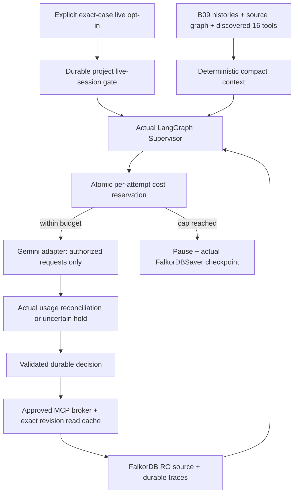

# flow.md — Repository map and runtime data/control flow (update after every microtask)

## Intended architecture (NOT yet implemented)
Complaint/API/CLI -> validation/intake service -> FalkorDB graph and durable domain event -> worker -> LangGraph supervisor -> MCP client (`tools/list`, `tools/call`) -> [official read-only FalkorDB MCP | Civicly domain MCP] -> read graph / sourced data -> hypotheses -> plan -> approval -> work order -> simulated department event -> outcome evidence -> memory graph -> investigator resumes.

Organizational documents -> validated ingestion -> FalkorDB GraphRAG document graph (`civicly_docs`, isolated SDK-controlled schema) -> source-backed retrieval tool -> stable `Document`/`Evidence` references in canonical `civicly_knowledge`.

API -> versioned DTOs, sanitized graph subgraphs, trace and SSE -> FUTURE Next.js Investigation Studio / FalkorDB Canvas / map / plan DAG / approvals.

## File ownership and import rules (proposed)
- `backend/app/api/`: HTTP endpoints, auth dependency and SSE. Must not issue raw Cypher.
- `backend/app/domain/`: Pydantic models, state transitions and enums. No network calls.
- `backend/app/services/`: domain state-changing services, authorization, idempotency, event emission.
- `backend/app/graph/`: parameterized Cypher templates, migrations, read/write repository implementation.
- `backend/app/agents/`: LangGraph states/steps, decision policy, prompts, model adapters.
- `backend/app/mcp/`: MCP client broker, official server filters, custom MCP server and tools.
- `backend/app/knowledge/`: GraphRAG document store ingestion and cited retrieval.
- `backend/app/simulation/`: seeded world and causal test events, never imported into agent context.
- `backend/app/events/`: outbox, claim/ack/retry, SSE trace publication.
- `backend/cli/`: scripts that invoke same services as FastAPI, no separate business logic.
- `backend/tests/`: unit + real integration + behavioral scenario tests.

## Change template per task
### Bxx — Actual paths and call flow
- Files added/changed:
- Imports / outward dependencies:
- Input contract -> validation -> graph/API/tool state -> output:
- Persisted state / events / cache:
- Security boundary and failure behavior:
- Verified by test_log entries:

### B00 — Actual audit file/data/control graph | 2026-10-17
- Changed only six tracking files: decision.md, flow.md, implementation_status.md, test_log.md, blockers.md, task_board.md. No application paths created.
- Read chain: AGENTS/README/start prompt -> requirements/system/microtasks/vendor map -> current backend/contracts/frontend contract/demo docs -> tracking files. Generators inspected without execution.
- Actual flow: Python 3.12/jsonschema -> supplied validators -> registry/machines/MCP/API/events/seeds/scenario structure/document hashes -> stdout/exit status -> test_log. Additional inline JSON property audit -> confirmed seed defect -> decision/blocker records. Environment/version checks -> local capability baseline.
- No database writes, persistent events, MCP sessions or agent runs. Only selected environment-variable presence printed; no secret values. Hidden evaluator structures inspected only for development audit; future runtime exclusion still required.
- Debug from test_log reproductions -> blockers -> DEC-004 -> earliest affected microtask. Intended architecture above remains unimplemented.

### B01 — Implemented foundation file graph | 2026-10-17
- Root: .git/ (main, no commits/remotes), .gitignore, .python-version, .env.example, ignored generated .env, compose.yaml, Makefile, updated README.md.
- backend/pyproject.toml + uv.lock -> isolated backend/.venv -> editable `app` and `cli` packages + console `civicly`.
- backend/app/config.py: Settings (Pydantic settings, FALKORDB_* environment fields, optional explicit env file, masked password, finite timeouts).
- backend/app/graph/connection.py imports Settings + official FalkorDB + redis retry policy; context opens client -> yields -> finally closes client and disconnects pool. No domain repositories, migrations or labels introduced into canonical graph.
- backend/app/services/health.py imports configuration/connection, defines typed foundation result; backend/cli/main.py imports Settings/check_health. CLI parser -> Settings validation -> service -> client -> PING/MODULE LIST/GRAPH.LIST -> existing graph only: GRAPH.RO_QUERY with parameterized scalar RETURN and LIMIT 1 -> typed JSON and exit 0/1/2. API/MCP can reuse service later; neither exists yet.
- Health never creates graph: absent canonical graph returns `uninitialized`, graph_read=null and only server/module foundation health. It never implies full-system readiness. Redis errors map to redacted GRAPH_UNAVAILABLE; config errors map to CONFIG_INVALID.
- scripts/configure_local.py reads .env.example -> exclusive create of ignored .env with random Browser keys and mode 0600, preserving existing file. `make setup` -> Python 3.12 venv -> pinned uv -> frozen sync. `make up` -> configure -> Compose wait.
- Compose -> pinned official single container (database + developer Browser) -> localhost ports 6379 and 3000. Healthcheck verifies PING, GRAPH.RO_QUERY command registration and Browser HTTP. Named civicly_falkordb_data -> /var/lib/falkordb/data (AOF + snapshots); civicly_browser_data -> /var/lib/falkordb/browser/.data (actual API-token store). Runtime source/evaluator files are not mounted into container.
- Tests: backend/tests/conftest.py gates disruptive persistence; unit/test_foundation.py tests invalid config/redaction/framework compatibility. integration/conftest.py only allows local DB, creates random civicly_b01_test_* graphs and cleans only those graphs. test_graph_smoke.py exercises real parameterized writes/reads, RO denial/no mutation, healthy/missing graph behavior and subprocess CLI. test_browser.py verifies live HTTP. test_persistence.py creates graph node + synthetic Browser volume marker, restarts then force-recreates only civicly service, asserts same/different container IDs respectively, and fresh read/settings/HTTP/marker after each. Volumes never deleted.
- A separate civicly_b01_runtime graph retains synthetic B01-PERSISTENCE node for human review; no canonical seed imported. Real Browser login and read of that node verified after recreation; screenshot in docs/evidence/B01-browser.jpg. Actual suite and CLI outputs in B01-tests.txt/B01-runtime.txt.
- Durability boundary: graceful lifecycle persistence verified; event atomicity/outbox, crash recovery, checkpoints, memory/GraphRAG and evaluator process isolation remain future work, with DEC-004 findings open.

#### B01 exact created/modified paths
Created source/config/docs/evidence files:
```text
.gitignore
.python-version
.env.example
Makefile
compose.yaml
scripts/configure_local.py
backend/README.md
backend/pyproject.toml
backend/uv.lock
backend/app/__init__.py
backend/app/config.py
backend/app/graph/__init__.py
backend/app/graph/connection.py
backend/app/services/__init__.py
backend/app/services/health.py
backend/cli/__init__.py
backend/cli/__main__.py
backend/cli/main.py
backend/tests/conftest.py
backend/tests/unit/test_foundation.py
backend/tests/integration/conftest.py
backend/tests/integration/test_browser.py
backend/tests/integration/test_graph_smoke.py
backend/tests/integration/test_persistence.py
docs/evidence/B01-tests.txt
docs/evidence/B01-runtime.txt
docs/evidence/B01-browser.jpg
```
Modified supplied files: README.md, decision.md, flow.md, task_board.md, implementation_status.md, test_log.md, blockers.md.
Generated local-only state: .git/, ignored .env, backend/.venv/, .uv-cache/, temporary clean environment /private/tmp/civicly-b01-locked-env and earlier temporary Compose spike /private/tmp/civicly-compose-spike.yaml. Named Docker volumes persist outside Git. No commit or remote created.

### B02 — Actual schema architecture and data/control flow | 2026-10-17
- Baseline: accepted B01 local commit 426f6e1322dca9e83e470ee471b25b8df7f9e028; B02 edits remain reviewable/uncommitted; no remote push. Exact paths and diff in docs/evidence/B02-files.txt and B02-git-diff.txt.
- Registry v3 contracts/schema_registry.json -> app/graph/schema.py Registry: strict property shape, enums/bounds, UTC times, point adapter, scope constants, declared parent labels and directed endpoint types. Public ontology names/enums retained. Storage-only CivicEntity supplies global domain-node identity; metadata label does not enter domain reasoning.
- Registry -> frozen app/graph/migrations/0001.json (registry hash, explicit index/constraint plan). app/graph/migration.py imports Registry/utc_now + official Redis lease primitives; official FalkorDB connection passed from services/schema.py. No business repository/API/agent integration.
- CLI migrate/schema-status -> Settings -> services.schema.schema_operation -> connect -> MigrationRunner -> version/hash preflight -> exclusive renewed 60s lease -> bootstrap metadata index/constraints -> APPLYING -> additive missing index creation -> actual index OPERATIONAL polling -> constraint creation/readiness -> READY -> fresh full-catalog status. Errors persist FAILED + redacted code/audit; no destructive graph/data cleanup. Every rerun introspects live catalogs and verifies hashes.
- Dynamic data (IDs/maps/scope/timestamps/checksums) uses parameter arguments. Only registry/immutable-plan identifier tokens form DDL. GRAPH.CONSTRAINT uses separate Redis command arguments because installed client has no convenience helper. Catalog procedures have fixed explicit columns and bounded return count; no arbitrary query input.
- node_statement/edge_statement compile schema-validated one-entity writes with inherited labels and source/target typed MATCH. They are testable schema adapters, not operational repositories or authorized tools. Strict validation rejects unknown fields rather than filtering. geo_point map becomes parameterized native point; other complex property values rejected.
- Persistence: canonical graph now has only migration bookkeeping (zero CivicEntity domain nodes); constraints/indexes survive B01 restart+replacement-container regression on retained volume. B01 civicly_b01_runtime graph is intact. No fixture import, checkpoint/GraphRAG changes or new DB containers/volumes.
- Metadata: version1, registry3, checksums, current state, attempts, UTC times and append-only state_history JSON string. Lease is separate Redis key, scoped by graph name and released after migration; no workflow outbox claims.
- Legacy compatibility: validators explicitly check supplied v1/v2 fixture structure, skip only newly introduced required fields in legacy presence checks, flag the exact known 55 unknown fields, and reject new unknowns. Runtime canonical adapter accepts no implicit scope/version conversion. B04 must convert source/edge metadata and repair Observation fields; files unchanged.
- Scope flows identically through registry, state/MCP/API/event metadata and current architecture docs. Client cannot choose municipality. No current framework needs tenant_id; any future mapping is explicit at boundary.
- Tests: unit/test_schema.py covers strict types/unknowns/enums/scope/time and retained defects; integration/test_schema_migrations.py performs real DDL/constraints, subtype/point writes, failure/recovery/version/lease/drift tests and B01-probe protection. Existing B01 tests all retained. Synthetic examples in tests/schema_examples.py are isolated test records, not city seeding.
- Debug: make schema-status -> backend/SCHEMA.md recovery guide -> actual db.indexes/db.constraints -> test_log/blockers. Domain graph-wide cardinality/cycles/evidence existence, retrieval templates and typed repositories are B03, not implemented here.

### B03 — Actual repository/query file graph and control flow | 2026-10-17

```text
connection.connect(Settings) -> official FalkorDB client
  GraphRepository -> MigrationRunner.status (real catalog READY)
                  -> Registry v3 + contracts/graph_access.json
                  -> NodeRecord / EdgeRecord / digest
  GraphQueries -> QueryRequest + ReadLimits -> eight static templates
               -> GraphRepository read/validation -> GraphResult / PathRecord
  tests.graph_fixtures -> repositories -> disposable civicly_b03_test_UUID
  tests.b03_evidence -> real queries + EXPLAIN -> B03-runtime.json
```

- Actual added source: backend/app/graph/models.py, repository.py, queries.py;
  contract graph_access.json; test fixtures/unit/integration/evidence reporter;
  backend/GRAPH_ACCESS.md. Migration runner whitelist now admits B03 test graphs;
  immutable registry/migration0001 unchanged. Makefile adds test-repositories.
- Write flow: strict shape/identity/origin validation -> per-graph Redis lease ->
  metadata owner/epoch fence -> recover prior intent only if pre-state unchanged ->
  actual endpoints/scope/FKs/evidence -> bounded cardinality/cycle proof -> pending
  ID/hash journal -> one fenced graph statement updates domain record, audit,
  repo_revision and pending clear -> strict typed retrieval. Mutable updates need
  expected content hash. Failures preserve state/evidence and return explicit errors.
- Read flow: typed named request -> root type validation -> pre-read revision/no
  pending -> parameterized GRAPH.RO_QUERY (finite hop/result/time limits) -> validated
  driver nodes/edges mapped from internal IDs to public stable IDs -> original edge
  direction/path order/evidence metadata, node/edge caps -> post-read revision/no
  pending -> retry once on revision change -> serialized GraphResult. Disconnected
  metadata projection is avoided after its installed-runtime upstream-path failure.
- All eight query families and temporal checks are described in GRAPH_ACCESS.md;
  candidate source-evidence pointers are also filtered by as_of. Explicit edges
  connect waste, drainage and roads; matching coordinates alone adds no connection.
  Graph paths support investigation but do not declare causation or recurrence.
- Persisted state: existing graph AOF/volumes; internal migration record receives
  repo_owner/epoch/revision/pending/audit scalars only in graphs actually mutated by
  repositories. Canonical graph has zero domain data and no B03 repository mutations.
  Test graphs are deleted individually. B01 runtime graph/probe and both named
  volumes remain. Restart/recreation is real; durable domain events are still B15.
- Future MCP/API/domain services consume typed methods, never raw Cypher inputs;
  auth, approvals, status transitions and trace envelopes remain their own gates.
  No agent/MCP/GraphRAG/API/frontend/importer was implemented. Tests use purpose-built
  synthetic fixtures, not hidden ground truth or full-city ingestion.

### B03-R — Actual corrective file/import/control flow | 2026-10-17
- targets.py provides exact canonical / milestone02–25 UUIDv4 name validation;
  MigrationRunner and GraphRepository import the same guard before selecting any
  graph. No registry/migration0001 change; no B01/document/checkpoint target admitted.
- graph_access.json v2 adds IN_ZONE/PART_OF outgoing singleton policies and route/
  service schedule applicability. Existing locked relationship policy invokes
  _schedule_policies on HAS_SCHEDULE writes; schedule service/date node updates
  inspect incoming edges and revalidate the affected routes before fenced commit.
  Effective interval = edge interval intersect schedule-node interval. Different
  services/date windows remain valid; opaque recurring text proves no compatibility.
- QueryRequest(default total6) -> policy per-template/root minimum/maximum -> typed
  QueryBudget -> fixed connectors subtracted from native bounded DRAINS_TO grammar
  -> total-path filter + existing scope/time/evidence/revision checks -> GraphResult
  search_budget/search_limited + independent output truncated. Fixed branches are
  selected by exact lengths (maintenance1/2/2/3, ownership1/1/2/1). Invalid budget
  yields explicit error; empty bounded search never asserts global absence.
- Actual changed runtime modules: targets.py (new), migration.py/repository.py,
  models.py/queries.py; normative graph-access policy + graph/runbook docs. New
  unit/integration correction modules exercise real isolated graph writes/queries.
  Existing B01/B02/B03 tests/evidence and review ZIP are retained unchanged.
- backend/B04_BENCHMARK_PLAN.md documents the future pilot/full/repeat benchmark,
  O(E_k²) repeated scans and O(N²) audit serialization costs. It performs no import
  and supplies no bulk path; current writer fence/intent/audit/strict policy remains.

## B04 implemented conversion/import flow | 2026-10-17

- `scripts/generate_demo_seed.py` -> distinct `data/generated/source_city_v2.json`
  (revision2.1); originals under contracts are immutable. It imports the registry for
  required legacy shape, does not connect to DB or read evaluator truth.
- `backend/app/ingestion/__main__.py` imports conversion, audit, settings, connection,
  MigrationRunner and GraphRepository. `audit.py` is offline-only and reads source/
  manifest/scenario inventory; `conversion.py` imports Registry, digest and temporal
  interval helpers. No scenario oracle is imported by converter or importer.
- prepare: allowlisted source envelope -> explicit field rules/quarantine -> node
  reference order -> relationship/temporal/cardinality/DAG preflight -> final strict
  Registry validation -> deterministic NodeRecord/EdgeRecord manifest. Actual source
  pointers/hashes and field deltas remain outside runtime graph in conversion reports.
 18 hash-verified Markdown references become Document nodes; no PDF/measurement added.
- `importer.py` imports validated bundle, repository errors and graph target guard.
  B04-only UUID target -> operational0001 -> explicit pending-intent reconciliation ->
  dependency-ordered create/get nodes -> create/get relationships -> equality/hash
  no-op or explicit changed-source conflict -> complete count/hash/revision audit.
  All mutations pass existing lock/fence/intent/atomic commit and policy validation.
  Whole-file import is not atomic: completed prefixes persist and resume safely.
- `benchmark.py` invokes the same importer/repository on one pilot and three fresh
  full targets, twice repeats each unchanged source, records wall/latencies/scans/
  parameter bytes/audit/AOF/memory. Instrumentation adds overhead; no bulk path exists.
  Only its successful scratch graphs are deleted; final and failed graphs retained.
- `tests/ingestion_examples.py` supplies synthetic test shapes. Unit conversion tests
  exercise all42/47 types and original55 numbers; real integration tests cover every
  type, interruption, uncertain replies, concurrent imports, exact hashes and paths.
  Both SPEC scripts invoke `scripts/validate_dataset.py` in addition to frozen-source
  structure checks. Their outputs remain distinct from live DB proof.
- `data/ingestion/`: runtime city-v3 bundle; external input/conversion/generator delta
  manifests; offline source audit, scenario-readiness and release references;
  legacy-conversion/legacy-v1 preserve rejected originals. Reports must not be mounted
  as agent inputs. `contracts/dataset_ingestion.json` fixes this boundary.
- Persistence: existing Compose named volumes unchanged. B01 probe and canonical
  knowledge graph preserved; B04 city is retained in its isolated graph, not promoted
  to canonical. Restart/recreation regression rechecks volume retention. Actual graph
  names/counts/hashes are recorded in evidence, not assumed from source counts.
- Current product reach: data support for R01–R05/R09/R14/R15; no end-to-end requirement
  is completed by ingestion. MCP, agents, GraphRAG, operations, API and frontend remain
  later tasks. B05 is proposed only after human B04 review.

## B05 implemented file/control flow | 2026-10-17

```text
analysis.models -> existing graph GraphModel/NodeRecord/EdgeRecord/PathRecord
analysis.engine -> reader -> official Graph.ro_query + strict repository decoder
                -> cases (actual factor/history paths + lexicographic ranking)
analysis.counterfactual -> bounded complete Snapshot + ingestion.check_graph
                        -> migration0001 -> capability-owned CloneWriter
                        -> existing lock/fence/intent/commit/audit
                        -> GraphAnalysis before/after + source/change fingerprints
analysis.evaluation -> accepted B04 bundle/readiness (no oracle/reveal/catalog)
                    -> actual retained city read-only analysis + dependency report
analysis.__main__ -> controlled test-only source/evidence or actual city evaluation
 tests.b05_benchmark ->10 real read-only runs/workload + unchanged fingerprints
```

- Eight analysis modules provide strict request/result models, fixed bounded path
  queries, deterministic coverage/weak components/Kahn/case ranking, owned clone
  ablation and offline review CLI/evaluation. New contract graph_algorithms.json
  adds response/budget semantics; no existing stored schema or0001 change.
- Reader checks READY/pending/revision before/after, validates graph labels/fields/
  endpoint directions/evidence, applies UTC knowledge/half-open validity/status,
  caches evidence within each request, meters shared64-query/10000-step/5s deadline
  and existing6-hop/100-path/120-node/200-edge/1000ms caps. Proof IDs derive from ordered
  real application node/edge IDs; evidence/source properties and direction survive.
- Source write flow: NONE for algorithms/evaluation/benchmark. No recover_pending
  fence changes on source. Administrative B04 full-manifest verification is separate
  from bounded algorithm exports; it uses accepted <=5000-record source contract.
- Counterfactual factory mints only new B05 UUID target; validates/copies complete
  <=120node/200edge snapshot via normal repository. Every inherited writer session
  checks capability/target. DELETE only verified DRAINS_TO with CAS and existing
  intent+atomic revision/audit commit. Candidate additions use normal proof policies.
  Ledger/fingerprint checks reject unrecorded changes; unknown outcomes retain named
  clone and require explicit recovery/review. Only owned scratch cleanup; no source/
  B01/canonical/volume reset. Public fingerprints hash writer metadata.
- Real city data remains858nodes/1246edges and revision/audit2104.42 drainage claims
  stay CANDIDATE. B05 runtime output/evidence contains sanitized source facts, separate
  verified/exploratory results and B08/B09/B11/B19 data dependencies; no hidden truth,
  expected actions or delayed payload imports. Staged release remains B19.
- Frontend/MCP consumers can later map typed nodes/edges/ProofPath IDs, statuses,
  sources, dates, graph revision, gaps and measured budgets. No API/server/agent
  runtime integration is implemented here; DEC-004 envelopes/traces remain pending.

## B06 implemented runtime/control flow | 2026-10-17

```text
backend/mcp_runtime/package.json + package-lock.json -> npm ci -> official Node1.3.0
app.mcp.runtime -> trusted configure -> named read-only DB ACL + ignored0600 credentials
                -> empty temporary cwd + explicit child env + pinned Node entrypoint
app.mcp.broker.open_broker -> Python MCP2.3.0 Client/private stdio child
 -> initialize/protocol2025-11-25 -> tools/list -> exact7 names + schema hashes
 -> ReadBroker.tools() safe template request schemas / ReadBroker.call(dict)
 -> policy.Request strict/deny graph/tool/unknown fields -> serialized call budget
 -> internal fixed READY/revision/pending read via official tools/call
 -> four approved tools + fixed parameterized node/drainage query or capped schema
 -> GRAPH.RO_QUERY under graph-key ACL -> bounded text JSON -> typed models/registry
 -> post revision read unchanged -> ReadResult(raw facts, limits/candidate status)
 -> sanitized actual trace metadata -> operator proof JSON (not graph-backed traces yet)
context exit -> close SDK streams/stdin -> bounded child process-tree termination
```

New modules:runtime.py trusted setup/lifecycle config; policy.py strict request and
3 fixed Cypher templates (including internal revision); models.py result projections;
broker.py discovery/schema verification/authorization/traces/budgets/result validation;
__main__.py configure/proof CLI; __init__.py namespace. contract official_mcp.json pins
observed inventory, hashes, scope and limits. Makefile commands and backend/MCP.md
explain reproduction. No existing graph algorithm/repository/schema/migration edit.

Credential material flows only local0600 file -> explicit subprocess environment ->
authenticated graph-scoped DB account, never public call/result/trace. No TCP MCP
listener, resources/prompts/raw client interface for agent selection. Node initialization
needs INFO; GRAPH.QUERY/DELETE/LIST/admin and other graph keys denied by DB. Schema
storage labels stripped; canonical unknown fields rejected. No hidden evaluator files
read at runtime. Upstream arbitrary-query/delete tools remain discovered for operator
evidence but absent/rejected at broker. DB default developer account remains privileged.

ReadResult is a B06 official-fact result, not a replacement for18 B07 custom contracts,
B05 decision-grade algorithms or later frontend DTO. Node current state; edge half-open
validity/as_of with explicit raw candidate statuses. Actual revision read, never vendor
Graph version. Errors/timeouts invalidate session as documented; fresh owned context
reconnects, no automatic replay. Trace list/operator JSON is current evidence storage;
B07/B17 graph-backed envelope/persistence remains open. No agent rationale fabricated.
Existing graph/Browser volumes and original B01/B04/B05 evidence retained; ACL account
must be reprovisioned after DB recreation, generated local credential reused.

B06 temporal query compilation imports the accepted B03 GraphQueries._time_key;
all supplied/recorded UTC values compare at the same microsecond precision. Actual
boundary tests read retained edge dates without modifying them. Integration fault
injection corrupts an actual returned record only in the test process, validating
fail-closed unknown-property handling and subsequent fresh-session recovery.

Final B06 post-lifecycle proof executes configure -> actual MCP initialize/list/call
-> independent official Python read -> clean session shutdown. Separate administrative
read helper verifies all retained fingerprints and migration readiness. Source audit
compares86 original protected file hashes/direct pins, scans actual private values
without emitting them and checks child-process absence. Source diff excludes generated
evidence bodies (exact evidence paths inventoried separately); no B06 review ZIP.

## B07 implemented file/import/control flow | 2026-10-17

```text
scripts.rotate_b07_mcp -> admin ACL password replacement/CLIENT KILL
                       -> atomic private file -> old AUTH denial/new RO verification
mcp.civicly.contracts/models -> normative12 READ + shared context/envelope/trace schemas
mcp.civicly.runtime.configure -> admin0001 on separate new B07 trace graph
 -> storage.TraceMigration0002 -> OPERATIONAL additive indexes/constraints/own ledger
 -> dedicated trace graph+lock-key ACL/private config (source city credential unchanged)
mcp.civicly.server -> SDK2.3 lowlevel Server -> real stdio initialize/list/call
 -> strict wire args/_context -> service.CivicReadService -> ScopedClient/read-only city
 -> existing B05 GraphAnalysis reachability/cases + B03 GraphQueries maintenance
 -> fixed bounded registered pickup/road/direct-decision reads or explicit UNAVAILABLE
 -> shared validated result -> TraceStore atomic fenced ToolExecution+detail append
mcp.civicly.broker -> actual discovery/identity/input+output schema compatibility
 -> agent-safe civicly:: args -> server call -> strict result graph/proof validation
 -> persisted server output-hash verification -> separate parented BROKER observation
mcp.civicly.router -> civicly:: domain broker | official:: unchanged B06 read broker
 -> shared persisted trace metadata for both; vendor/domain result shapes distinct
```

Runtime/new files:contracts.py,models.py,storage.py,runtime.py,service.py,server.py,
broker.py,router.py,__main__.py,__init__.py. Additional storage migration0002 and shared
mcp_envelopes plus synchronized mcp_tools/API AgentTraceEvent schemas; no registryv3/
0001/source-dataset change. __main__ configure/proof is operator CLI only. New unit
and real integration tests cover strict boundaries/data gaps/trace/migration failures.

Source reads use rotated one-city readonly account; ScopedClient substitutes restricted
GRAPH.LIST with actual fixed READY lookup, never invented catalog success. Normal
repository catalog/registry checks still execute via RO_QUERY. Trace writer is separate
and cannot access city. Trace writes use existing session/fence/intent/CAS/audit and
atomic core/detail creation, with zero Redis automatic retries. Persisted data is
metadata/hashes/references, not raw arguments/output bodies. No cross-graph atomicity
claim; no source mutation. Server append precedes reply, broker append follows actual
validated receipt. Distinct execution IDs/parent preserve failed/corrupted observations.

Transport is private Python stdio; no model credentials/raw clients exposed by tool
schemas. Session budgets, serialization/timeout/restart behavior explicit. Model
rationale remains null. Procedure/memory/document/monitor capability gaps remain
UNAVAILABLE; external55 measurements have no legitimate location link. All42 drainage
links stay CANDIDATE. Shared node/edge/path IDs and evidence dates retain future API/UI
compatibility without implementing either. Trace records persist in existing DB volume,
separate trace graph referenced only by private configuration. No B08+ work.

Typed dependency mode is an optional read-RPC field, not a stored ontology change.
DRAINAGE(default) -> B05 directed reachability/BOTH bounded merge;
TYPED_DEPENDENCIES -> existing B05 forward dependencies (DRAINS_TO/UNDERLIES/COLLECTED_BY).
Unsupported reverse typed traversal is rejected by input schema. Legacy asset_ids
lists actual infrastructure assets only; full typed route/asset paths retain all IDs.
B07 proof includes actual waste→route and utility→road paths, candidate qualified.

Final verification flow:full426 tests -> actual DB restart/recreation -> trusted ACL
reprovision (same replacement credentials) -> read-only verify_b07 helper checks all
retained source hashes/B01/B05/canonical readiness and13 preexisting trace IDs -> fresh
actual custom initialize/tools-list/calls -> verified-vs-candidate and typed dependency
proof ->15 persisted server observations read back -> native0002 status93indexes/
186constraints total (2/4 additive) -> final source/secret/process audit. No source
mutation or B07 archive. Actual normalized SDK discovery included in operator proof.

## B07-R corrected history projection and query flow | 2026-10-17

- service.py imports the existing GraphQueries._time_key; schema.timestamp supplies
  normalized UTC parameters. history_query selects one of two fixed label/relation/date
  triples. RO_QUERY MATCH + optional typed Evidence -> visibility + requested date
  WHERE -> normalized chronological ORDER BY/time+eventID+edgeID -> LIMIT101 -> strict
  repository decode ->100 rows -> atomic record/Evidence export within existing caps.
- maintenance_history still calls B03 GraphQueries; maintenance_evidence intersects
  each event's path prefix with validated edges/Evidence, extending Inspection through
  PRODUCED only. Aggregate project evidence stays at envelope level.
- result() records operational field gaps before WorkOrder lookup. server.py appends
  absence/failure gaps without replacing capability gaps. Normal SDK/broker validation,
  durable SERVER observation, hash read-back and child BROKER observation unchanged.
- New tests/unit/test_civicly_mcp_history_projection.py exercises pure projection with structural
  fakes. integration/test_civicly_mcp_review.py creates canonical-validated disposable
  fixtures -> tests.b07r_server build() real SDK stdio -> unchanged DomainBroker +
  actual TraceStore. Source substitution is explicitly test-only; production CITY_GRAPH
  and readonly ACL unchanged. No dataset/policy/migration/algorithm edits.
- docs/evidence/B07R-* preserves before/after output/commands/patch; audit_b07r.py checks
  accepted working-tree hashes and actual private values without printing secrets.
  Full existing lifecycle/official/domain tests and fresh retained-source checks follow.

B07-R final verification flow:440-test full regression -> actual restart/recreation
(including B01/Browser volume) -> existing ACL reprovision -> production CITY_GRAPH
SDK initialize/list/all12 calls/15 trace readbacks -> verify_b07.py all retained
source/metadata fingerprints +13 earlier traces -> verify_b07r_traces.py actual log
ordering and fresh readback of15 final B07 +4 before +11 corrected observations ->
audit_b07r.py333 preserved old files, unchanged wire contracts, actual local-secret/
process checks -> B07-R-only inventory/patch. No source/volume reset or new migration.

## B08 actual file/import and data/control flow | 2026-10-17

```text
services.complaints.models -> strict Pydantic union/normalization/units/original/hash
services.complaints.reader -> existing GraphRepository.RO +B03 GraphQueries histories
                          -> B05 GraphAnalysis verified forward/upstream topology
services.complaints.service -> normalize +references +stable external ID
 -> repo.create_node(Evidence PREPARED journal) [separate fenced commit]
 -> repo._session -> actual bounded context +three validators +event/cluster plan
 -> complaints.writer -> exact registry +identity/endpoints/evidence/cardinality
 -> repo._commit -> one atomic approved domain batch +COMMITTED receipt +revision/audit
 -> strict actual relationship/evidence readback -> typed historical receipt
retry -> same journal hash -> PREPARED resumes current plan | COMMITTED verified replay
regroup -> trusted Review+CAS -> close old PART_OF/add replacement+review receipt atomically
preview -> bounded RO plan +preview flag/proposed IDs; no source write
```

New package has models.py,reader.py,writer.py,service.py,__init__.py; no broad scaffold.
New complaint_intake contract mirrors models/rules; no registry/0001/0002 changes.
No MCP module changes: actual fixture server tests.b08_server calls same SDK build()
with test-only source substitution; production scope/broker/TraceStore remain unchanged.
New b08_fixtures and tests exercise real DB failure/concurrency/typed history;
tests.b08_evidence creates retained synthetic graph and verifies exact fingerprint/
receipt replay after real container lifecycle. Source City/B01/B05/traces independently
verified. audit_b08.py checks all accepted files/pins/tests against baseline and
local-secret/process exclusions; exact source patch/file inventory under docs/evidence.
No domain-event worker/outbox, public API, agent, hypothesis lifecycle or frontend.

B08 final verification:507-test complete regression -> real restart/recreation +Browser
volume -> fresh retained B08 fingerprint against pre-retry owner/epoch anchor ->5
receipt replays no domain changes -> re-provision same MCP ACL credentials -> actual
production-city initialize/list/all12 reads/15 server trace readbacks -> verify_b08.py
all2104 city records/B01/B05/native schemas +43 accepted trace hashes -> preserve fresh
B07-R regression proof/restore accepted artifact -> audit_b08.py358 original files and
private-value/process check -> exact B08 source patch/file inventory. No later feature.

## B09 actual file/import and data/control flow | 2026-10-17

```text
services.evidence.models -> strict command union/Actor/Review/Report/Assessment/Receipt
services.evidence.policies -> versioned3-issue verification criteria/typed primary assets
services.evidence.reader -> GraphRepository.GRAPH.RO_QUERY +B03 microsecond time keys
                        -> B05 GraphAnalysis topology/historical cases (unchanged)
services.evidence.service -> typed command/role/target -> PREPARED Evidence journal
 -> repo._session fence/recovery -> current CAS +normative state transitions
 -> bounded actual references +report/original-command/finding provenance checks
 -> requested/prior/discovered evidence union -> as_of filter -> deterministic label
 -> evidence.writer -> registry/endpoints/B03 policies/global+batch IDs -> repo._commit
 -> one atomic nodes/edges/entity update +COMMITTED receipt +revision/audit/clear intent
 -> actual receipt/assessment/path readback -> typed historical acknowledgment
history -> validated proposal source -> append-only snapshots ordered time/revision/ID
inspection -> typed pending/unavailable/conducted/findings view +pre/post revision check
```

New package: __init__.py,models.py,policies.py,reader.py,writer.py,service.py.
New evidence_hypotheses contract mirrors runtime models/policies; EVIDENCE.md documents
limits, trust and active-graph gate. No schema/migration/dependency changes.
Tests.b09_fixtures creates actual B08 intake then explicitly copies stable records
into owned B09 graphs and verifies source hashes; no source guard bypass.
Tests.b09_server only substitutes disposable source in real SDK/broker/TraceStore,
production unchanged. b09_evidence retains a small source/working graph and immutable
verification→contradiction history for real restart/recreation read-only fingerprint
comparison. verify_b09.py checks city/B01/B05/native schemas plus accepted B07/B08
traces/intake; audit_b09.py protects accepted source/tests/data/pins and checks secrets.
No B10 agent/checkpoint, B11 GraphRAG, dispatch/monitor/worker/API/frontend.

B09 final verification flow:582 regression -> actual FalkorDB restart/recreation and
Browser volume/HTTP200 -> same-credential ACL provisioning -> fresh official MCP
5 reads/5 denials +independent equality; production domain list12/call12/15 readbacks
-> read-only retained B09/source exact fingerprints/history -> original B08 fingerprint
+five historical replays -> verify_b09.py with latest B08 owner/epoch anchor -> city/
B01/B05/native schemas +70 accepted trace observations -> restore accepted generated
B07R/B08 proof bytes/save fresh B09 copies -> frozen source/secret/process audit ->
file inventory/source patch and both SPEC validators. Canonical domain nodes remain0.
No B10 or later phase; full results and failures remain reviewable in docs/evidence.

## B09-R actual file and data flow | 2026-10-18

`EvidenceService.execute` still uses the same strict commands, actor authorization,
PREPARED journal, fenced session, revision/CAS and atomic writer/COMMITTED receipt.
`service.py` imports `classification.classify_evidence` and `policies.classify_reviewed`;
classification imports typed evidence uses and `relevance.attribute/independent`.
`relevance.py` follows INSPECTS -> immutable request journal -> Investigation ->
actual INVESTIGATES bindings + immutable open journal; never infers an occurrence
from the asset alone or reads a cluster's future mutable pattern to select identity.
Actual EXPLAINS/CONCERNS/AFFECTS must agree with the proposal and affected asset or
declared topology destination. Current incident visibility remains strict.

For each visible report observation: validate own provenance/inspection/finding hash,
asset subtype, request binding and per-incident interval; classify authority + meaning.
Optional version2 report attribution names earlier incidents and reviewed direct
evidence basis; earlier evidence references/hashes remain in the snapshot. Independent
corroboration requires disjoint source lineage per explained occurrence.
`Reader.topology` continues to use B05 verified-only bounded graph algorithms.
Only reviewed discriminating lists become SUPPORTED_BY/CONTRADICTED_BY; all other
uses remain explicit immutable assessment metadata. Hypothesis state and append-only
HAS_ASSESSMENT chain are written through unchanged writer.py. `models.py` reads v1
without emitting absent new fields and validates v2 category summaries/edge lists.

New tests: `unit/test_evidence_review_models.py`, `integration/test_evidence_review.py`,
`tests/b09r_fixtures.py` (explicit owned B08 source copies, actual intake, dated authored
repair/closure/recurrence). Existing B09/MCP/B05 tests are unchanged. No migrations,
new graph labels/relationships, dependency changes or runtime graph target changes.
Persistence remains B01 AOF retained volumes; no graph merge, volume removal or
historical assessment rewrite. See B09R-ACTIVE-GRAPH.md for the uncompleted shared
application graph gate before a live B10 investigator.


## B10 implemented runtime flow (partial acceptance; 2026-10-18)

```text
app.active [private profile, exact graph context, ACL provisioning]
  -> B08 ComplaintService -> B03 GraphRepository -> same B10 source graph
  -> B09 EvidenceService -> immutable hypothesis/assessment/inspection history
app.agents.__main__ / test drivers
  -> agents.mcp.brokers
       -> B06 official Node MCP initialize/list/call -> GRAPH.RO_QUERY exact source
       -> agents.server -> B07 CivicReadService -> B03/B05 same source
       -> B07 TraceStore -> existing separate B07 trace graph (0002)
  -> provider.Gemini + prompts/B10-1.txt -> strict models.Selection
  -> runtime.InvestigationAgent -> actual LangGraph StateGraph
       Supervisor -> Investigator -> Supervisor
       Supervisor -> RootCauseAnalyst -> existing B09 service -> Supervisor
       Supervisor -> ResolutionPlanner -> Coordinator -> AwaitDependency(interrupt)
       Supervisor -> Coordinator(request inspection/pause) -> AwaitDependency
       explicit resume -> source/reference/revision refresh -> Supervisor
  -> control.Control -> AgentDecision / B10_OPERATION Evidence / Investigation.thread_id
       B03 parameterization + CAS + fence + immutable decision + durable receipt journal
  -> checkpoints.saver -> public FalkorDBSaver -> separate SDK-owned checkpoint graph
  -> checkpoints.ownership -> host thread lock/heartbeat/quarantine
```

Imports: `active` reuses graph target validators and resolves the repository root locally; B08/B09 import only `is_shared_target`. B06 broker/policy use trusted graph injection. B07 Context/TraceRecord contracts permit compatible B10 source references and actual optional summaries. New agents models/provider/control/checkpoints/runtime compose existing B03/B05/B06/B07/B09 interfaces; no reverse dependency from graph algorithms into agents. The production domain server binds the profile exactly; credentials never enter model state/catalog/checkpoint/traces.

Startup: private profile -> schema readiness -> source/read ACL + separate SDK ACL -> two real MCP sessions and discovery/schema validation -> inventory hash -> strict typed state -> stable investigation/thread binding -> model selection -> policy and trusted-cutoff validation -> actual tool call -> inherited B05 returned-fact temporal validation or typed B09 action -> durable decision/journal/trace -> synchronous checkpoint -> interrupt. Actual provider summaries and execution IDs are preserved. Planning remains a nonbinding proposal; no operations.

Resume: recreate actual graph/Saver in a new process, take exclusive host lease, validate version/source/catalog/thread and graph relationship binding, resume helper with no prior side effects, compare source revision and evidence hashes, require fresh MCP read after change. Committed result journals replay; unknown PREPARED reads pause for reconciliation. Exceptions quarantine the exact thread. SDK internals remain vendor-owned; public checkpoint-history/update APIs are the recovery interface.

Actual persistence witnesses are B10-before-lifecycle.json and the final post-lifecycle comparison, separate from existing B01/B04/B05/B08/B09 retained checks. No old graph/volume deletion. Complete file inventory, commands, runtime proofs and limits are under docs/evidence/B10-* and backend/AGENTS_RUNTIME.md. Controlled shared-graph proof does not establish final canonical-city deployment, B11 memory or a completed product capability.


## B10 final verification record (2026-10-18)
- Full regression: **655 PASS / 0 FAIL / 0 SKIP**, 824.63s, including all accepted 617 cases, actual official/domain MCP and container restart/recreation.
- Final B10 source: **42 PASS / 0 FAIL / 0 SKIP**, 126.05s: 23 unit (including mocked HTTP/broker errors, not live) and 19 actual FalkorDB/MCP/Saver integration cases (18 explicitly deterministic fake-model cases; one direct shared-graph boundary probe). Four new cases added after the full suite collected; unique cases covered across both runs: 659, not one 659-test invocation.
- Both specification validators PASS; separate static evidence. Exact commands/raw logs in B10-COMMANDS.md and B10-regression-tests.txt/B10-final-runtime-tests.txt.
- B10 pre/post-recreation source fingerprint: revision103, 80 nodes/47 relationships, immutable content/audit and writer state exactly matched. Six public SDK checkpoint threads and 12 referenced actual executions retained; B07 storage remains separate. Browser HTTP/volume and B01 retained probe PASS.
- Accepted B01/B04/B05/B08/B09 source checks PASS; 101 earlier B07/B08/B09 trace observations verified. Original B09-R v1 node/journal hashes and exact two-version history preserved. Native receipt replay changed only writer lease metadata, explicitly distinguished from immutable content/audit. Four rolling proofs restored after their fresh output was saved under B10-regression-*.
- Registry3, 0001 and 0002 remain byte-identical; source/security audit and exact changed inventory/patch are in docs/evidence/B10-*. No ZIP or push.
- Live acceptance remains PARTIAL: actual provider 503/429, incomplete full three-issue competing-cause/contradiction/perturbation proof, B10-2 live correction unverified. Deterministic controls do not close those gates.
- Stop for review. Exact next task remains B10 acceptance/recovery; B11 cited GraphRAG/multi-layer memory is proposed only after separate approval.


## B10-O implemented flow (2026-10-18)

- `app/agents/__main__.py` parses per-investigation/thread `--live` and explicit cost cap; `policy.py` denies absent authorization and ordinary-test live attempts. `tests/live/` delegates only to this explicit CLI. Legacy paid batch drivers fail closed; prior evidence is retained.
- `runtime.py` loads unchanged actual B09 histories and exact discovered MCP catalog, then imports `context.build`. The projection interns repeated node/edge/path/report bodies by full-content hash and exact schemas into `facts`/`tool_schemas`. Latest authoritative assessments and all material historical classifications/contradictions/provenance/paths/limits remain. Current IDs, cutoff/revision, recent results and remaining budgets are explicit. Original histories and evidence remain in FalkorDB.
- `provider.py` imports `policy`, `spending.Ledger/Pricing`, strict `models.Selection` and prompt B10-3. A live session spans the whole LangGraph wake. Before each HTTP attempt it atomically reserves conservative integer cost in a shared private SQLite transaction, then reconciles actual input/output/thinking/cached token metadata or holds unknown billing. Configured limits, requests and warnings persist independently of database container recreation. SQLite contains accounting only, not municipal knowledge. No extra package dependency.
- `mcp.Tools` caches validated discovery; exact read-cache keys include source graph/revision, tool/inventory/schema, arguments, time cutoff and permission/invocation context. Hits return the original execution reference and bounded result, never manufacture traces. Revision change, including host audit writes, invalidates. All16 approved safe tools stay available and bounded GRAPH.RO_QUERY/exact-key ACL remain unchanged.
- `runtime` records sanitized provider failures/usage in durable checkpoint state; normal cap rejection selects PAUSE before HTTP, preserving evidence and Saver state. A resumed explicit higher case limit keeps prior spend. Uncertain process failures retain reservations/session ownership until operator reconciliation. No automatic takeover or cost reset.
- `backend/test_guards/sitecustomize.py` imports `civicly_no_live.install`; root pytest conftest installs HTTPX/DNS interception and inherits it into Python children, including real MCP servers. Suite-wide counters separately record intentional negative probes. Actual localhost DB/MCP/SDK calls continue; Gemini is blocked. Fake models and HTTP responses remain explicitly labeled. No live quality claim follows from these tests.



Preserved: `active.py`, checkpoints/public Saver APIs, all graph/repository/analysis/B09 source and migrations, three issue categories, candidate/verified separation and all18 objectives. New exact file inventory/source patch and measured byte/cost evidence are B10O-*; no B11 code or canonical dataset change.


## B10-O final observed verification — 2026-10-18

- Final **691 PASS/0 FAIL/0 SKIP**,951.17s:432 unit/259 actual integration. All659 previous unique cases retained (including accepted617 B01–B09-R),32 new cases. First full687 PASS,940.94s; overlapping runs are not added. Both specification validators PASS; uv lock --check --offline PASS,74 unchanged packages. Python3.12.1,SQLite3.43.1; no new external dependency.
- Entire ordinary-suite interlock:0 external Gemini requests,2 intentional HTTP parent/child probes blocked before network,0 ordinary unexpected attempts. Real model/live acceptance **NOT RUN** (not authorized). Mock provider errors and deterministic/reactive model routing are distinct from actual graph/MCP/Saver calls.
- Real actual-schema/context benchmark:8 persisted B09 assessment versions,4 source read observations and all16 discovered tools per issue.

| Issue | Before JSON bytes | After JSON bytes | Reduction |
|---|---:|---:|---:|
| WATERLOGGING | 62913 | 56921 | 9.52% |
| ROAD_DAMAGE | 63308 | 57121 | 9.77% |
| WASTE_ACCUMULATION | 63762 | 57512 | 9.80% |

Small actual two-assessment cases changed by+28/+10/-2 bytes; no universal reduction claim. Authored large duplicate-schema/source fixtures reduce74.8%, separately labeled and not treated as production savings. Simulated allocations use versioned pricing/context bytes only, not tokenizer/billed usage. Native paid caching remains disabled.

- Exact source/audit fingerprints, all6 retained B10 SDK threads/12 executions, original B01/B04/B05/B08/B09 sources and immutable B09R v1/v2 history preserved.101 prior trace observations verified (43+27+31). Registry3/migrations0001/0002 unchanged. Actual container restart/recreation and Browser persistence PASS. Simulated financial ledger matches exact before/after state, including unknown reservation; no reset or retained-volume deletion.
- Preserved genuine failed attempt: after first recreation dynamic shared MCP trace-writer ACL was unavailable.24 authentication failures/1 Browser pass, interrupted72.93s; unexecuted remainder is NOT RUN for that attempt. Existing trusted configure/exact-key provisioning restored authorization without changing domain records. All6 retained threads/source matched before lifecycle; final full691 run then passed. Runtime guide now states configure before pytest. Raw failure/counters retained in B10O-auth-failed-*; no test weakened or removed.
- Four rolling proofs saved as B10O-regression-* before exact pre-task copies were restored. Previous B10 evidence remains byte-identical. B10O-FILES.md/source-audit.json and incremental B10O-changes.patch identify exact changes against frozen B10O-baseline.json, not a misleading HEAD-only diff.
- **STOP for human review.** B10-O verified; B10 remains PARTIAL pending separately authorized genuine three-issue/contradiction/topology/B10-3 acceptance. B11 cited GraphRAG/memory is proposed only after the B10 gate and explicit authorization, not implemented. All18 objectives remain binding.

## B10-O-R actual token, accounting and recovery flow

B10-O-R only, after accepted baseline c16346a; registry/migrations, source graph,
B03/B05/B09 policies, B10-3 prompt, all16 MCP tools and context projection unchanged.

- `agents.provider` imports `tokens.plan/total_usage`, `policy.Permit`, `spending.Ledger/Pricing` and strict `models.Selection`. `tokens` verifies the ignored offline Gemma3 asset SHA and uses locked SentencePiece0.2.1. Only `scripts/configure_tokenizer.py` downloads the pinned public asset; runtime does not fetch anything.
- Complete generation body → serialized UTF8 byte measurement (separate financial estimate) + local proxy count → explicit uncertainty margin/input+4096 output plan. LIVE additionally goes through exact-case authorization → reserved countTokens RPC → verified input count plus framing allowance. Counting is not a generation usage receipt and its financial reservation remains held. Ordinary tests intercept all external Gemini calls and use explicit MockTransport.
- `Ledger.reserve` atomically checks exact session/case/project/hold limits and durable per-thread cumulative token exposure, inserts separate dollar request and token reservation, and appends immutable accounting audit. No byte/token arithmetic remains in token guards. Retry and repair each get an independent allowance; repair includes changed instructions/schema.
- Provider usage → independently validated token total and integer-priced input/output/thought/cache usage → reconcile known fields, retain unknown reservations. Host state `tokens` records cumulative accounted exposure; request metadata separately records actual returned usage and simulated/proxy/verified origin. Reopening the ledger cannot erase exposure; legacy checkpoint consumption is a durable floor.
- `runtime.run` validates operator budget input before acquiring ownership (bad input does not quarantine). A paused same-thread resume accepts only explicitly authorized monotonic Budget changes, records previous/current/reason, retains counters and native journal identities, then revalidates graph/evidence and requires fresh MCP reads on source changes. Recursion150 accommodates bounded32-selection wakes; default limits unchanged.
- `spending_cli` supports summary, explicit audited configure, exact hold inspection and bound single-request reconciliation. Settled-over-reservation recovery reprices stored usage under the exact tariff, binds usage hash/evidence/operator/reason, checks available caps and immutable audit, and resolves only that hold. Unknown billing/unattributed legacy holds cannot be cleared. Original request/charge/legacy hold records remain.
- SQLite config adds compatible complex_cap; accounting_events/request_holds/legacy_hold_links/token_usage/token_floors are auxiliary private accounting, not graph schema. Original retained B10-O probe is inspected read-only; configuration migration is demonstrated on a private SQLite backup. New accounting witness includes one unknown token/$ reservation and one resolved settled overage for process/container lifecycle comparison. FalkorDB remains the source, evidence, MCP trace and checkpoint store.

New test helpers `tests.b10or_http`, `b10or_worker`, `b10or_context` feed explicitly
simulated graph-reactive HTTP selections into the actual Gemini adapter and
MCP/B09/StateGraph/Saver path. Two fresh Python processes reopen the same ledger
and checkpoint. Three real complex contexts preserve eight assessment versions,
two competing hypotheses, all16 schemas, source/provenance/negative/temporal
material, pickup history and road topology/episode identities. Simulated counts
are never presented as genuine Gemini usage. No B11 or live acceptance closure.


## B10-O-R final observed verification | 2026-10-18

- Local reviewed baseline c16346a; no push. Final **740 PASS/0 FAIL/0 SKIP** in1249.98s:466 unit/274 actual FalkorDB/MCP integration; all691 original cases unchanged plus34 unit/15 integration. Actual Gemini outputs/counts/costs **NOT RUN**; HTTP responses and returned usage are simulated. Both specification validators PASS; frozen offline lock75 packages, only SentencePiece0.2.1 added.
- Whole-suite external-request interlock:0 Gemini requests,2 intentional parent/child probes blocked,0 ordinary unexpected attempts. All new tests and original real official/domain MCP, B09 authority/episode rules, LangGraph/Saver and actual Docker restart/recreation/Browser checks passed. Targeted overlapping batches58/76/10/29 passed; do not sum overlapping totals. Initial unit1-failure and authored integration-fixture failures are preserved in B10OR-COMMANDS.md/raw logs.
- Bytes/token minimal reproduction: old byte+output guard127331 vs corrected proxy allowance30394 tokens under60000. Three real complex contexts preserve8 assessment versions/4 observations/2 alternatives/all16 schemas: complete request bytes66234/73621/81990; proxy input+output allowances37476/41089/46721. Exact/-1/+1 cases reject/pass/pass. These estimates and mock130-token receipts are not genuine Gemini usage or billed savings. Model mapping/framing uncertainty is explicit; LIVE requires separately authorized/accounted counting.
- New-ledger8/.50/concurrency1/explicit complex ceiling1.50; existing6/.15 history and reservations unchanged. Explicit audited upgrade demonstrated on a private SQLite backup, not the original. Exact-request hold recovery binds known usage/tariff/hash/evidence/operator/reason and caps, retains immutable audit, and cannot clear unknown billing. Reopen/fresh-process/lifecycle witness retains5120 token exposure. Same-thread authorized Budget increases preserve counters/source refresh; operational defaults unchanged. Only checkpoint counter storage widens to2M to retain an unexpected1100000-token simulated overrun exactly and pause.
- Retained B10 source revision103/80nodes/47edges/content/audit/writer state and all6 public SDK threads/12 executions match accepted evidence. B01 probe, B04 city858/1246 revision2104, B05/B08/B09 sources and B09R original v1/v2 history preserved;101 accepted trace observations checked43+27+31. Registryv3/0001/0002 and all prior evidence unchanged. Four fresh rolling proofs saved as B10OR-regression-* before restoring accepted bytes. No graph/volume deletion to pass tests.
- Supplemental legacy verifier rejected only pytest's ',2 warnings' summary formatting after real data assertions. New B10OR evidence adapter validates the untouched raw740-pass log, lifecycle markers and successful guard, then runs every unchanged original B09 graph/history assertion. PASS; no old tests or logs normalized. This genuine compatibility adjustment/failure is recorded in B10OR-retention-parser-compatibility.json.
- Current source inventory, actual patch, dependency/retention/financial/zero-request proofs and commands live under docs/evidence/B10OR-*. Final source/security audit checks exact accepted files, actual private values without printing them, secret patterns and leaked MCP children. Human review required; no ZIP or later milestone.

Final verification flow: preflight exact-key ACL restore → full pytest740 with inherited Gemini interception and real Docker lifecycle → restore dynamic ACL only → read-only retained source/checkpoint/trace/history and private accounting comparison → save fresh rolling proofs/restore accepted bytes → warning-aware raw-log adapter reuses original B09 assertions → exact source/secret/process audit and review patch. Application source stayed fixed throughout final regression; only documentation/evidence compatibility tooling finalized afterward.

Final B10-O-R scope/security audit PASS:61 prior test files unchanged, all prior evidence byte-identical, actual private credential values/patterns absent, no leaked MCP children. No push or ZIP. Exact source inventory/patch is against c16346a; subsequent human review and separately authorized B10 live acceptance remain required.
